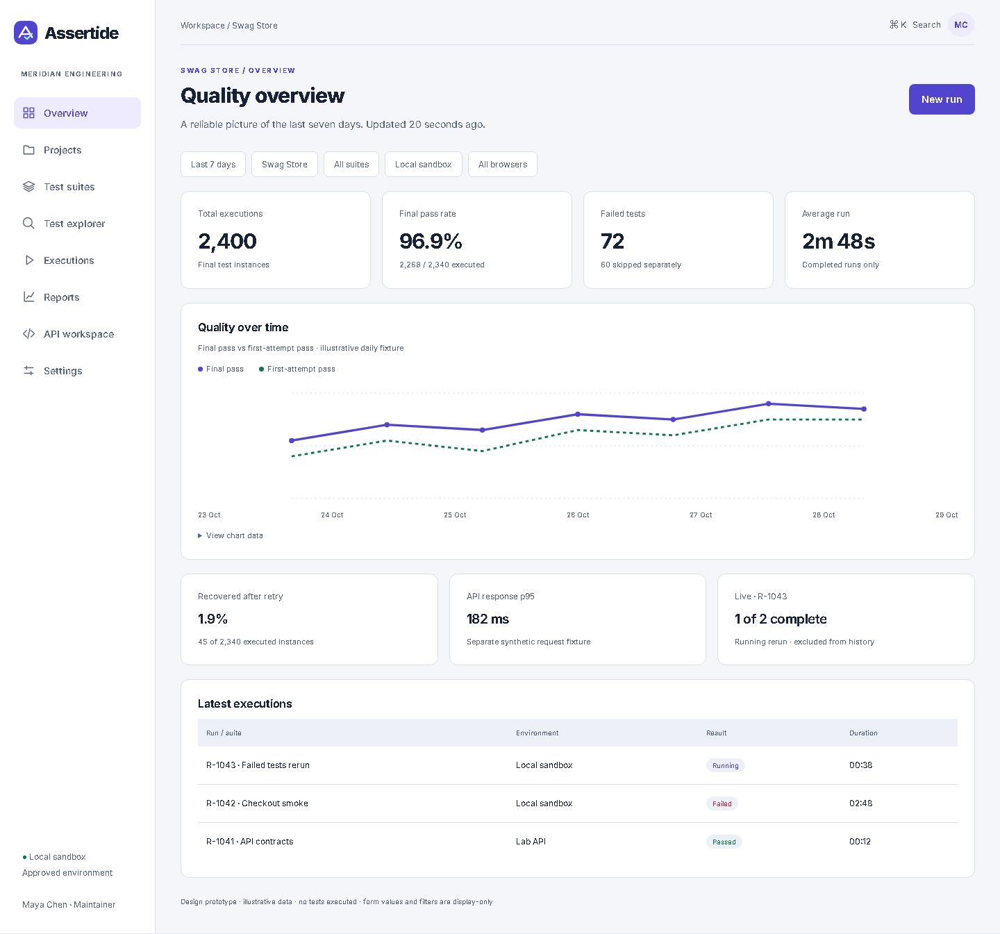
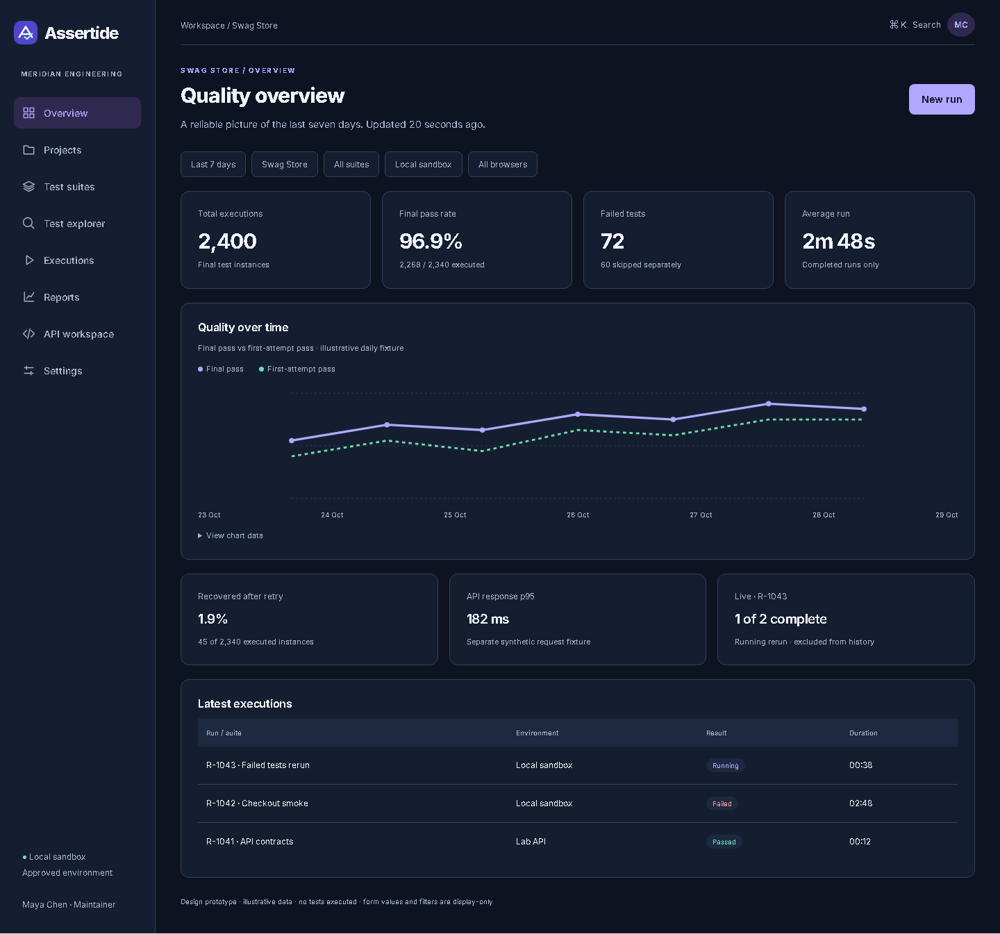
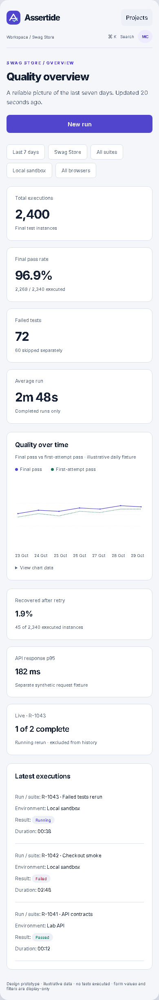
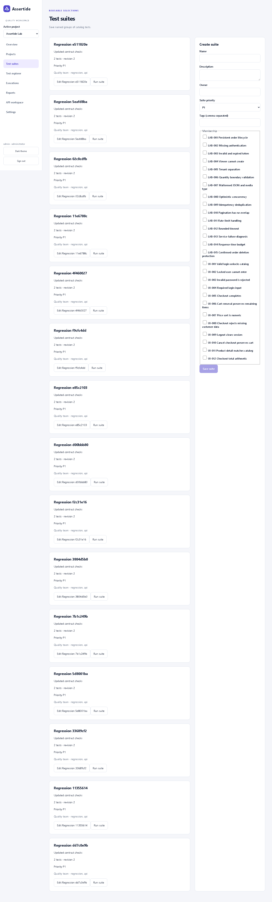

# Changelog

Noteworthy completed changes are recorded here. Entries under Unreleased have not been published or deployed as a product release. Release notes follow [the project changelog rules](docs/changelog-rules.md).

## Unreleased

### Added

- Administrators can create, rotate and revoke project-scoped CI credentials. Tokens are displayed once, stored only as hashes and denied suite/settings administration; executions can record a commit SHA. HTTP and browser tests verify scope isolation and immediate invalidation after rotation/revocation.
- Added serialized project/organization capacity checks (two active runs per project, four per organization and eight aggregate workers) and queued-run explanations. Concurrent-claim tests pass. History now has stable cursor pagination and URL-persisted phase, browser and UTC date filters, verified by database and browser checks.
- Catalog discovery now reads Playwright's actual test list from the saved source snapshot, including file locations and browser projects. Failed discovery preserves the previous catalog; duplicate stable IDs are rejected. Explorer search includes tags and URL-persisted kind/priority filters.
- Added an atomic SQL run outbox, renewable worker leases, stale-worker write rejection and optional Redis/BullMQ delivery. Local database and browser workflows pass; Redis delivery is exercised separately by CI.
- Added URL-persisted analytics filters, daily reliability charts with table alternatives, browser/API breakdowns, failure rankings, average run duration and recorded API request p95. Calculation tests and desktop/mobile browser checks pass; empty and small samples are labeled explicitly.
- Added an API evidence workspace showing recorded methods, paths, request/response bodies, status and duration without repeating requests. The browser journey verifies authenticated evidence retrieval and responsive desktop/mobile views.
- Added attempt-linked evidence downloads with access checks, audited retrieval, secret redaction for text, 14/30-day expiry and deletion that preserves an explanatory tombstone. SQL/HTTP tests verify access revocation and expiry. Worker output now streams through authenticated events, with snapshot resync after the replay window expires.
- Executions now save and verify content-addressed test-source snapshots. Added editable suite owners/tags/membership and linked reruns for failed or selected tests. Strict compilation, database tests and four browser journeys pass; suite editing was captured from the running app.
- Completed all 15 controlled Lab cases, including invalid/expired tokens, boundaries, pagination, signed fault injection, bounded transport timeout, a 20-request rate window and local latency evidence. All pass locally and in the browser-launched mixed run; unsigned fixture controls are rejected.
- Added browser execution against a pinned local Sauce Labs sandbox, with telemetry disabled. All 12 catalog browser cases pass in Chromium, Firefox and WebKit; mixed browser/API launch and Allure viewing pass through the Angular UI.
- Added authenticated live execution events, seven-day server-calculated metrics with denominator explanations, and report rebuilding that preserves test outcomes. Browser checks cover viewer launch denial, anonymous evidence denial, rejected cross-origin logout and session invalidation.
- Added a connected local workflow for OIDC sign-in, project-scoped catalog selection, suite creation, trusted-fixture Playwright execution, stored results and authorized Allure 3 viewing on a separate hostname. The browser journey passed against the running services; production isolation and the full specification remain unfinished.
- Added responsive catalog screens with light/dark themes. Desktop and 390px checks passed and screenshots were captured from the running application.
- Added an opt-in local Lab API with signed fixture tokens, SQL-backed tenant-scoped order CRUD, idempotent creation, optimistic concurrency and viewer restrictions. SQL and HTTP integration tests pass using embedded PostgreSQL-compatible development storage; deployed PostgreSQL verification remains pending.
- Added execution-domain functions for legal phase transitions, stale-version/lease rejection, idempotent cancellation, and historical pass/retry/latency calculations. Five Node tests verify the PRD fixture and edge cases; these functions are not yet integrated with a persistent API or runner.
- Added the initial strict, standalone Angular 22 web workspace with a dependency lockfile and an explicit setup-status screen. Production compilation and two starter component tests pass; backend integration and platform workflows are not implemented or verified.
- Added the Assertide product requirements, architecture, testing-target research and test catalog, Allure and analytics specification, and implementation roadmap to guide development. These are specifications, not implemented platform features.
- Added representative Playwright TypeScript examples for checkout and API contract tests, with a dependency lockfile. Type checking and discovery of five test instances pass; target execution has not been performed.
- Added project-wide changelog and release-note rules covering compatibility-based versioning, migration guidance, actual implementation screenshots, and evidence checks.
- Added the Assertide vector logo, favicon, 18 icons, theme tokens and four Pip mascot poses, with brand usage guidance.
- Added a local design-review prototype covering 12 main screens and supporting states, light/dark themes, mobile layouts and linked journeys. Values and controls are illustrative; this is not a running automation platform.
- Added an offline Figma development plugin intended to create editable screens, components, styles, variables and prototype links. Native Figma execution and visual validation remain blocked by the connected provider quota.

### Fixed

- Private report tickets now remain bound to the exact report build and issuing login session or CI credential. Logout, session expiry and credential rotation/revocation invalidate subsequent report asset requests. The browser journey verifies denial after logout.
- Cancellation now stops the owned worker process tree and retains completed attempts from durable checkpoints. Missing browser instances are reconciled individually, queued cancellations retain explicit canceled outcomes, and concurrent progress updates no longer discard a cancellation request. The Windows browser cancellation test and database checks pass.

### Design preview visuals

These screenshots were captured from the running local HTML design preview. They are not screenshots of a deployed platform or the Figma canvas.

Historical aggregates and the current rerun are visibly separated in the desktop preview.

The same dashboard uses the dark palette without changing the sample data.

The 390px preview stacks metrics and turns execution rows into labeled details.

### Known issues

- The editable Figma design is incomplete: the file was created, but Figma's Starter-plan tool limit blocked further access before screens could be added. The local generator is provided for recovery, but its output has not been executed or inspected in Figma.

Suite edits retain a revision and reject stale saves.

