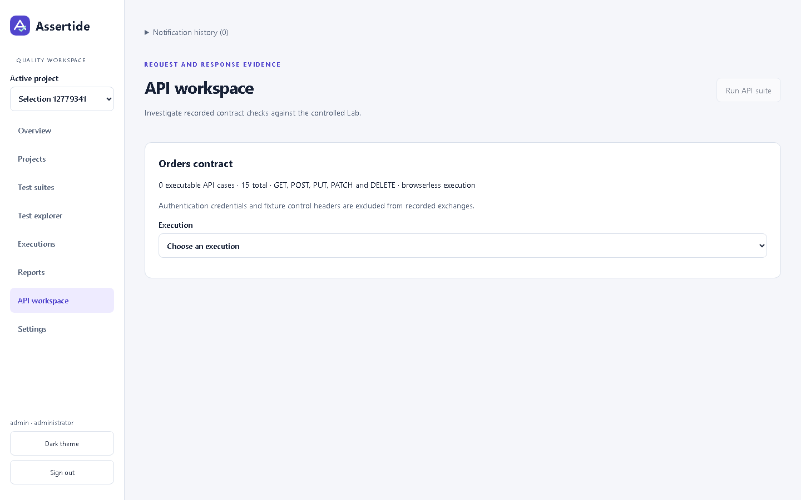
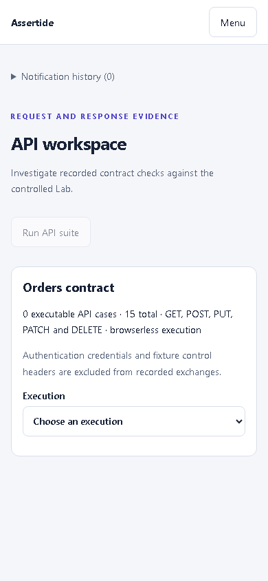
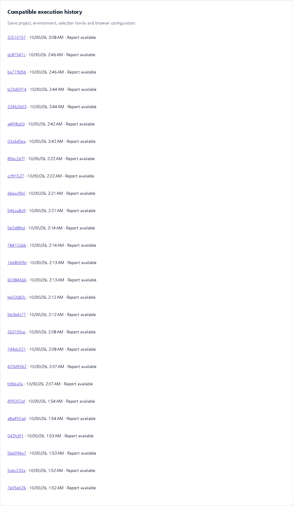
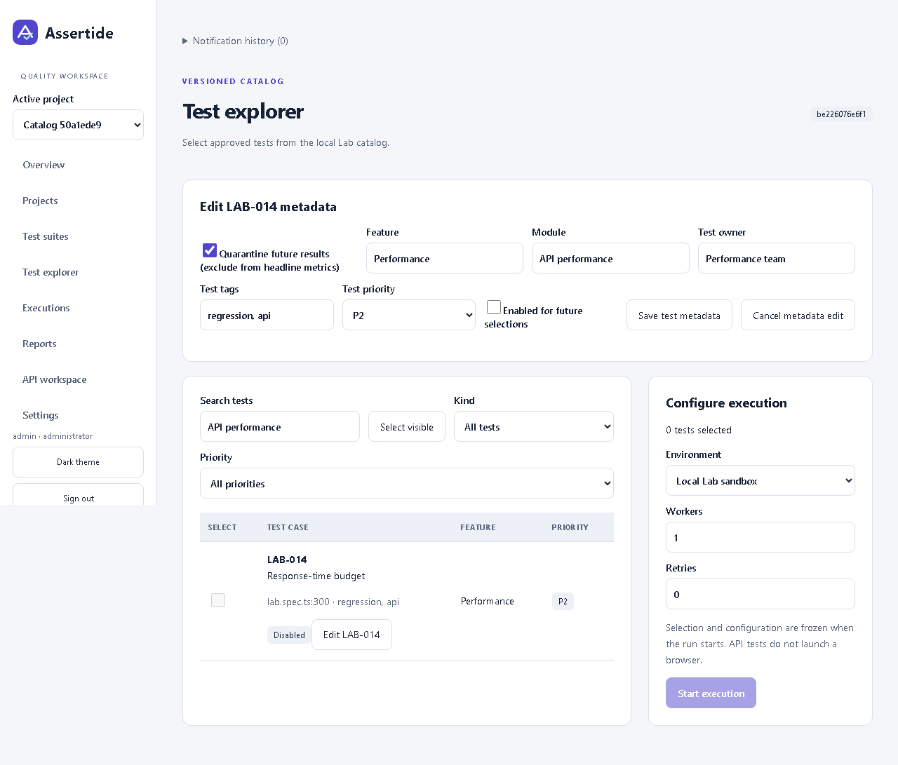
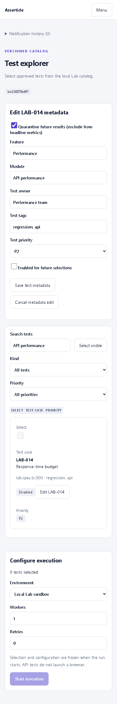
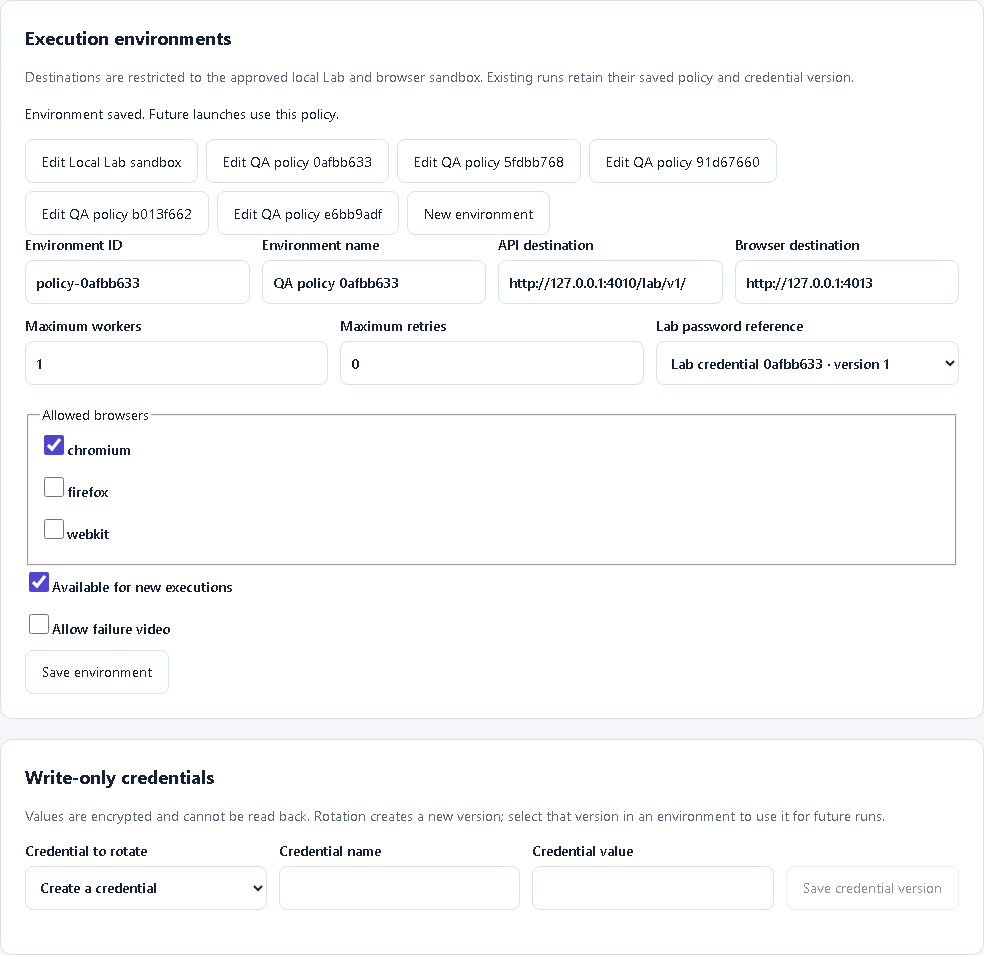
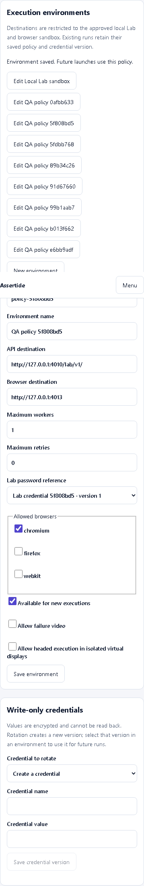
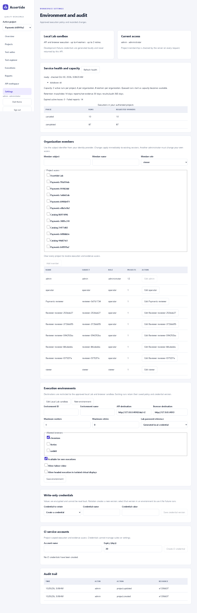
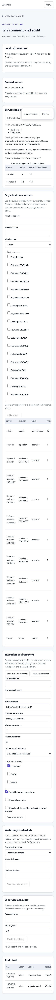

# Changelog

Noteworthy completed changes are recorded here. Entries under Unreleased have not been published or deployed as a product release. Release notes follow [the project changelog rules](docs/changelog-rules.md).

## Unreleased

### Fixed

- Explorer Select all now switches to Deselect all when every matching enabled test is selected. The header shows the selected count beside Start execution, and numbered pagination is above the test list so it is visible without scrolling through ten cards. Four browser tests including 64 accessibility states, local verification, and architecture/reporting checks pass. See [selection controls](docs/ui-refresh.md#explorer-selection-toggle-and-visible-pagination).

- Added Start execution to the Test explorer header, ten-test numbered pagination, and Select all across every page of matching enabled tests. Selections persist between pages and filters reset pagination. Catalog checkboxes now have themed checked, disabled, and focus states. Nine browser tests including 64 accessibility states, local verification, and architecture/reporting checks pass. See [explorer pagination and controls](docs/ui-refresh.md#explorer-pagination-and-launch-controls).

- Rebalanced execution summaries into aligned phase/selection cards and a full-width report card, so report actions no longer form a tall narrow column. Buttons wrap on phones and report status sits beside its heading. Local verification, six browser tests including 64 accessibility states, and light/dark checks at 320/390/768/1280px pass. See [balanced summary comparisons](docs/ui-refresh.md#balanced-execution-summary).

- Refined notification history with a compact header, subtle close icon, activity icons, smaller timestamps, and a clearer empty state. The panel opens and closes smoothly, respecting reduced-motion preferences. Local verification, three browser tests including 64 accessibility states, and open-panel scans in both themes pass. See [notification panel comparisons](docs/ui-refresh.md#notification-panel-refinement).

- Compacted execution summaries with an expandable frozen-test selection, aligned history filters in a responsive grid, and grouped filter actions. Content links now look like clickable buttons while preserving navigation and evidence downloads. Local verification, 12 browser tests including 64 accessibility states, and light/dark layout checks at 320/390/768/1280px pass. See [execution layout and link comparisons](docs/ui-refresh.md#execution-summaries-filters-and-button-links).

- Spaced report headings across a shared toolbar and moved Refresh to a labeled icon beside Action. Notification history now opens from a bottom-right bell; a red unread count clears when opened, and new actions restore it. Visual toast popups are replaced by the badge, while screen-reader announcements remain. Six browser tests, the 64-state accessibility matrix, open-panel accessibility checks, and local verification pass. See [report toolbar and notification evidence](docs/ui-refresh.md#report-toolbar-and-notification-bell).

- Compacted test and report cards by grouping metadata, priority, and actions; report links now match workspace styling. Moved the mobile theme control beside Menu as a labeled sun/moon icon, with an icon control retained on desktop. Six browser tests including 64 accessibility states and light/dark layout checks at 320/390/768/1280px pass. See [card and header comparisons](docs/ui-refresh.md#compact-test-and-report-cards).

- Replaced oversized execution-history header buttons with compact sort headings and visible direction arrows. Mobile headings adapt to two columns on narrow phones while preserving keyboard sorting and touch targets. Build/lint, four browser tests including the 64-state accessibility matrix, and light/dark layout checks at 320/390/1280px pass. See [before-and-after sorting controls](docs/ui-refresh.md#execution-history-sort-headings).

- Mobile navigation now closes when its dimmed backdrop is clicked and slides out smoothly while the backdrop fades. Close, Escape, and navigation actions restore the menu trigger consistently; reduced-motion settings disable transitions. Fixed sign-in cards drifting left at tablet/zoomed widths by keeping equal automatic side margins. Build/lint, five browser tests including 64 accessibility states, and centered-layout checks at 320/390/840/1280px pass. See [navigation and sign-in evidence](docs/ui-refresh.md#mobile-navigation-and-sign-in-alignment).

- Dialogs now animate their closing transition and backdrop, with immediate dismissal for reduced-motion preferences. Replaced the oversized mobile navigation close button with a compact, labeled icon; project cards keep Open/Edit in one row, and catalog badges no longer touch edit buttons. Build/lint and seven browser tests, including 64 accessibility states, pass. See [dialog and card polish](docs/ui-refresh.md#dialog-and-card-polish).

- The project picker now closes when a pointer press starts and ends outside it, returning focus to its trigger; clicks inside and drags out remain open. Regular selects use compact anchored menus, themed selected options, and inset arrows; scrolling surfaces use slim theme-aware scrollbars. Native select behavior remains the fallback where customizable selects are unsupported. Build, lint, six browser tests (including the 64-state accessibility matrix), and test architecture/reporting checks pass. See [controls and scrollbar evidence](docs/ui-refresh.md#dropdowns-and-scrollbars).

- Fixed crowded suite/member/rerun actions, off-screen member-table controls on phones, oversized membership lists, and suite editors stretched to the full list height. Long labels wrap within panels; the suite form appears before the list on mobile. Chart tooltips now match dark mode and stay inside the chart. Verified eight primary routes at 320/768/1440px in both themes, all 27 browser acceptance tests (including 64 accessibility states), and local build/lint/type/unit checks. See [site-wide review and screenshots](docs/ui-refresh.md#site-wide-review).

### Changed

- Development checks now enforce explicit TypeScript APIs, intentional class visibility, handled promises, safe production boundaries and consistent formatting across maintained source. CI rejects lint warnings and formatting drift. Contributors should run `npm run lint:fix` followed by `npm run format`; see [code quality conventions](docs/code-quality.md) and [PR #3](https://github.com/orKonijn/Assertide/pull/3). Verified locally with strict type checks, API/domain/web tests, production build, 36 browser tests, and the UI architecture/reporting checks. No product version or database migration is assigned.

- GitHub verification now runs for pushes to `main` as well as pull requests and the existing feature branch. UI regression tests use the established Page Objects and no longer regenerate committed screenshots during routine runs.

### Added

- Replaced the long native project dropdown with a searchable project dialog. Names wrap, the current project appears first, and results scroll within a bounded panel. Browser tests verify search, empty results, switching and persistence, mobile Escape/focus restoration, and dark-mode accessibility; build and lint pass. [Mobile picker screenshot](docs/changelog/assets/unreleased/project-picker-mobile.png).

- Corrected crowded project actions and service-health headings, reduced logo sizing, and aligned the mobile drawer below a consistently sized header. Mobile navigation no longer repeats the logo, and the background page stops scrolling while the drawer is open. Build, lint, and responsive browser checks pass at 320, 390, 768, and 1280px; see [layout corrections](docs/ui-refresh.md#layout-corrections).

- Refreshed the workspace with navigation icons, clearer headings, consistent cards and tables, a focused sign-in screen, and expandable history filters that keep overview metrics visible. Added subtle entrance, button, loading, notification, and mobile-menu animations with reduced-motion support. Build, lint, analytics/history browser tests, light/dark desktop/mobile accessibility scans, and keyboard checks pass. See [before-and-after screenshots and verification](docs/ui-refresh.md). No release version or publication is assigned.

- Added the new Assertide logo to the main sidebar, mobile header, and sign-in/loading screens, with a white treatment for dark mode. Production build and lint pass; browser checks confirm image loading and no horizontal overflow at 390px. Actual implementation captures: [sidebar](docs/changelog/assets/unreleased/assertide-logo-sidebar.png), [dark mobile header](docs/changelog/assets/unreleased/assertide-logo-mobile.png), [sign-in](docs/changelog/assets/unreleased/assertide-logo-login.png), and [dark sidebar](docs/changelog/assets/unreleased/assertide-logo-dark.png). These show the current implementation; no before-state capture was taken.

- Added feature-grouped Allure reports for connected UI acceptance, with domain steps, runtime/build metadata, masked failure screenshots and sanitized context. OCI and Kubernetes CI preserve separate reports and evidence, with bounded branch history. Both runtimes passed all 26 app journeys; local verification also passed 36 storefront browser cases, seven manual browser exercises and the credential-redaction failure probe. Merged in [PR #2](https://github.com/orKonijn/Assertide/pull/2); see [verified CI results](https://github.com/orKonijn/Assertide/actions/runs/41061287034), [UI testing and report usage](docs/ui-testing.md), and the [actual Allure report screenshot](docs/changelog/assets/unreleased/ui-acceptance-allure.png). This remains unreleased; no product version or production deployment is assigned.

- Added service/web container builds, validated Kubernetes deployment rendering, production startup checks, supervisor health probes, internal queue/lease metrics, scheduled encrypted PostgreSQL backups and a manual image publication/provenance workflow. Renderer, configuration and metrics checks pass locally; container, backup and cluster gates run in CI. See [deployment and recovery setup](docs/production-deployment.md).

- Added Kubernetes Job execution with digest-pinned workers, bounded resources, cancellation cleanup and isolated source/output transfer, plus Vault Transit credential encryption using Kubernetes workload identity. Local policy/authentication checks pass; real cluster and Vault integration checks are CI gates. See [production deployment](docs/production-deployment.md).

- Added TypeScript and Angular-template lint checks to local verification and CI, with a reusable in-memory browser authentication fixture and explicit anonymous contexts. Execution history, reports and catalog rows now use mobile card layouts. Lint, strict build and browser checks pass; see [contributor checks](CONTRIBUTING.md) and [implementation evidence](docs/implementation-verification.md).

- Added outcome filtering and a rerun review dialog showing frozen selections and environment availability before queueing. Browser checks verify the linked child preserves its selection and source; see [rerun review](docs/investigation.md).

- Added organization-timezone analytics, frozen quarantine badges and parameter-aware comparisons. Incremental database projections materialize completed test instances and daily counts transactionally. Tests cover DST, quarantine denominators, distinct parameter sets, backfill, rollback and deletion; see [analytics definitions](docs/analytics.md).

- Execution and report supervisors can run separately from the API with shared PostgreSQL and private object storage. Linux CI verified the split topology, report reconstruction and all 15 connected browser journeys in commit `99bbd98`; see [worker configuration](docs/isolated-workers.md).

- Added five-second success notifications with a bounded session history, delayed loading placeholders, keyboard-sortable execution history and generated error references. Browser and unit checks verify notification expiry, retained sorting focus and safe correlation logs; see [interaction behavior and screenshot](docs/shared-interactions.md).

- CI now packages the compiled web application and reviewed source with checksums and signed build provenance. Both checks passed for commit `80cbd91`; this is a verified build artifact, not a published product release or signed container image. See [build verification](docs/build-provenance.md).

- Added checksum-locked, transactional database migrations with concurrent-start serialization and preservation of existing data. Local tests verify adoption, repeat startup, rollback, failed-batch retry and refusal of edited migrations; PostgreSQL verification runs in CI. See [migration and rollback guidance](docs/migrations.md).

- Added an authenticated screenshot dialog, collapsible/downloadable redacted JSON, suite/environment history filters and automatic expiry/revocation clearing of protected views. Browser checks verify real evidence, Escape/focus return, downloads and sign-in return URLs; see [investigation screenshots and behavior](docs/investigation.md).

- Extended analytics with UTC date, suite, environment and status filters, saved personal filters, equal-interval comparison, JSON export, first-attempt trends, instability candidates, retry-inclusive duration, endpoint latency and evidence completeness. Suite launches freeze their saved version. Calculation, scope, browser/export and accessibility checks pass; see [definitions and screenshots](docs/analytics.md).

- Implemented all seven supplemental JSONPlaceholder API cases and all seven The Internet browser cases as manual, low-volume practice. All cases pass in local public-fixture checks; execution is opt-in, excluded from CI, single-worker, without retries and stopped on access/rate-limit responses. See [practice commands and limits](docs/practice-targets.md).

- Added root setup, start and verification commands that configure local sign-in automatically. Fresh dependency setup and all 14 connected browser checks pass locally; see [local startup](README.md#web-development).

- Added environment-controlled headed execution for isolated Linux workers, using a private virtual display per run. Policy tests verify local-runtime and API-only refusal and authorized OCI launch; the environment browser workflow passes locally. Linux execution is covered by the OCI integration gate. See [worker setup](docs/isolated-workers.md).

- Added automated accessibility checks across login, primary routes, configuration, live execution and result investigation in light/dark desktop/mobile states. Fixed undersized result targets, audit-table keyboard scrolling and skip-link route changes; mobile navigation now supports focus containment and Escape. All 44 local view/state scans and keyboard checks pass; [coverage and limitations](docs/accessibility.md).
- Results now retain nested attempt steps, versioned failure categories, supported expected/actual assertion values, comparable prior-result links and authored investigation notes. Notes are scoped, audited and separate from immutable outcomes. Database and browser checks pass, including note persistence and desktop/mobile investigation views.
- Added a guarded PostgreSQL backup/restore command with checksum and encryption-key verification, empty-target protection and a successful CI recovery drill. See [recovery setup and measured scope](docs/database-recovery.md).
- Catalog discovery supports 10,000 stable case identifiers. The reference control-plane check passed with 50 authenticated clients, 100,000 result instances and 20 worker leases across five projects; [measurement details](docs/operations.md#reference-control-plane-measurement) explain the workload and limits.
- Trace evidence now opens in a privately hosted Playwright viewer with credential-bound access, artifact expiry checks and session-revocation clearing. A real Chromium trace test verifies actions and DOM snapshots under CSP, anonymous denial and revocation. See [trace viewing and screenshot](docs/private-traces.md).
- Ready reports now offer immutable ZIP downloads with SHA-256 and generation headers. Media-inclusive archives expire after 14 days; a report archive without trace/video remains available for 30 days. Real-store tests verify ZIP contents and expiration, and browser checks verify checksums and anonymous denial.
- Administrators can inspect dependency health, queue age, failed reports, capacity and retention in Settings. Added bounded database/Redis/object-store readiness probes and configurable deployment capacity limits. Database failure, scope, quota and desktop/mobile browser checks pass; see [operations guidance](docs/operations.md).
- Added opt-in Linux OCI workers with immutable image selection, non-root execution, read-only source/root filesystems, resource caps and no external network. CI verifies the isolation boundaries, mixed fixture execution, container cleanup and the connected app workflow. See [worker setup and scope](docs/isolated-workers.md).
- Execution details and Allure now record Node, Playwright, Allure/integration and bundled browser versions. Reports use the run's frozen feature, owner, module, priority and tags. Browser checks verify recorded versions, generated labels and report rebuilding.
- Raw Allure inputs now have immutable, checksum-verified object-store archives. Report rebuilding restores them when a worker's local staging files are missing. Real-store tests cover cross-run and path rejection, integrity failures and 14/30-day retention; the browser rebuild passes after deleting local raw inputs.
- Added Allure 3 JSONL history partitioned by project, environment, selection family and browsers. SQL leases and version checks protect concurrent history writers; report history and the ready pointer publish atomically. Rebuilds replace their point, expired links are cleared in new reports, and execution pages link to compatible runs. Database and browser checks pass.
- Added private S3-compatible evidence and report storage with version-pinned, integrity-checked downloads. Complete report uploads publish immutable manifests; viewer access remains bound to the issuing credential. Real local MinIO tests verify privacy, object-version/delete-marker removal and interrupted multipart cleanup, and the browser report/rebuild journey passes against object storage.
- Added 30-day report/raw-data expiration and 365-day result/audit cleanup without changing retained test outcomes. Trace/video copies expire independently after 14 days, including embedded report assets and original raw files. Real-store tests and an Allure rebuild after attachment expiry pass; see [storage setup and retention details](docs/object-storage.md).
- Maintainers can edit project-scoped test owners, modules, features, tags, priorities and enabled status, with stale-edit rejection. Disabled tests are excluded from new selections; earlier runs retain their metadata snapshots. Suite priority is editable. Database checks and browser editing/reload checks pass.
- Added saved environment policies with approved destination validation, worker/retry/browser/video caps, and versioned write-only encrypted credentials. Runs freeze policy and credential references; rotation preserves earlier versions. Database tests and all nine browser journeys pass, including execution with a saved credential. See [configuration and key backup guidance](docs/environments.md).
- Failure-video selection now reaches Playwright. A controlled blocked-target check verifies non-empty video, trace and screenshot evidence from a failed browser attempt.
- Administrators can create/edit projects and manage organization roles and project membership with stale-edit protection. Project selection persists across reloads, access changes apply to existing sessions, and local startup preserves edited memberships. HTTP authorization tests and the desktop/mobile browser workflow pass.
- Administrators can create, rotate and revoke project-scoped CI credentials. Tokens are displayed once, stored only as hashes and denied suite/settings administration; executions can record a commit SHA. HTTP and browser tests verify scope isolation and immediate invalidation after rotation/revocation.
- Added serialized project/organization capacity checks (two active runs per project, four per organization and eight aggregate workers) and queued-run explanations. Concurrent-claim tests pass. History now has stable cursor pagination and URL-persisted phase, browser and UTC date filters, verified by database and browser checks.
- Catalog discovery now reads Playwright's actual test list from the saved source snapshot, including file locations and browser projects. Failed discovery preserves the previous catalog; duplicate stable IDs are rejected. Explorer search includes tags and URL-persisted kind/priority filters.
- Added an atomic SQL run outbox, renewable worker leases, stale-worker write rejection and optional Redis/BullMQ delivery. Local database and browser workflows pass; Redis delivery is exercised separately by CI.
- Added URL-persisted analytics filters, daily reliability charts with table alternatives, browser/API breakdowns, failure rankings, average run duration and recorded API request p95. Calculation tests and desktop/mobile browser checks pass; empty and small samples are labeled explicitly.
- Added an API evidence workspace showing recorded methods, paths, request/response bodies, status and duration without repeating requests. The browser journey verifies authenticated evidence retrieval and responsive desktop/mobile views.
- Added attempt-linked evidence downloads with access checks, audited retrieval, secret redaction for text, 14/30-day expiry and deletion that preserves an explanatory tombstone. SQL/HTTP tests verify access revocation and expiry. Worker output now streams through authenticated events, with snapshot resync after the replay window expires.
- Executions now save and verify content-addressed test-source snapshots. Added editable suite owners/tags/membership and linked reruns for failed or selected tests. Strict compilation, database tests and four browser journeys pass; suite editing was captured from the running app.
- Completed all 15 controlled Lab cases, including invalid/expired tokens, boundaries, pagination, signed fault injection, bounded transport timeout, a 20-request rate window and local latency evidence. All pass locally and in the browser-launched mixed run; unsigned fixture controls are rejected.
- Added browser execution against a pinned local Sauce Labs sandbox, with telemetry disabled. All 12 catalog browser cases pass in Chromium, Firefox and WebKit; mixed browser/API launch and Allure viewing pass through the Angular UI.
- Added authenticated live execution events, seven-day server-calculated metrics with denominator explanations, and report rebuilding that preserves test outcomes. Browser checks cover viewer launch denial, anonymous evidence denial, rejected cross-origin logout and session invalidation.
- Added a connected local workflow for OIDC sign-in, project-scoped catalog selection, suite creation, trusted-fixture Playwright execution, stored results and authorized Allure 3 viewing on a separate hostname. The browser journey passed against the running services; this was the initial local milestone, subsequently extended by the production adapters and workflows recorded above.
- Added responsive catalog screens with light/dark themes. Desktop and 390px checks passed and screenshots were captured from the running application.
- Added an opt-in local Lab API with signed fixture tokens, SQL-backed tenant-scoped order CRUD, idempotent creation, optimistic concurrency and viewer restrictions. SQL and HTTP integration tests pass using embedded PostgreSQL-compatible development storage; deployed PostgreSQL verification remains pending.
- Added execution-domain functions for legal phase transitions, stale-version/lease rejection, idempotent cancellation, and historical pass/retry/latency calculations. Five Node tests verify the PRD fixture and edge cases; these functions are not yet integrated with a persistent API or runner.
- Added the initial strict, standalone Angular 22 web workspace with a dependency lockfile and an explicit setup-status screen. Production compilation and two starter component tests pass; backend integration and platform workflows are not implemented or verified.
- Added the Assertide product requirements, architecture, testing-target research and test catalog, Allure and analytics specification, and implementation roadmap to guide development. These are specifications, not implemented platform features.
- Added representative Playwright TypeScript examples for checkout and API contract tests, with a dependency lockfile. Type checking and discovery of five test instances pass; target execution has not been performed.
- Added project-wide changelog and release-note rules covering compatibility-based versioning, migration guidance, actual implementation screenshots, and evidence checks.
- Added the Assertide vector logo, favicon, 18 icons, theme tokens and four Pip mascot poses, with brand usage guidance.
- Added a local design-review prototype covering 12 main screens and supporting states, light/dark themes, mobile layouts and linked journeys. Values and controls are illustrative; this is not a running automation platform.
- Added an offline Figma development plugin intended to create editable screens, components, styles, variables and prototype links. Native Figma execution and visual validation remain blocked by the connected provider quota.

### Fixed

- Execution supervisors now prepare verified source snapshots before accepting work. Kubernetes API/execution pods share a durable source claim so retained revisions survive pod replacement; provision the claim and retain matching worker images as described in [deployment setup](docs/production-deployment.md). Independent-directory integrity checks pass locally; fresh-container startup is checked in CI.
- Disabled cases already saved in a suite can be removed, and API-suite launches include only enabled cases. The API workspace shows the executable count and disables launch when none remain. The browser regression verifies removal, saved membership, successful launches and the empty selection state.
- Run detail ignores older same-run snapshot/history/error responses and invalidates pending reads after route changes or access revocation. Deferred-response unit tests verify ordering and protected-state clearing.
- Unexpected platform, administration, environment and CI-account failures now reuse the request ID for generic client errors and allowlisted diagnostic categories. Tests verify correlation without logging credentials, query values or unrestricted exception messages. Current setup, retention and scheduling docs now reflect implemented behavior.

- Overview date filters now retain explicit accessible names while analytics labels update. Light/dark desktop and mobile accessibility checks pass locally; the visible layout is unchanged.

- Private report tickets now remain bound to the exact report build and issuing login session or CI credential. Logout, session expiry and credential rotation/revocation invalidate subsequent report asset requests. The browser journey verifies denial after logout.
- Cancellation now stops the owned worker process tree and retains completed attempts from durable checkpoints. Missing browser instances are reconciled individually, queued cancellations retain explicit canceled outcomes, and concurrent progress updates no longer discard a cancellation request. The Windows browser cancellation test and database checks pass.

### Application captures

The executable count distinguishes runnable cases from the retained catalog.

The same state remains readable at 390px without horizontal scrolling.

History links open the selected execution and retain its authorization and report-expiry checks.

Disabled cases remain discoverable and editable, while their selection checkbox is disabled.

The metadata form remains available at mobile width.

The running settings screen shows approved destinations, execution limits and the selected credential version without exposing its value.

Environment fields stack at 390px; the browser check confirms that the page does not overflow horizontally.

Administrators assign a role and explicit project access; changing their own access requires another administrator.

The same controls stack at 390px, with the member table horizontally scrollable.

Suite edits retain a revision and reject stale saves.

### Historical design previews

The following three images were captured from the running local HTML design preview. They are not screenshots of a deployed platform or the Figma canvas.

Historical aggregates and the current rerun are visibly separated in the desktop preview.

The same dashboard uses the dark palette without changing the sample data.

The 390px preview stacks metrics and turns execution rows into labeled details.

### Known issues

- The editable Figma design is incomplete: the file was created, but Figma's Starter-plan tool limit blocked further access before screens could be added. The local generator is provided for recovery, but its output has not been executed or inspected in Figma.
