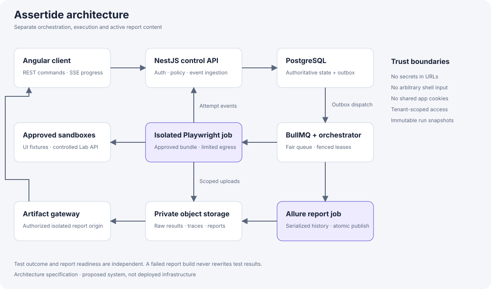
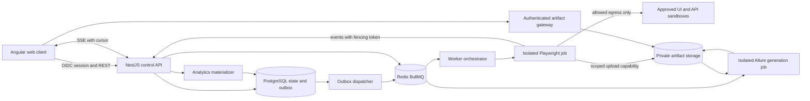
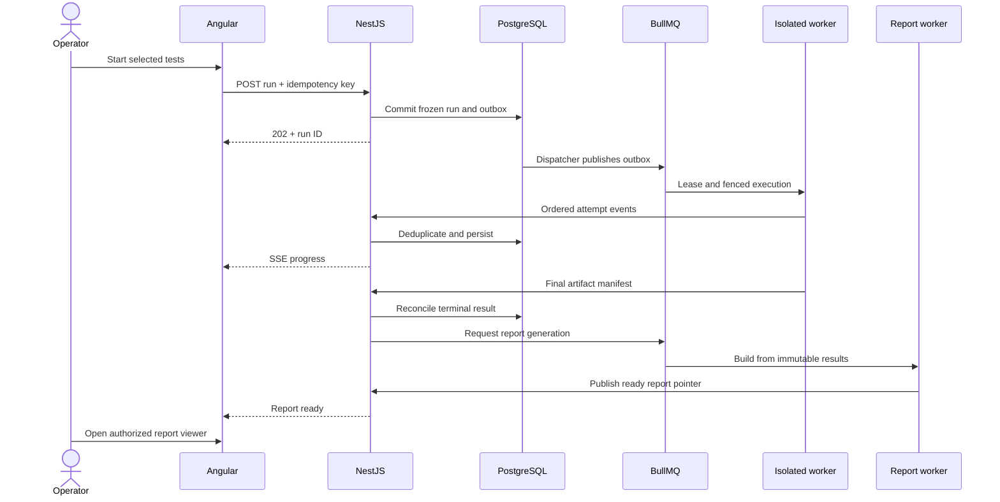
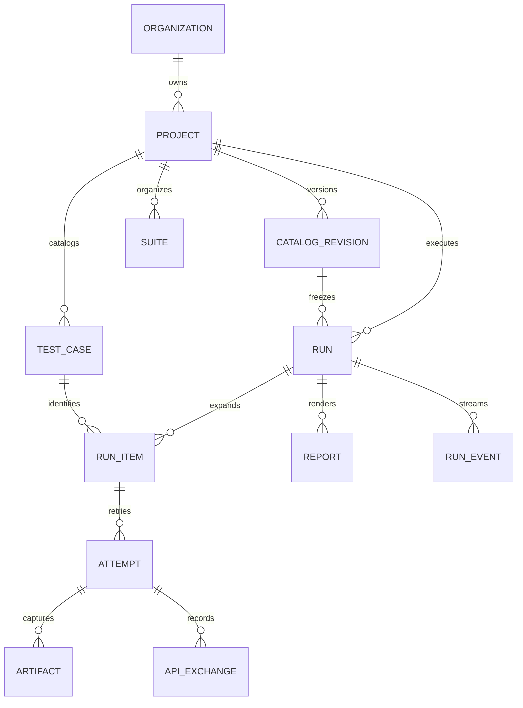

# Assertide architecture and automation specification

## Technology baseline

Use Angular 22 stable APIs with TypeScript, standalone components, router-level lazy loading, signals for view state, RxJS for event streams, Tailwind CSS and Apache ECharts for accessible interactive charts. Angular's official release table identifies v22 as actively supported; resolve and lock exact compatible patch versions during implementation rather than shipping floating dependencies. Use Node.js 24 LTS, NestJS, PostgreSQL 17, Redis with BullMQ, S3-compatible object storage, and OCI worker containers. Nest's supported BullMQ integration provides queue primitives; PostgreSQL remains the authoritative state ledger. [Angular releases](https://angular.dev/reference/releases), [Nest queues](https://docs.nestjs.com/techniques/queues).

Use Playwright Test + TypeScript and allure-playwright + allure-js-commons with Allure Report 3. Pin the runner package, browser image and report generator as a tested compatibility set. The checked-in examples are representative specifications, not a certified dependency lockfile. An implementation spike must build a report, open a trace and verify retry grouping before accepting upgrades. Allure 2 history-directory copying is deliberately not part of the Allure 3 design.

## Architecture



The diagram shows the proposed runtime boundaries. The Mermaid definitions below remain editable source for implementation documentation.



Deploy control API, event ingestion, report generation and execution jobs as separate processes. MVP uses Docker Compose for developer infrastructure and one orchestrator host for trusted suites; production uses Kubernetes Jobs with network policy, resource requests/limits, and isolated service accounts. A queue consumer process alone is not a security boundary. For future untrusted tenant repositories use stronger sandboxing such as dedicated VMs; do not describe ordinary containers as sufficient isolation against hostile code.





## Execution protocol

1. Client submits POST /v1/projects/{projectId}/runs with an Idempotency-Key. Server authorizes project and environment, validates the enum-based configuration, resolves test IDs against a catalog revision, and freezes source SHA, suite membership, parameters and policy version.
2. In one DB transaction insert run + run items + outbox record + idempotency response. Dispatcher publishes job with run ID as job ID. Duplicate delivery is expected. No DB/Redis distributed transaction is assumed.
3. Orchestrator obtains a lease with monotonically increasing fencing token, checks cancel_requested and per-project/tenant/global quotas, and creates a single isolated job. A database conditional transition elects the owner; Redis locks alone are insufficient.
4. Job uses prebuilt approved test bundle. Test discovery and dependency installation also execute code, so perform them in equally restricted jobs. No user-supplied shell command, arbitrary npm install, branch name interpolation or runtime source upload is allowed.
5. Reporter emits ordered run events and attempt records, uploads evidence, and sends final manifest. Ingestion deduplicates by (runId, workerId, leaseEpoch, eventId); stale lease epochs cannot mutate state. Event timestamp is evidence only; server sequence establishes replay order.
6. Finalizer reconciles all selected items, marks missing results incomplete/broken with reason, commits terminal execution status and queues report generation. DB aggregates are updated idempotently by terminal run version. Report readiness is independent.
7. Report job validates and merges raw result files by attempt UUID, attaches sanitized environment/executor information, reads the prior compatible history snapshot, builds Allure 3, uploads an immutable prefix, then atomically publishes a report pointer. A report failure leaves existing results accessible.

## State machines and cancellation

Run phase: queued → provisioning → running → finalizing → completed. Alternative terminal phases: canceled, infrastructure_error, timed_out. Outcome for completed: passed, failed, mixed or empty; empty is rejected before launch except when discovery drift causes a diagnosed infrastructure error. Separate report phase: pending → generating → ready or failed → generating on explicit retry. This avoids saying a run is still running merely because HTML generation is slow.

Test-instance states: queued, running, passed, failed, broken, skipped, canceled. Attempt states additionally include timed_out and interrupted. Preserve raw Playwright status and expectedStatus; map unexpected assertion failure to failed, fixture/runner/setup failure to broken, deliberate skip to skipped, externally interrupted work to canceled. An expected-failure test that fails is annotated as expected failure and excluded from ordinary product pass/fail KPIs unless the user selects an explicit inclusion policy. Unexpected pass fails the quality gate.

Cancel is idempotent. Queued work transitions canceled without allocating a worker. Running work records cancel_requested, signals the process group with a 10-second graceful window, then terminates the job if needed. Completed attempts remain; active and not-started items become canceled, never skipped. Finalization uses compare-and-swap on run version: if normal completion wins before cancellation, return completed plus “finished before cancellation.” Worker heartbeat every 5 seconds, lease timeout 30 seconds; lease expiry triggers reconciliation before any replacement. Do not blindly rerun side effects. Mark the abandoned run infrastructure_error and let a user create a new linked run.

## API contract

All endpoints are under /v1, JSON UTF-8, TLS only. IDs are opaque UUIDs. Every query is organization and project scoped. Cursor pages default 50/max 200; sorting has a stable ID tiebreaker. UTC timestamps use RFC 3339. Mutating metadata requires If-Match version. Validation errors use application/problem+json with type, title, status, detail, instance, correlationId and fieldErrors. 400 malformed input, 401 unauthenticated, 403 forbidden, 404 absent or concealed resource, 409 conflict, 412 stale revision, 422 invalid selection/policy, 429 quota with Retry-After, 503 transient control-plane unavailability.

| Method and path | Input / response | Authorization |
|---|---|---|
| GET /me | Identity, roles, allowed projects | Authenticated |
| GET /projects | Cursor list, archived filter | Viewer |
| POST /projects | Name, approved repository ID | Admin |
| GET /projects/{p}/catalog | revision, query, tags, kind, priority, cursor | Viewer |
| POST /projects/{p}/catalog-syncs | Approved commit SHA; 202 sync ID | Maintainer |
| GET /projects/{p}/suites | Suite summaries and versions | Viewer |
| POST /projects/{p}/suites | Name, description, case IDs, tags | Maintainer |
| PATCH /suites/{s} | Metadata/membership with If-Match | Maintainer |
| GET /tests/{t} | Metadata, source locator and latest result | Viewer |
| PATCH /tests/{t} | Owner, priority, description; no executable source | Maintainer |
| POST /projects/{p}/runs | Frozen selection request; 202 run ID and events URL | Operator |
| GET /runs/{r} | Phase, outcome, counts, snapshot and report phase | Viewer |
| GET /runs | Project, dates, suite, env, browser, status, cursor | Viewer |
| POST /runs/{r}/cancel | Optional reason; 202 or existing terminal result | Owner/maintainer |
| POST /runs/{r}/reruns | failed/all/selected, optional approved revision; 202 new run | Operator |
| GET /runs/{r}/events | SSE; Last-Event-ID; snapshot-required event if expired | Viewer |
| GET /runs/{r}/results | Attempt summaries with pagination | Viewer |
| GET /results/{id} | Steps, assertion, request metadata, attempts, artifact refs | Viewer |
| GET /reports | Filters, build phase, retention date | Viewer |
| POST /runs/{r}/report-rebuilds | Idempotent rebuild at same result version | Maintainer |
| GET /reports/{id}/viewer | Authorized isolated-origin report session | Viewer |
| POST /artifacts/{id}/download-ticket | 60-second scoped capability | Viewer |
| GET /projects/{p}/analytics | window, grouping, comparison; dataAsOf | Viewer |
| GET/POST /projects/{p}/environments | Metadata / create approved destination | Viewer/Admin |
| PATCH /environments/{e} | Destination and secret references; If-Match | Admin |
| POST /secret-references | Provider/key reference; never plaintext readback | Admin |
| GET /audit-events | Cursor, actor, action, resource | Admin |

Example launch request:

```json
{
  "catalogRevision": "catalog-17",
  "selection": {"testIds": ["UI-001", "UI-005"]},
  "environmentId": "env-local",
  "browserProjects": ["chromium"],
  "workers": 2,
  "retries": 1,
  "headed": false,
  "video": "retain-on-failure"
}
```

Only one selection mode is accepted: testIds, suiteId or structured filters. Client labels never determine executable names. Server maps exact IDs to a generated Allure test plan or a vetted runner manifest; never concatenate titles into a shell grep expression. API-only runs require browserProjects=[]; mixed UI/API runs expand browser matrix only for UI cases. Idempotency key is scoped to principal+project+route and stored 24 hours; identical payload repeats the original response, different payload with same key yields 409.

SSE event shape: {id,runId,sequence,type,occurredAt,payload,schemaVersion}. Keep replay events 24 hours; logs 30 days. If the requested cursor has expired, send resync_required and force GET snapshot. Client drops duplicate sequences and reconnects with exponential backoff capped at 30 seconds. Auth uses same-origin HTTP-only session cookies; never place bearer tokens in stream URLs. Logs are bounded to 10KB/event and 20MB/run with explicit truncation event.

## Data model

| Entity | Key fields and invariants |
|---|---|
| Organization / User / Membership | orgId, userId, role; unique membership; no client-supplied tenant trust |
| Project | orgId, slug, repositoryId, archivedAt; unique (orgId,slug) |
| RepositoryRevision | projectId, commitSha, bundleDigest, trustDecision; immutable |
| CatalogRevision | revisionId, sourceSha, discoveredAt, manifestDigest; immutable |
| TestCase | projectId, stableCaseId, kind, sourcePath, title, tags, module, feature, owner, priority |
| CatalogEntry | catalogRevisionId, caseId, runnerLocator, definitionDigest; tombstone removed cases |
| Suite / SuiteMembership | projectId, version, description; membership snapshots at run creation |
| Environment | orgId, projectId, allowlisted origins, policyVersion, secretRefs; no secret values |
| Run | projectId, revisionId, selectionSnapshot, configSnapshot, phase, outcome, leaseEpoch, version, parentRunId, createdBy, queuedAt, startedAt, endedAt |
| RunItem | runId, caseId, browserOrNull, parameterFingerprint, environmentId, finalState; unique expanded instance key |
| Attempt | runItemId, attemptIndex, rawStatus, expectedStatus, normalizedState, startedAt, durationMs, failureCategory; unique (runItemId,attemptIndex) |
| Step / ApiExchange | attemptId, parentStepId, order, timings, method, sanitizedPath, status, schemaErrors, redactedBodyArtifactId |
| Artifact | orgId, runId, attemptId, objectKey, sha256, mime, bytes, redactionVersion, expiresAt, availability |
| Report | runId, resultVersion, generatorVersion, phase, objectPrefix, historyStreamKey, expiresAt |
| RunEvent / Outbox | runId, sequence, eventId, payloadVersion / delivery state |
| AuditEvent | actor, organization, action, resourceId, before/after safe metadata, requestId |

Foreign keys include organization scope where practical. Index Run(projectId,createdAt DESC,id), Attempt(runItemId,attemptIndex), RunEvent(runId,sequence), TestCase(projectId,stableCaseId). Use PostgreSQL row-level security as defense in depth alongside explicit service authorization. Transaction-scoped tenant setting prevents pooled connection leakage. Partition high-volume attempt/event data by month only after measured need; do not prematurely shard.

## Automation framework

```text
apps/web/                  Angular product
apps/api/                  Nest modules: identity, catalog, execution, artifacts, analytics
apps/worker/               lease owner and job launcher
apps/report-worker/        Allure 3 generation and publication
packages/contracts/        OpenAPI and event schemas
packages/automation/
  playwright.config.ts
  fixtures/                credentials, seeded API resources, environment policy
  pages/                   LoginPage, InventoryPage, CheckoutPage
  tests/ui/                login.spec.ts, checkout.spec.ts
  tests/api/               posts.spec.ts, orders.spec.ts, authorization.spec.ts
  schemas/                 post.schema.json, order.schema.json
  reporters/               durable event spool and ingestion client
  utilities/               redaction, deterministic IDs, API evidence
  test-data/               synthetic customers and contract fixtures
infra/                     Compose, job templates, network policies, migrations
```

Use stable explicit IDs in test titles/annotations and Allure labels; tags @smoke, @regression, @ui, @api. POM wraps user-level actions but assertions stay visible in tests. Fresh browser context per test; unique API entity per test; cleanup in finally/fixture teardown. Shared auth storage may be reused only for independent read-only users. Mutating workers get dedicated identities. Seed random data with run ID for reproducibility, but exclude run ID from Allure identity parameters. Never use fixed sleeps, dependency on execution order, unconditional retry loops, or force-click as default. Trace on retained failure preserves the original failure even when retries are disabled. [Playwright practices](https://playwright.dev/docs/best-practices).

API tests use a standalone APIRequestContext, schema validation through Ajv strict mode, exact status and contract assertions, and bounded timeouts. Dispose contexts. Measure client-observed request duration with a monotonic clock; report transport and HTTP failures separately. Do not test real auth on JSONPlaceholder: use the controlled API contract in the test plan. Separate API and browser projects prevents accidentally executing API cases three times. [API testing](https://playwright.dev/docs/api-testing), [APIRequestContext](https://playwright.dev/docs/api/class-apirequestcontext).

## Security and resource policy

Allowlist destination origins per environment. Validate DNS resolution and redirect targets at an egress proxy; reject metadata IPs, loopback/private ranges except explicitly provisioned sandbox service addresses, alternate IP encodings, DNS rebinding and non-HTTP schemes. Reject arbitrary headers that alter routing. Public targets default to one worker and no automated retry storm; honor Retry-After and stop on 429 or access challenge. Public caps are our conservative policy, not publisher rate-limit guarantees.

Run containers non-root, read-only root filesystem, private writable temp directory, no Docker socket, no privileged mode, no host networking, dropped capabilities and seccomp. Use a suitably configured Chromium sandbox; verify the container profile against [Playwright Docker guidance](https://playwright.dev/docs/docker). Request 1 CPU/2GB per browser worker initially; cap tenant at 4 active runs and 8 aggregate workers, project at 2 active runs, run at 4 workers on self-controlled targets. Job timeout 30 minutes; UI test timeout 30 seconds; API request timeout 10 seconds; retries 0–2, default 1 local and 0 public. Headed pools use Xvfb and have the same quotas, with no desktop exposed to the internet.

Secrets come from a vault via short-lived workload identity and reference IDs. Prevent logging Authorization, Cookie, Set-Cookie, passwords and known sensitive body fields; use allowlisted body capture with 64KB cap. Traces can contain DOM and network secrets despite log redaction: use synthetic test accounts and private storage, disable traces for sensitive environments when adequate sanitization is impossible. Upload via short-lived prefix-scoped credentials; verify checksum, MIME and size. ZIP extraction rejects traversal, symlinks and decompression bombs.

Reports are active HTML and must live on a separate origin with no app session cookies. Gateway authorizes every report resource using a scoped report session; no public S3 listing or forever-signed URL. Embed with carefully tested iframe sandbox/CSP, allowing scripts only within that isolated origin and no top-level navigation. Provide an “Open in separate viewer” fallback if browser policies block embedding. Serve trace viewer privately; do not upload traces to a public third-party viewer without consent.

## Retention and operations

Default logs/raw results/screenshots 30 days, traces/video 14 days, generated reports 30 days, normalized results 365 days, audit records 365 days. Artifact tombstones preserve result context after evidence expires. Deletion jobs retry with reconciliation, include object versions and incomplete multipart uploads, and record counts; backups age out after 30 days. Export is audited and subject to the same authorization. Report history must not link to expired reports as if available.

Metrics: queue age, active slots, lease expiry, report failure rate, event ingest lag, upload failures, object bytes, API p95 and authorization denials. Correlate runId and requestId without logging tokens. Alert queue oldest >5m for 10m, lost heartbeat >30s, report failures >5% over 20 jobs. Backup PostgreSQL daily and test restore quarterly. Redis loss is repaired from outbox and DB states; artifact loss is represented explicitly, never silently converted into a passing result.

## CI and delivery

PR pipeline: formatting/typecheck → unit tests for state reducer, authorization and redaction → migration compatibility → isolated API integration → Chromium smoke against local apps → Allure generation/trace check → dependency/image scans → signed build. Nightly: all browsers, regression, auth matrix, cancellation races, replay and worker-loss chaos. Release uses additive DB migrations, canary API + compatible workers, then UI. Rollback retains old schema readers and last compatible runner image. Rotate signing and service credentials, test incident runbooks and rehearse restore before production acceptance. Required gate: zero P0 defects, zero known critical exploitable findings, all data isolation checks passing, complete evidence retention drill.
