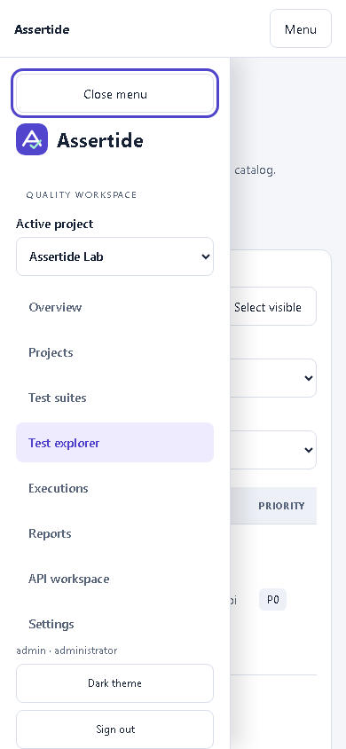
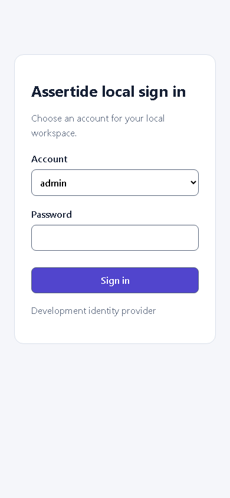

# Accessibility verification

The application has a keyboard skip link that focuses the current route's content without changing routes. Navigation indicates the current page. The mobile navigation drawer traps keyboard focus while open, makes page content inert, closes with Escape, and returns focus to its opener. Its contents scroll on short screens. Buttons and result summaries have 44px targets; result links have sufficient target height. The audit table's scroll region is keyboard-focusable. Reduced-motion preferences disable CSS movement; charts already render without animation and provide table alternatives.

The automated browser check covers the login and local SSO, eight primary routes, a live execution, selected browser-run configuration, and expanded result investigation. It checks light/dark themes at 1280px and 390px using axe-core's WCAG 2.0/2.1/2.2 A/AA rule tags, verifies no horizontal page overflow, and exercises skip-link focus, mobile focus wrapping, Escape and reduced motion. The local run recorded 44 view/state checks with no reported violations. CI saves its JSON evidence as an artifact.

This is automated rule coverage plus specified keyboard interactions, not a claim of complete WCAG conformance or a substitute for assistive-technology and moderated usability testing. The separately hosted upstream Allure/Playwright viewers retain their own interfaces; the private trace integration verifies actual actions/snapshots and access controls.

