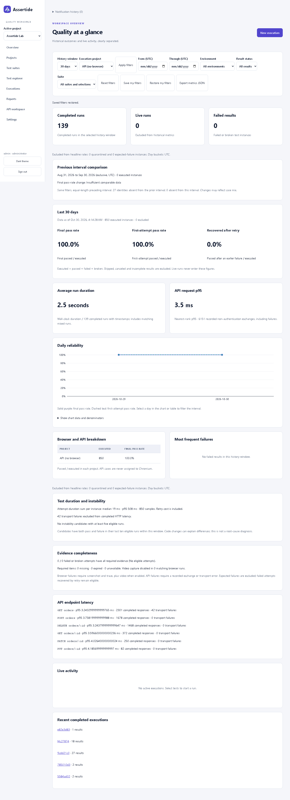
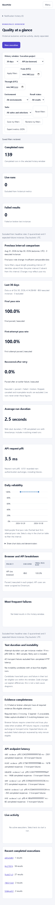

# Historical analytics

Overview reads completed outcomes from the database. Filters support organization-calendar dates, project, frozen suite reference, environment, browser/API and result status. Suite launches now freeze suite ID, version and metadata; older runs without suite provenance remain visible under all suites and are not retroactively attributed to an edited suite. Saved filters are local to the signed-in subject/project on that device. Shared URLs contain filter identifiers only.

The equal-length preceding UTC interval uses the same filters. Pass-rate changes use percentage points, including when a baseline is zero. Missing case/browser/environment/parameter identities are counted explicitly; this is a cohort comparison, not a claim that code and case mix stayed constant. The day table and chart can select a single organization-calendar day. Both first-attempt and final-pass series retain their denominators.

Instability candidates have both pass and failure over their last ten eligible runs within the selected interval, with at least five observations. Expected failures and explicitly quarantined results are excluded from headline rates and instability; both excluded counts are disclosed. Catalog quarantine is versioned and frozen per run, appears in result badges and Allure tags, and does not prevent execution or rewrite earlier results. Current fixture cases have the `default` parameter fingerprint; analytics keeps distinct recorded fingerprints separate. Duration sums all recorded attempt durations, retaining retry cost; missing durations are excluded rather than treated as zero. Failure rankings show count, exposure and rate. API p95 uses completed HTTP exchanges, including HTTP failures, and counts transport failures separately. Method/path groups normalize numeric and UUID identifiers; fewer than 20 completed responses is a small sample.

Evidence completeness counts failed/broken attempts, including failures recovered by retry. Required browser evidence is screenshot plus trace, and video when enabled. API attempts require exchange/transport evidence. Missing, expired and unavailable required items are separate counts; disabled video is disclosed. A zero-eligible denominator displays no rate.

JSON export contains the displayed metrics, comparison, filters, definitions, sample counts, generatedAt and dataAsOf. Completed results incrementally materialize into indexed `analytics_instances` in the same database transaction as the authoritative run. The `analytics_daily_utc` view exposes exact daily denominator counts; the API assembles filtered instances from this projection and computes non-additive percentiles/comparisons without averaging pre-rounded rates. The migration backfills existing history without changing its original bodies. Live runs are absent, rollback also rolls back the projection, and retention deletes dependent rows. There is no asynchronous materialization delay. Set `ORGANIZATION_TIME_ZONE` to an IANA timezone before starting the API; UTC is the default. Date inputs and daily buckets use that zone, while stored instants and comparison boundaries remain UTC. Day-boundary tests cover 23/25-hour DST days and fractional offsets. Invalid timezone configuration fails startup.

Verification covers exact denominator fixtures, transport failures, instability minimums, attempt duration, evidence reasons, cross-project exclusion, date boundaries, matching comparison filters, stale suite versions, immutable suite snapshots, saved-filter/export consistency and responsive accessibility scans.

Desktop Overview from the running application.

The same workflow at mobile width.
