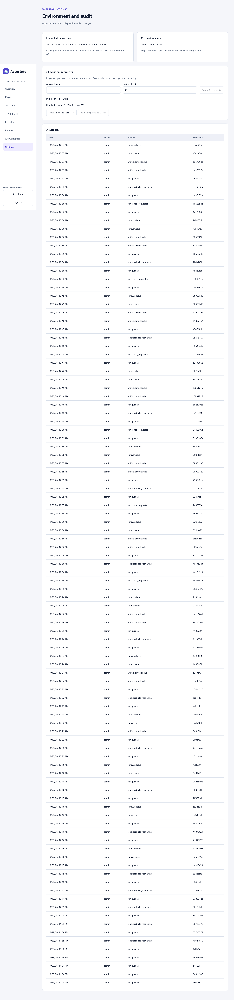

# CI execution credentials

An administrator opens Settings → CI service accounts to create a credential for the selected project. Copy the token into the CI provider's secret store, then hide it. Listing credentials never returns token values or hashes. Tokens expire after 1–90 days; rotation issues a replacement with a 30-day expiry and invalidates the old token immediately. Revocation takes effect on the next request or stream authorization check.

Send `Authorization: Bearer <secret>` when reading the project's catalog, launching a run, reading results/evidence, rerunning or canceling an owned execution. Machine credentials cannot manage suites, catalog settings, audit records or service accounts. Cookie-based callers still require same-origin checks for mutations.

Launch with the catalog's returned revision and an `Idempotency-Key` unique to the CI attempt. Supply the same key when retrying a disconnected launch response. An optional 40-character lowercase hexadecimal `commitSha` is preserved in the run configuration. Test-source identity remains the separate immutable source revision.

Example request body (send to `/v1/projects/{projectId}/runs`):

```json
{
  "catalogRevision": "<revision returned by the catalog>",
  "selection": { "testIds": ["LAB-001"] },
  "environmentId": "local-lab",
  "browserProjects": [],
  "workers": 1,
  "retries": 0,
  "headed": false,
  "video": "off",
  "commitSha": "<40-character commit SHA>"
}
```

The server returns 202 with the run ID. Read `/v1/runs/{id}` or subscribe to its authenticated events endpoint. Treat infrastructure errors and canceled runs separately from test failures; an Allure build failure does not alter test outcomes.



No token value is included in this screenshot. HTTP and browser tests verify creation, denied cross-project access, rotation, revocation and one-time token visibility.
