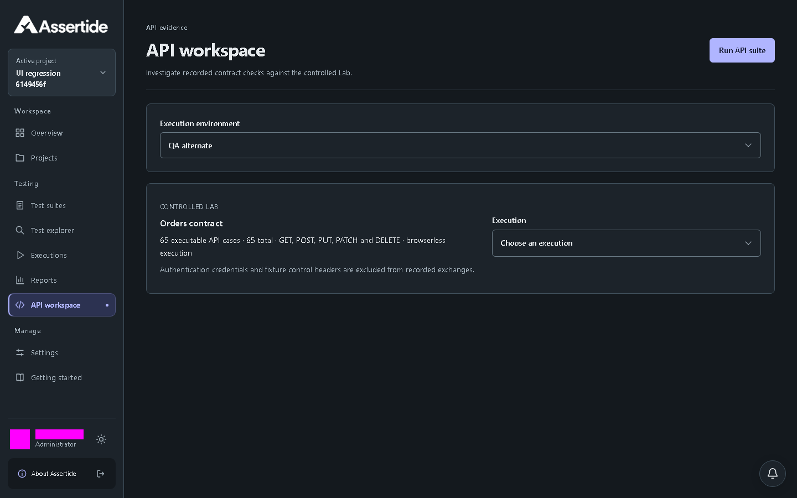

# Environment policy and credential references

## Launch environment selection

Test suites and API workspace offer an Execution environment selector containing enabled environments for the active project. The initial selection prefers enabled `local-lab`, otherwise the first enabled environment. If none is enabled, the launch action is disabled and guidance points to Settings. Suite browser launches prefer Chromium when allowed, otherwise the environment's first allowed browser. The server still validates current policy when accepting each launch.

These changes require no configuration or database migration. Existing environment snapshots and reruns retain their existing behavior.

Actual local UI capture at 1440px: the selected environment is explicit before launching.

Actual local UI capture at 390px: the selector fits the mobile layout. Inputs and account identity are masked in evidence.

## Policy and credentials

Administrators use Settings to create named execution environments, set worker/retry/browser/video limits, and disable future launches. The local deployment approves only `http://127.0.0.1:4010/lab/v1/` and `http://127.0.0.1:4013`. Other destinations are rejected by the API, including link-local metadata endpoints. This validation is not a network isolation boundary; production OCI workers and egress enforcement remain required.

Each accepted run stores its environment snapshot. Reruns retain the original snapshot and credential version, but current environment availability and limits are checked before queueing. Changed policies do not rewrite queued/running executions. Headed execution is rejected until a dedicated virtual-display worker is available.

Credential writes create immutable encrypted versions using AES-256-GCM, random nonces, and organization/project/reference/version authenticated context. API responses return metadata only. Environment references select an explicit version; rotation does not silently change existing references. The runner resolves the pinned value only when executing and redacts it from textual evidence and logs. API tracing is disabled to avoid credential-bearing traces.

`node scripts/dev-api.mjs` generates the 32-byte encryption key in ignored `.local/credentials.json` and passes it as `SECRET_ENCRYPTION_KEY`. Back up this key separately from the database; losing it makes stored credentials unrecoverable. Never commit it or copy it into screenshots. Other deployments must supply a 64-character hexadecimal key through their secret manager. Master-key rotation/re-encryption is not implemented yet. Older credential versions remain available for reproducible reruns; deleting historical secret versions is not currently exposed.

Credential and environment changes are audited. Environment updates and secret rotations require an `If-Match` version. Tests cover encryption, write-only responses, tenant/project scoping, stale rotation, forbidden destinations, policy caps, disabled environments, frozen references, and an authenticated browser-launched Lab run using a saved credential.
