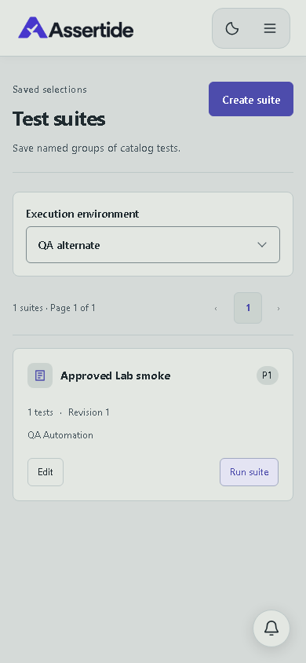
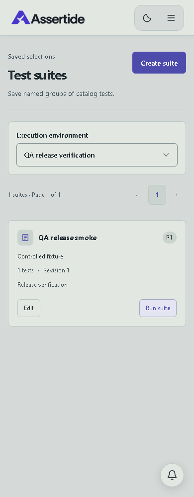
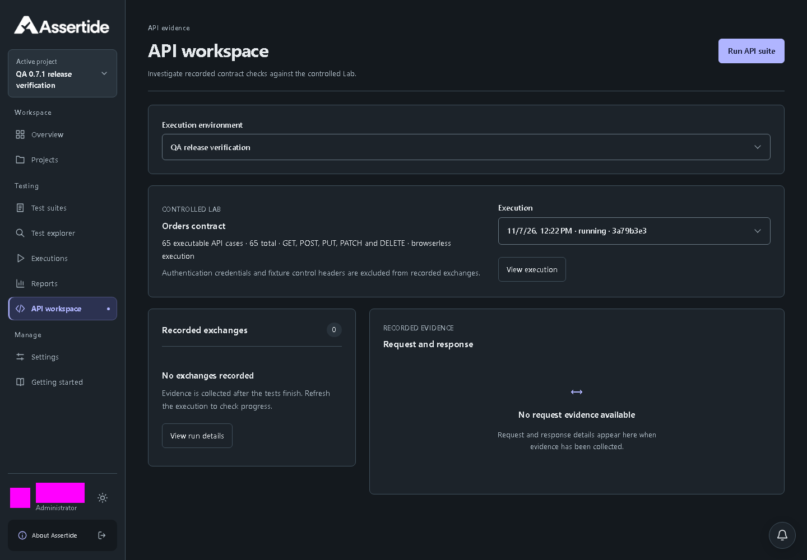

# Environment policy and credential references

## Launch environment selection

Test suites and API workspace offer an Execution environment selector containing enabled environments for the active project. The initial selection prefers enabled `local-lab`, otherwise the first enabled environment. If none is enabled, the launch action is disabled and guidance points to Settings. Suite browser launches prefer Chromium when allowed, otherwise the environment's first allowed browser. The server still validates current policy when accepting each launch.

These changes require no configuration or database migration. Existing environment snapshots and reruns retain their existing behavior.

Actual local UI capture at 1440px: the selected environment is explicit before launching.

Actual local UI capture at 390px: the selector fits the mobile layout. Inputs and account identity are masked in evidence.

## Policy and credentials

Administrators use Settings to create named execution environments, set worker/retry/browser/video limits, and disable future launches. The local deployment approves only `http://127.0.0.1:4010/lab/v1/` and `http://127.0.0.1:4013`. Other destinations are rejected by the API, including link-local metadata endpoints. This validation is not a network isolation boundary; production OCI workers and egress enforcement remain required.

Each accepted run stores its environment snapshot. Reruns retain the original snapshot and credential version, but current environment availability and limits are checked before queueing. Changed policies do not rewrite queued/running executions. Headed execution is rejected until a dedicated virtual-display worker is available.

Credential writes create immutable encrypted versions using AES-256-GCM, random nonces, and organization/project/reference/version authenticated context. API responses return metadata only. Environment references select an explicit version; rotation does not silently change existing references. The runner resolves the pinned value only when executing and redacts it from textual evidence and logs. API tracing is disabled to avoid credential-bearing traces.

`node scripts/dev-api.mjs` generates the 32-byte encryption key in ignored `.local/credentials.json` and passes it as `SECRET_ENCRYPTION_KEY`. Back up this key separately from the database; losing it makes stored credentials unrecoverable. Never commit it or copy it into screenshots. Other deployments must supply a 64-character hexadecimal key through their secret manager. Master-key rotation/re-encryption is not implemented yet. Older credential versions remain available for reproducible reruns; deleting historical secret versions is not currently exposed.

Credential and environment changes are audited. Environment updates and secret rotations require an `If-Match` version. Tests cover encryption, write-only responses, tenant/project scoping, stale rotation, forbidden destinations, policy caps, disabled environments, frozen references, and an authenticated browser-launched Lab run using a saved credential.

## Publication - 0.7.1 - 2026-11-07

The three QA fixes are merged through [PR #7](https://github.com/orKonijn/Assertide/pull/7) and deployed to [assertide.com](https://assertide.com). Product version 0.7.1 is a compatible patch release; private package versions remain unchanged.

Web source `1a059692e2166be800a0a6a3919f9bd794e593a4` passed [publication workflow 42363448810](https://github.com/orKonijn/Assertide/actions/runs/42363448810), including non-root startup, SPA health, vulnerability gates and signed provenance. Provenance was verified against that exact source and the hosted publication workflow before rollout. Deployed web digest: `sha256:db65475730f56a90f9c52f525c1e2de2a8e656ddcab5717be5086aebccb68529`.

Kubernetes confirmed the web rollout and ready replicas. API, execution/report supervisors and worker images were not updated. No migration, DNS, authentication-policy, storage or isolation change was made. The previous web deployment is retained privately for rollback.

Live verification used a temporary identity and an independent synthetic project. Production sign-in, anonymous data denial, a completed suite run in an alternate enabled environment, and private Allure generation/opening passed. API workspace also launched with the selected alternate environment; its worker log recorded all 65 cases passed in 12 seconds. However, that API execution was still marked running with result/evidence finalization pending at the end of the bounded check. This publication does not claim that its final persisted API report completed.

Both launch pages disabled execution and explained recovery when the synthetic project's environments were disabled. Desktop/mobile layouts passed at 1440px and 390px in both themes. The deployed frontend passed report/API pagination and draft-filter separation checks using 101 controlled browser-intercepted response rows; these were not 101 executions inserted into production storage. Live v0.7.1 identity and logout passed. The temporary provider identity was disabled, provider/application sessions revoked, project access removed and the local credential copy deleted. The owner identity was unchanged.

The live mobile suite page explicitly selects the approved verification environment.

The live API page retains the selected environment. The captured execution is still awaiting result finalization, as noted above; identity details are masked.

All 72 local acceptance journeys and local lint/type/unit/build, architecture and reporting checks passed before merge. [PR verification 42315071092](https://github.com/orKonijn/Assertide/actions/runs/42315071092) passed the full Linux matrix on one retry. Its first attempt and the later [main verification 42322447799](https://github.com/orKonijn/Assertide/actions/runs/42322447799) failed when nested Kubernetes Lighthouse collection returned Unavailable instead of Measured. The strict assertion remains unchanged. [Release-source verification 42363424979](https://github.com/orKonijn/Assertide/actions/runs/42363424979) was still running when publication was recorded; it is not claimed as passed. The release version change separately passed a production web build, and the published image passed its own security and startup checks.
