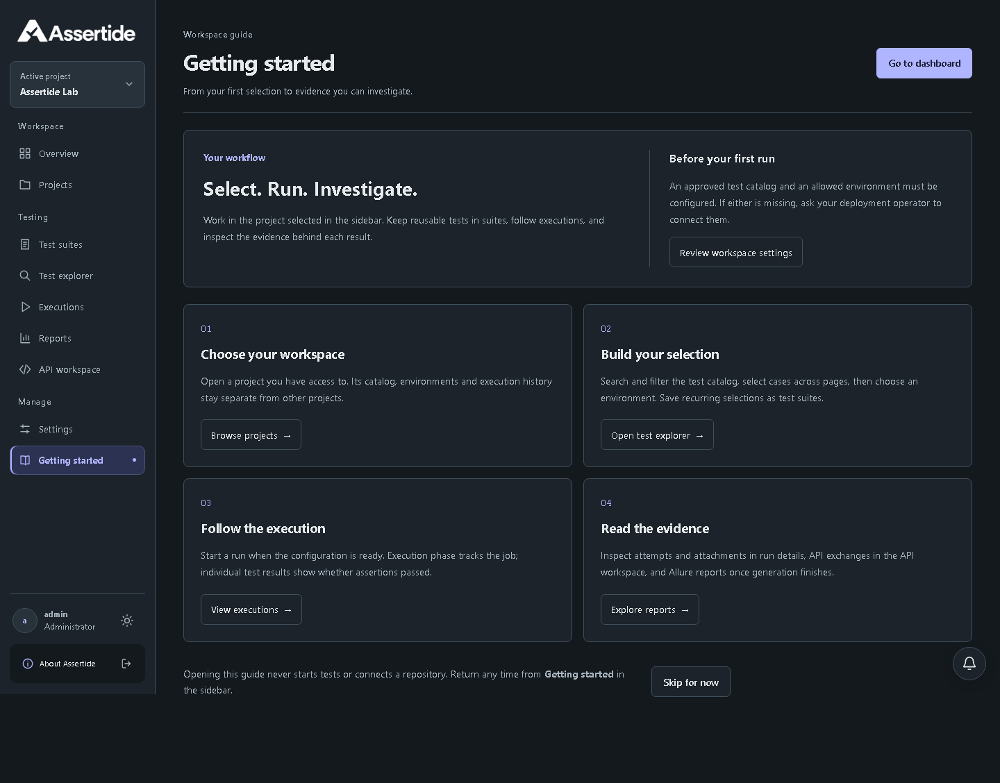
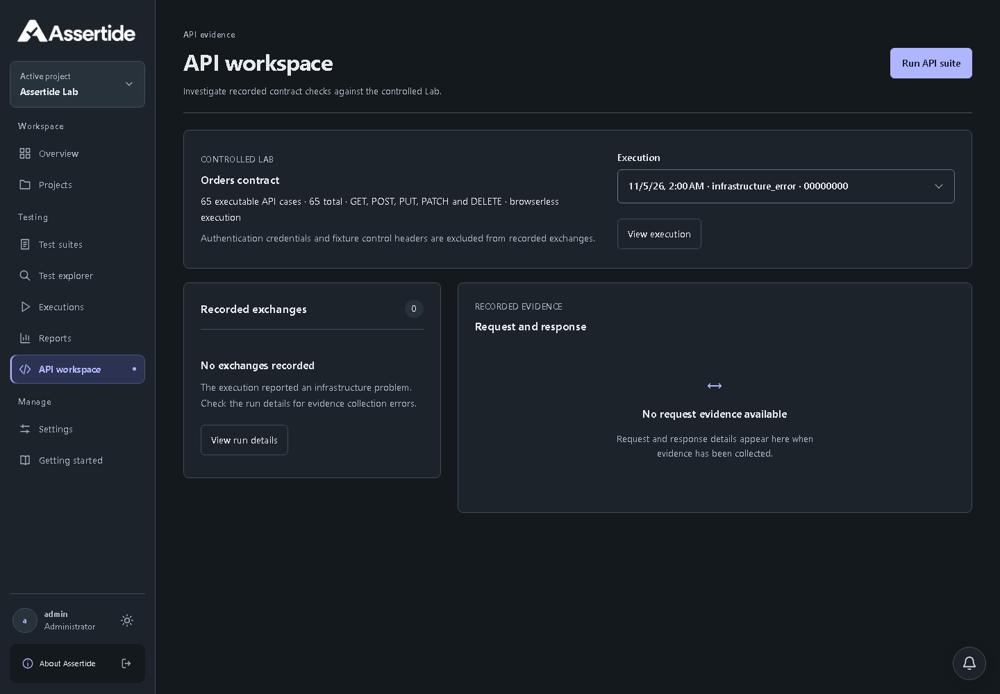

# Evidence collection and workspace guide

## Findings and repair

The pilot run `83406ab4-2497-41e6-8197-cab2f0060889` retained 127 complete Allure result records, all passed, with every referenced attachment present. Its application records instead contained 127 synthetic “No terminal result received” placeholders after a Kubernetes artifact transfer failure. Those placeholders were incorrectly counted as failures because the run was marked completed.

The checkpoint reporter embedded binary attachments in both checkpoint and JSON summaries. A controlled 70 MiB attachment fixture reproduces oversized summaries; the revised reporter stores those attachments in files, keeping both summaries below 1 MiB without losing their contents. The retained production evidence and transfer error establish the collection failure; the oversized-summary mechanism is validated by the controlled regression rather than a retained original summary file.

On 2026-11-05, a guarded one-run recovery verified all 127 result IDs and all referenced attachments, backed up the original run privately, and restored the recorded outcomes. Analytics now contain 127 eligible, final-passed and first-attempt-passed results. Recovery also restored 1,392 attachments including 556 API exchanges. No tests were rerun and no outcomes were inferred solely from console text. Raw evidence archiving completed; report generation is tracked separately from these recovered test outcomes.

The recovered report subsequently exhausted its 2 GiB worker limit during Allure generation (the pod recorded `OOMKilled`). The report deployment now allows 4 GiB; API and execution limits remain unchanged. Operators must reserve sufficient node capacity before applying this setting. The pilot had more than 8 GiB available before rollout.

## Implementation and rollout

- Binary attachments become private files before checkpoint and JSON reporting.
- Kubernetes transfer/cleanup failures return an infrastructure exit status. Missing terminal results also prevent a run being classified as completed.
- Raw evidence archival and restoration transfer at most eight files concurrently. Each batch settles before failure is propagated; run ownership, path, integrity and retention checks remain in place.
- Getting started is available in the sidebar on desktop and mobile. Its guide explains workspace selection, execution prerequisites, test selection and evidence inspection without assuming a project is empty.
- Clear selection sits with execution actions. API workspace explains missing evidence and avoids showing a one-page pager or promising an available Allure report.

The preventive code and UI changes are local and unreleased. Publish compatible API/service and immutable automation worker images together, then update the configured worker image/source revision through the existing deployment procedure. Existing run evidence is not rewritten by deployment. No database migration or authentication change is required. Rollback uses prior image digests; the separately backed-up one-run repair must not be reverted merely by deploying older code.

## Verification

- `npm run verify:quick`: passed. Existing access-entry stylesheet budget warning remains (4.37 kB against 4 kB).
- Reporting checks: passed, including actual Playwright output with 70 MiB of file attachments.
- Architecture checks: passed.
- Execution outcome tests: passed for complete pass/fail exits, missing results, transfer error, cancellation and timeout.
- Controlled object-storage fixture: archive/restore of 16 files passed, with eight simultaneous transfers and exact restored contents.
- Focused connected browser journeys: four passed, covering API evidence, drawer behavior and Getting started navigation on desktop/mobile. Existing catalog selection/clear behavior also passed.
- Three fresh-context registration checks passed, including verified workspace provisioning and invalid/reused verification handling.
- Actual running UI captures: desktop/mobile, dark/light guide accessibility scans and no horizontal page overflow passed. API empty-state screenshots use an explicitly controlled infrastructure-error fixture.

Linux isolation and real object-storage integration checks are not part of local quick verification and were not rerun for this change. No new image or production code deployment is claimed.

## Running UI evidence

[Mobile guide](changelog/assets/unreleased/evidence-fix-guide-dark-390.png) · [Test explorer selection actions](changelog/assets/unreleased/evidence-fix-explorer.png)

[Mobile API workspace](changelog/assets/unreleased/evidence-fix-api-mobile.png). These are screenshots of the local running implementation, not design mockups.
