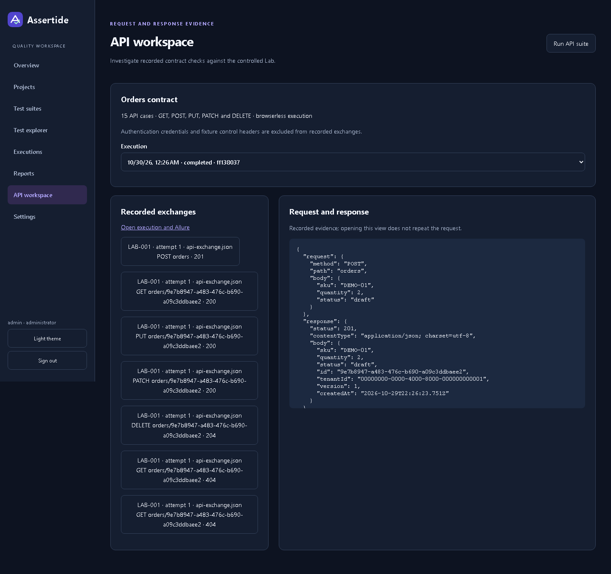
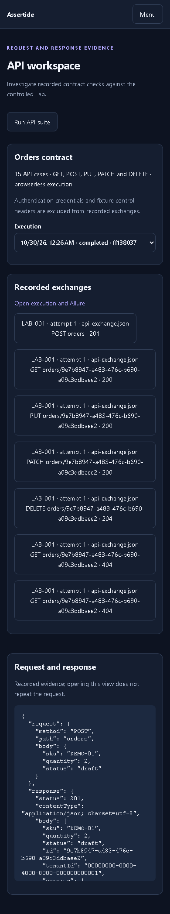

# Local execution evidence

The API workspace reads recorded exchanges; inspecting a request does not send it again. Lab authentication requests and credential-bearing headers are omitted. JSON and text evidence pass through fixture-password and JWT redaction before storage. Bodies are capped at 64 KiB per recorded exchange.

Execution results identify each artifact by run, result, attempt, capture time and expiry. Downloads require current project membership and create an audit event. Files are addressed by generated UUIDs rather than user-provided paths. The importer rejects files outside the run directory, unsupported content types and artifacts over 50 MB. Browser evidence is restricted to the trusted local storefront; API traces remain disabled.

Traces and video expire after 14 days; other imported artifacts expire after 30 days. The local worker sweeps expired evidence every minute, deletes each file and records a tombstone. Expired evidence returns HTTP 410. This currently covers imported local artifact files; S3 object-version deletion, raw/report cleanup and backup aging remain separate unfinished operational requirements.

Worker logs retain a redacted tail. Events are retained for 24 hours. Reconnecting outside the retained window triggers a snapshot resync. A report rebuild remains separate from execution outcomes.

Verified with SQL/HTTP integration tests and the browser journey, including recorded POST/GET/PUT/PATCH/DELETE evidence, a transport timeout, role revocation, artifact deletion and desktop/mobile overflow checks.

The exchange list identifies method, path and response status; the evidence pane shows the recorded payload.

The evidence panels stack at 390 px without widening the page.
