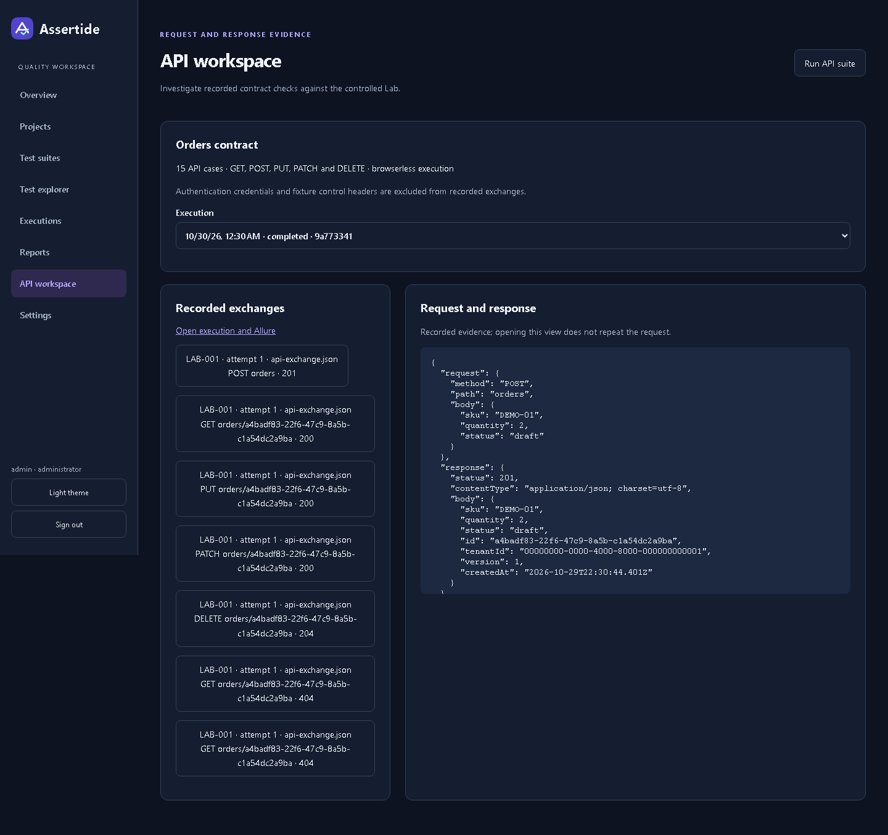
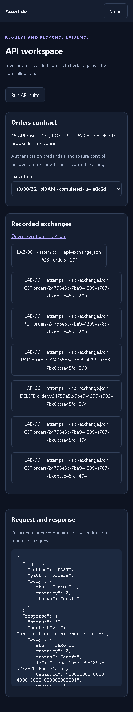
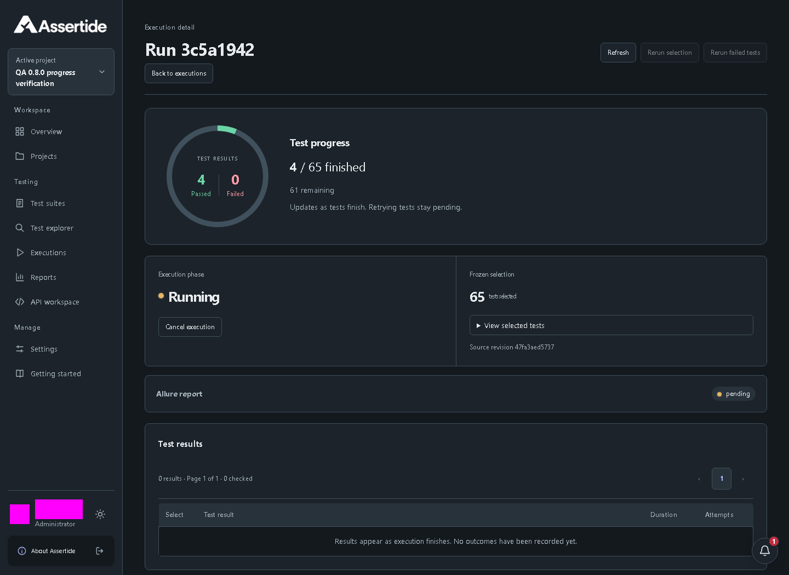
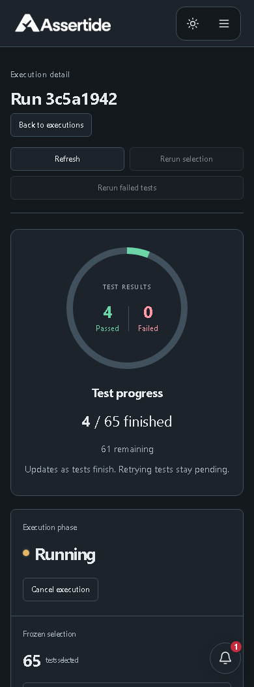

# Local execution evidence

The API workspace reads recorded exchanges; inspecting a request does not send it again. Lab authentication requests and credential-bearing headers are omitted. JSON and text evidence pass through fixture-password and JWT redaction before storage. Bodies are capped at 64 KiB per recorded exchange.

Execution results identify each artifact by run, result, attempt, capture time and expiry. Downloads require current project membership and create an audit event. Files are addressed by generated UUIDs rather than user-provided paths. The importer rejects files outside the run directory, unsupported content types and artifacts over 50 MB. Browser evidence is restricted to the trusted local storefront; API traces remain disabled.

Traces and video expire after 14 days; other imported artifacts expire after 30 days. The local worker sweeps expired evidence every minute, deletes each file and records a tombstone. Expired evidence returns HTTP 410. Private S3 storage deletes all object versions and multipart uploads; raw evidence, reports and history have their own retention sweeps. Scheduled database backups use a separate encrypted, versioned bucket. Its retention/object-lock and replication policy must be configured by the deployment owner; see [recovery guidance](database-recovery.md).

Worker logs retain a redacted tail. Events are retained for 24 hours. Reconnecting outside the retained window triggers a snapshot resync. A report rebuild remains separate from execution outcomes.

Execution detail includes a live progress circle. The approved reporter emits only case/browser identifiers and final outcome categories; the supervisor persists aggregate counters through the existing owned-run update and event stream. Retries stay pending until the final attempt, each browser combination counts separately, and the separate performance benchmark does not add a functional result. Green counts include expected failures that satisfy the test's expectation; unexpected passes fail that expectation. Skipped and canceled outcomes remain neutral. Final normalized results replace interim counts. Older frozen source snapshots without progress events show pending counts until final results arrive; no migration or replay is needed. A disconnected monitor explicitly warns that displayed results may be stale.

Local progress verification (2026-11-09): quick verification passed (51 API tests passed, 10 infrastructure-dependent tests skipped; 23 web tests passed), all 73 browser acceptance tests passed, and architecture/reporting checks passed. A real 65-case run exposed nonzero progress while still running and preserved final counts on mobile. After the final log-display cleanup, the focused live-progress test passed again and confirmed that progress protocol messages do not appear in the displayed log. Desktop/mobile captures include an actual completed run and explicitly labeled mixed-outcome response fixtures in both themes. Isolated Linux infrastructure was not rerun for this unreleased change.

After worker execution ends, normalized results are saved under the `finalizing` phase before remote attachment uploads start. The detail page shows those results while evidence is saved. The worker retains its lease and capacity reservation until finalization finishes; stale owners cannot publish attachments. Lease recovery preserves already-saved results while marking the interrupted finalization as an infrastructure error.

Attachment imports share a maximum of eight concurrent operations across the whole run, including different cases and retry attempts. This replaces serial per-attachment uploads without changing generated object keys, redaction, integrity checks, expiry, authorization or the explicit unavailable marker for a failed attachment. The recorded end time is captured before attachment transfer. Raw archives and reports retain their existing complete-manifest publication rules. No configuration or database migration is required. Existing completed runs need no replay; an old run already finalizing on a previous worker should be allowed to finish before rollout.

Verified with SQL/HTTP integration tests and the browser journey, including recorded POST/GET/PUT/PATCH/DELETE evidence, a transport timeout, role revocation, artifact deletion and desktop/mobile overflow checks.

The exchange list identifies method, path and response status; the evidence pane shows the recorded payload.

The evidence panels stack at 390 px without widening the page.

## Publication - 0.7.2 - 2026-11-07

Published source `12a8e5cb58542f485e1c8ae97864328cb6ceb37f` to main and deployed it to [assertide.com](https://assertide.com). [Signed image publication 42394335663](https://github.com/orKonijn/Assertide/actions/runs/42394335663) passed ARM64 builds, startup checks, vulnerability gates and signing. Provenance for all three images was verified against that exact source and the hosted publication workflow.

Deployed immutable image references:

- Service: `ghcr.io/orkonijn/assertide-service@sha256:42ad07ee2d7eadbd4a5c15ac9d2d9cc89ca99b7b3049bb69e286bcf7f12f8afc`
- Web: `ghcr.io/orkonijn/assertide-web@sha256:e84c71b171679611872b8b1914fb8c3bfa6b528bd86df1903e7b841aae541405`
- Worker: `ghcr.io/orkonijn/assertide-worker@sha256:60e9601e2d50c9b86a719304fbd850359cb20d7f918b1276e7d227729b302b04`

Execution and report queues were idle before rollout. Previous deployment/configuration snapshots were retained privately for rollback; restore those image references if required, after draining active runs. API, execution, report and web deployments became ready. No database migration, authentication change, DNS change or worker-isolation relaxation was needed.

`npm run verify:quick` passed, including 50 API tests (10 infrastructure-dependent cases skipped locally), 20 web tests, lint, formatting, type checks and the production build. All 72 local browser acceptance journeys passed. The new controlled upload test verifies a maximum of eight concurrent operations across cases and attempts, ordering, ownership, redaction, object versions and failed-upload metadata. Scheduler coverage verifies persisted results during finalization and lease recovery. The upload regression also passed inside the published service image on the ARM64 Kubernetes host; its temporary job was removed.

The original delayed run recovered before rollout with 65 results, 559 attachments and a ready report; no replay or data repair was required. In the new live run, all 65 passing results were persisted and visible during `finalizing`, on desktop and at 390 px without horizontal overflow. All 559 attachments subsequently finalized with no unavailable markers. Authenticated API evidence was readable and checked for fixture-secret redaction; anonymous access returned 401.

Measured from launch in this single live controlled run: results became visible after 26.3 seconds, execution/evidence finalization completed after 161.6 seconds, and the Allure report became ready after 547.2 seconds. The report opened on the private report origin. These are observed end-to-end timings, not a controlled performance benchmark or an SLA; report generation remains a separate, slower step. Release identity displayed `v0.7.2`, logout revoked access, and the temporary verification identity was then disabled with provider/application sessions revoked and project access removed.

[Full Linux verification 42394327255](https://github.com/orKonijn/Assertide/actions/runs/42394327255) was still running platform browser acceptance when publication verification finished. Its controlled API/cross-browser regression stage had passed. A fully green infrastructure matrix is not claimed; the previous release also had intermittent nested Kubernetes Lighthouse availability failures. This does not replace the successful local checks, signed-image publication or live checks above.

Actual sanitized desktop and mobile captures are stored in `docs/changelog/assets/0.7.2/` and shown in the changelog. These are captures of the deployed implementation.

## Publication - 0.8.0 - 2026-11-09

Source `e37d20ef9380cce8c12a767e1f4f437564ef7266` was pushed to main and deployed to [assertide.com](https://assertide.com). [Image publication 42533788643](https://github.com/orKonijn/Assertide/actions/runs/42533788643) passed native ARM64 builds, startup and vulnerability checks, and signing. All three images had provenance verified against the exact source and hosted publication workflow:

- Service: `ghcr.io/orkonijn/assertide-service@sha256:15eb34bbe9d2d751bfc7b32ab144407d5b5b21f01dc62b783df1f129fed58af1`
- Web: `ghcr.io/orkonijn/assertide-web@sha256:f0bb426817a1ad15b93c0eabd1cc7f293b84c977fe0fd158955741e7a9832115`
- Worker: `ghcr.io/orkonijn/assertide-worker@sha256:73909a89a92f850e5d49d55fc69013c4340bf692e47da1ca5d8cc522f09bc507`

The idle-work guard passed before rollout; a private snapshot retained previous deployment images and configuration for rollback. API, execution, report and web deployments became ready. No database migration or authentication-policy change was required.

The live 65-case API suite showed 4 passed, 0 failed and 61 remaining while its execution phase was still running. Actual desktop and 390 px mobile captures show the live circle; neither viewport overflowed. The test outcomes then became available during finalization. Mixed green/red local previews remain explicitly labeled as controlled fixtures rather than actual failing production runs.

The completed circle matched all 65 passing results with no failures. All 559 attachments finalized without unavailable markers; authenticated evidence was readable and checked for fixture-secret redaction, while anonymous access returned 401. The private Allure report finalized and opened successfully. The About page displayed v0.8.0 and logout revoked access. The temporary verification identity was disabled afterward, provider/application sessions revoked and project access removed; its local credential file was deleted.

For this single live run, all final results were visible after 26.1 seconds, evidence finalization completed after 146.2 seconds, and the report was ready after 486.6 seconds from launch. The interim circle was already showing passes before final results appeared. These observations are not performance guarantees.

[Full Linux verification 42533778596](https://github.com/orKonijn/Assertide/actions/runs/42533778596) passed the controlled API/cross-browser regression stage and was still running platform browser acceptance when live verification finished. The complete infrastructure matrix is not yet claimed green. Local quick verification, all 73 acceptance tests, the final focused live-counter/log-display check, and architecture/reporting checks passed as recorded above.

