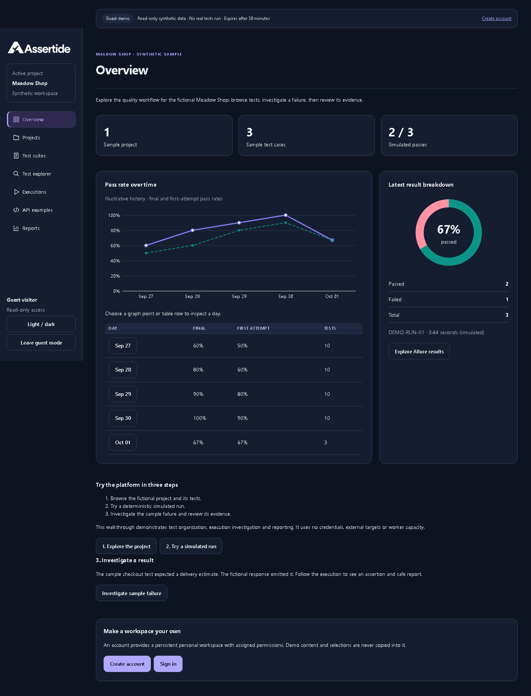

# Guest workspace pilot deployment � 2026-11-01

The latest application is live at [https://assertide.com](https://assertide.com). Guest visitors can explore the workspace-style dashboard and graphs, test catalog, simulated execution and the actual synthetic Allure sample. This is a deployment to the existing free pilot, not a versioned product release.

## Build and rollout

- Application source: `b33f5cecdd95f627d1817192532c03c58e93701f` on `codex/deploy-guest-workspace`; [draft PR #6](https://github.com/orKonijn/Assertide/pull/6). Main and PR #1 were not merged.
- [ARM image build and security scans](https://github.com/orKonijn/Assertide/actions/runs/41297038069) passed. All three published images passed signed provenance verification against that exact source commit and the repository's hosted build workflow.
- The update preserves the previous B2 storage-health quota correction, private storage, Vault, Kubernetes isolation and retained databases/sources.
- A pre-deployment database backup completed successfully before the additive registration/issuer-binding migration. Original deployment images and configuration were retained privately for rollback. No database reset or historical data replacement occurred.
- API, execution supervisor, report supervisor and web rollouts completed; all are ready. The scheduled backup now uses the same service image.
- No DNS record, paid plan, network exposure or hosting resource was added. Existing HTTPS and www redirects remain in place.

| Component                  | Deployed image                                                                                               |
| -------------------------- | ------------------------------------------------------------------------------------------------------------ |
| API / supervisors / backup | `ghcr.io/orkonijn/assertide-service@sha256:dd0286649e958b7e4629c3508837d929d847e9e796f8354ffdf10d46720f2bcd` |
| Web                        | `ghcr.io/orkonijn/assertide-web@sha256:f4c32295d94a844ff4434b15a5cbe131da008cca8a9d35f8b301575c94125619`     |
| Isolated execution         | `ghcr.io/orkonijn/assertide-worker@sha256:bd0c9d48226961035080898dc7d13065dda4bd002930fb2d7f574fcf1380afc6`  |

## Live verification

- HTTPS frontend and production OIDC discovery respond successfully; HTTP redirects to HTTPS and www redirects to the apex while preserving path/query.
- Anonymous guest entry, dashboard charts, report library and public Allure sample passed browser checks on the real domain. The sample failure details open correctly.
- A temporary controlled identity completed production OIDC sign-in and loaded its authorized workspace through the frontend/API.
- One controlled execution of `LAB-001` and `UI-001` completed on the isolated worker with **both results passed**. Its Allure report generated successfully.
- The authenticated user opened that private report on the separate report origin. An anonymous context received 403 for the private report and 401 for protected application data.
- Logout invalidated the application session. The temporary verification identity was disabled, provider/application sessions revoked, project access removed, and its temporary local password file removed. The owner's identity was unchanged.
- Public database, Redis, Vault and Kubernetes administration ports remain inaccessible. Keycloak administration remains blocked publicly.
- Combined local `verify:quick` passed. Guest/mobile/theme/accessibility and safe-reporting checks passed. [Full Linux infrastructure CI](https://github.com/orKonijn/Assertide/actions/runs/41297045353) is still running; pending steps are not claimed as passing.

## Remaining limits

Public **Create account** remains disabled (`ACCOUNT_REGISTRATION=false`). Production email delivery, provider registration/password/abuse policy and any required legal notices must be configured and verified before enabling it. Existing sign-in and the public guest demo work. The sample Allure file is intentionally public and contains only fictional results; actual customer/execution reports retain authorization.

The existing single-node/free-tier capacity, storage transaction quotas and recovery limitations still apply. This deployment does not claim high availability or unlimited worker capacity. No new paid service was purchased.
