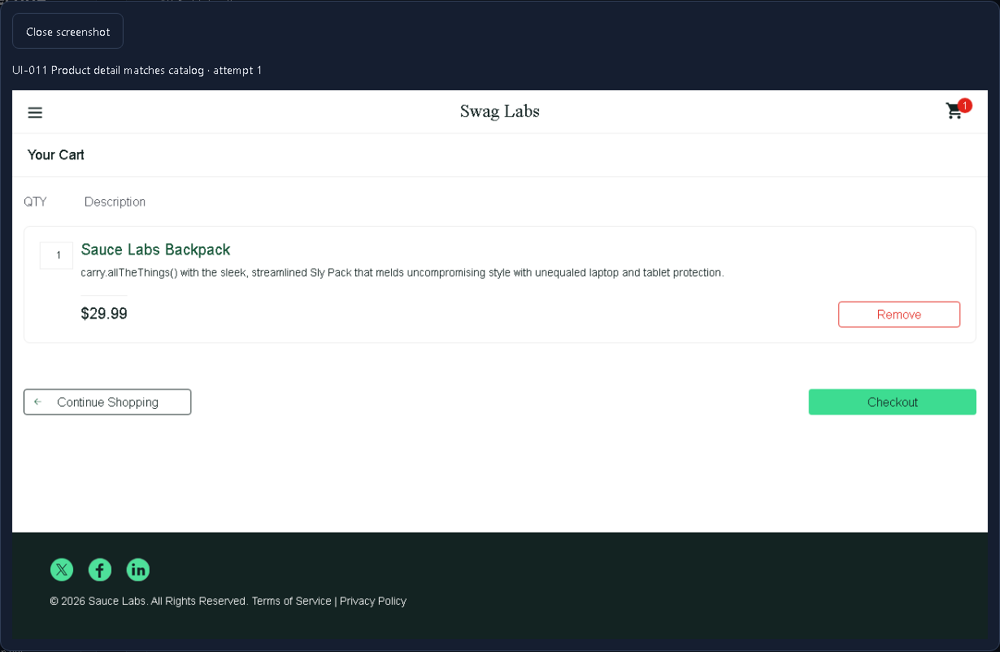
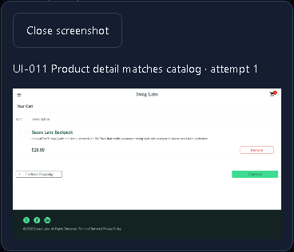

# Investigation and session lifecycle

Result screenshots open in a native modal dialog with a close control, Escape handling and focus return. The image request uses the existing scoped artifact endpoint; denied/expired images show an unavailable message. UI-011 now verifies the product name, price and quantity through the cart and records a real screenshot as review evidence. Failed browser attempts retain their configured screenshot/trace/video policy.

API evidence collapses after 200 lines, can be expanded, and downloads the full recorded redacted JSON. Changing the selected execution invalidates pending evidence reads, so a late response cannot display another execution's evidence. Opening/downloading evidence does not repeat the original API request. Tailwind utilities provide bounded scrolling and responsive image layout while preserving the existing application theme and base styles.

History filters now include frozen suite and environment identifiers in its shared URL. Records created before suite provenance was introduced remain under all suites. A rerun whose original OCI image is unavailable is rejected before queueing; restore a matching worker deployment to reproduce that run.

The authenticated identity response includes the session expiry. The application clears its protected shell at that deadline and revalidates membership/session on tab visibility and every 15 seconds while visible. A revoked session clears protected route content and retains the current URL for sign-in. API authorization remains authoritative for every request; a transient network failure never extends the known session deadline.

Verification includes actual screenshot retrieval, Escape/focus return, redacted JSON download, idle revocation and return URL, scoped history filters, strict API/web compilation and automated responsive accessibility checks.
