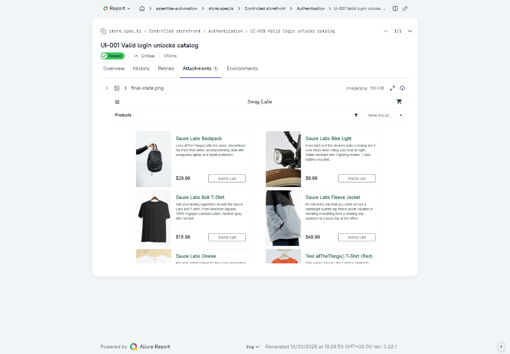

# Private evidence storage

Set `S3_BUCKET`, `S3_ENDPOINT` (for compatible services), `AWS_REGION`, and AWS credentials through the deployment secret manager to use private object storage. Standard AWS credential-provider discovery is supported. The application never makes buckets public or returns permanent object URLs. Enable bucket versioning externally; `S3_SSE=AES256` requests provider-managed encryption when the selected service supports it.

Evidence is stored under run-scoped immutable keys. PostgreSQL authorization is checked before each download and every report asset request. Stored references contain a SHA-256 digest and the provider's version identifier. Downloads verify integrity. Report uploads register their prefix first, upload all assets, then publish the complete manifest and pointer. An interrupted upload remains unpublished and discoverable by retention. Rebuilding creates a new prefix; existing viewer tickets remain bound to the build they opened.

The deletion worker removes every object version and delete marker, aborts unfinished multipart uploads, and retains artifact tombstones. Screenshots/text evidence, reports and raw execution files expire after 30 days; traces/videos after 14. Report manifests identify their short-lived binary assets, which expire independently with an explanatory HTTP 410 response. Original trace/video copies in raw results are also deleted after 14 days. Rebuilding does not extend retention dates. Normalized results and audit records expire after 365 days. Report expiry never changes test outcomes. Raw expiry prevents report rebuilds and removes live log tails. Interrupted report uploads are registered before transfer and expire after one day if never completed.

## Local real-service verification

Ready reports expose authenticated ZIP downloads at `/v1/runs/:id/report-download`. Responses include `X-Checksum-SHA256`, `X-Report-Generation` and `X-Includes-Trace-Video`. Every archive includes `assertide-build.json` describing the run/build and media policy. A media-inclusive archive is available only while trace/video evidence is retained; the separate report-only archive remains for 30 days. Downloads are audited and checked against their stored hash. Older builds need rebuilding before ZIP export is available. Archive generation currently caps uncompressed inputs at 256 MiB and reports a build failure when exceeded; normalized test outcomes remain intact.

Raw Allure inputs are archived before report generation. Their version-pinned manifest is attached to the run through the worker lease, so another worker can restore the files and rebuild the report. Only complete manifests are published. Raw trace/video objects use a separate 14-day prefix; remaining raw inputs expire after 30 days, including incomplete uploads. Restoration rejects cross-run references, path traversal, symbolic links and checksum mismatches. The browser history test deletes local raw inputs before rebuilding to exercise recovery from the object store. This covers report-input recovery, not PostgreSQL disaster recovery.

MinIO is a development test fixture, not a managed production storage deployment. Its source revision and AGPL license are retained in the ignored checkout. Go 1.27.3 was used to build it; on Windows, place a checksum-verified Go distribution under `.local/tools/go` or set `GO_BINARY`.

1. Run `node scripts/setup-object-store.mjs` to build the pinned source.
2. Run `node scripts/dev-object-store.mjs`. It generates private local credentials and binds only loopback port 9000. Service output is suppressed to prevent accidental credential logging.
3. Run `node scripts/with-local-object-store.mjs apps/api/node_modules/tsx/dist/cli.mjs apps/api/scripts/setup-bucket.ts` to create a private versioned development bucket.
4. After this one-time setup, stop the standalone MinIO process and run `npm start`. The app restores the saved local storage configuration and starts MinIO automatically. `node scripts/dev-api.mjs` and the object-store wrapper also start it when needed.
5. Run the usual platform browser tests. They exercise object-backed evidence, report viewing/rebuilding and post-logout denial.

Startup waits for storage readiness before launching the API. MinIO uses the existing `.local/objects` data and saved credentials; a running instance is reused, and shutdown stops only an instance started by this app process. Explicit external S3 configuration is preserved. Missing binaries or failed startup stop launch with a diagnostic. If an older session failed with `connect ECONNREFUSED 127.0.0.1:9000`, restart the app and rebuild the failed report. Do not disable S3 to recover existing object-backed runs: their stored evidence still requires MinIO.

## Screenshot attachments

Every named browser workflow step attaches a masked `step-state.png` under that step, including failed steps. Successful browser tests also attach `final-state.png`; failure diagnostics keep their masked failure screenshot. Automatic step/success screenshots are suppressed for tests marked sensitive and pages already closed. API-only runs contain request/response evidence, not browser screenshots. Open a browser test in Allure and expand a step in **Overview**, or choose **Attachments** to inspect its images. Images are also included in report ZIP downloads. See [coverage and evidence rules](regression-coverage.md).

Older executions cannot gain screenshots that were never captured: start a new execution to collect them. Rebuilding an old report only uses its existing evidence.

The successful login test exposes its final storefront image in the authenticated Allure viewer.

The wrapper enables bounded retries for observed transient `AccessDenied` writes in the native Windows loopback fixture only. Production authentication errors are not retried by that exception. CI builds the same MinIO source on Linux and runs the database and browser workflows with PostgreSQL, Redis and versioned object storage.

Local S3 integration tests verify private GET denial, retrieval of an earlier object version, hash mismatch rejection, deletion of versions/delete markers and multipart cleanup. Storage tests also verify report expiration preserves normalized results. Do not treat these checks as a backup/restore drill or a production security certification.
