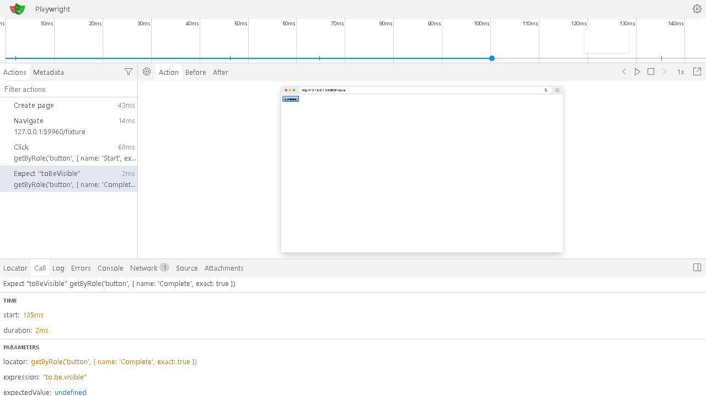

# Private trace viewing

Trace artifacts have an **Open private trace viewer** action beside their authenticated download. Assertide serves the installed Playwright viewer on the report origin; trace bytes are fetched from the application's authorized evidence storage, not uploaded to a public viewer.

The opener issues a one-use ticket bound to the current session or CI credential and run. Viewer assets and trace downloads recheck project membership and that credential. Trace downloads enforce the original artifact expiry. The viewer checks access every two seconds and when the tab becomes visible; revoked/expired sessions clear its document and unregister the run's viewer service worker. Existing downloaded files cannot be recalled.

Content Security Policy restricts network access to the viewer origin, permits the viewer's local worker/blob resources, and allows same-origin snapshot frames. The application and report origin should use separate hostnames. Set `REPORT_ORIGIN` and `REPORT_PORT` behind your reverse proxy; production requires HTTPS and a hostname different from `APP_ORIGIN`. Local defaults remain `http://localhost:4012`.

The integration check records a real Chromium interaction, imports its trace as run evidence, opens the private viewer, verifies actions and the recorded DOM snapshot, rejects an anonymous asset request, then revokes the session and verifies that the view clears. It runs with `TEST_TRACE_VIEWER=true` after installing Chromium.

