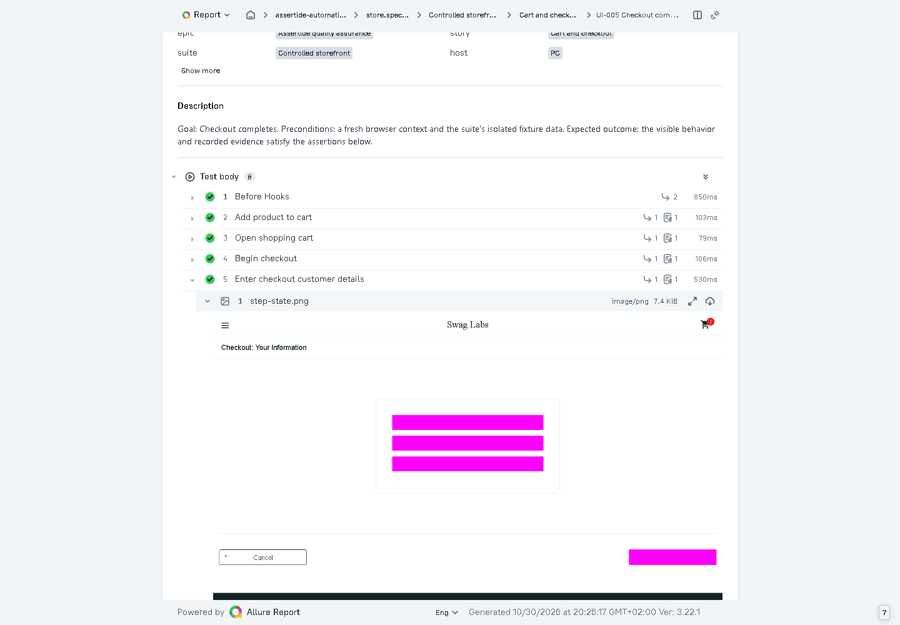

# Controlled regression coverage

The catalogue contains **127 distinct cases: 65 API and 62 UI**. This expansion adds exactly **50 API cases (`LAB-016`–`LAB-065`) and 50 UI cases (`UI-013`–`UI-062`)**. Browser projects execute the same UI cases in Chromium, Firefox and WebKit; those repetitions are not counted as new cases. A full run has 251 executions with retries disabled.

## Run locally

After `npm run setup`, run `npm run test:regression`. This starts the local API and controlled storefront when they are not already running, reads the generated fixture credentials without printing them, and executes all controlled cases. Use `npm run test:regression -- --project api --project chromium` for a shorter run. Results and Allure inputs are written beneath `.local/automation-results`; `RUN_OUTPUT` can select a separate output directory. Public practice sites are not contacted.

The CI verification workflow executes this suite and retains its raw report/evidence artifact for 14 days. This complements the platform acceptance tests and isolated-worker checks.

## Added API cases

| IDs         | Count | Behavior and evidence                                                                                                                     |
| ----------- | ----: | ----------------------------------------------------------------------------------------------------------------------------------------- |
| LAB-016–025 |    10 | Invalid quantity, SKU, status and server-field inputs cannot create resources; a valid retry with the same key succeeds.                  |
| LAB-026–035 |    10 | Invalid patches preserve the complete original resource and version; a valid write with the original precondition recovers.               |
| LAB-036–040 |     5 | Missing/malformed/stale preconditions and concurrent writers cannot lose updates; the losing writer can recover with the latest version.  |
| LAB-041–045 |     5 | Cross-tenant read/update/delete denial and viewer read-only access preserve owner data.                                                   |
| LAB-046–050 |     5 | Concurrent replay, conflicting payloads, replay after updates, tenant key isolation and key-length boundaries preserve idempotency.       |
| LAB-051–055 |     5 | Complete cursor traversal at three page sizes, status transitions, SKU isolation and invalid-filter recovery.                             |
| LAB-056–060 |     5 | Full/partial updates, confirmed-order protection, stale deletion and canonical SKU filtering.                                             |
| LAB-061–065 |     5 | Service/rate-limit faults, mismatched fixture subjects, unsigned injection and invalid authentication preserve state and permit recovery. |

Each API scenario uses an isolated SKU, validated response schemas, status/ETag assertions and cleanup of the orders it creates. Negative cases check persisted state rather than only a response code. Signed fixture scopes isolate rate limits; the existing rate-limit case separately tests the real window boundary. Request and response attachments are retained without authorization headers or credential values.

## Added UI cases

| IDs        | Count | Behavior and evidence                                                                                                                                                   |
| ---------- | ----: | ----------------------------------------------------------------------------------------------------------------------------------------------------------------------- |
| UI-013–018 |     6 | Every catalogue product retains its identity/price across details, reload, cart entry and removal.                                                                      |
| UI-019–022 |     4 | All four sorting modes preserve selected items, prices and the persisted cart.                                                                                          |
| UI-023–028 |     6 | Distinct baskets exercise equal prices, low/high prices and two through six products; totals, rounded tax and post-purchase clearing are checked.                       |
| UI-029–034 |     6 | Removing first/last/alternating/grouped/all products survives reload and supports restoring the full basket.                                                            |
| UI-035–040 |     6 | Required-field combinations exercise error priority and cancellation/recovery without losing the basket.                                                                |
| UI-041–046 |     6 | Failed/locked login recovery, protected navigation, logout, reload and keyboard submission continue into real shopping flows.                                           |
| UI-047–054 |     8 | Review cancellation, customer cancellation, consecutive purchases, detail removal, cart-to-detail navigation, sort cycling, empty-cart recovery and selection toggling. |
| UI-055–058 |     4 | Complete sorted-catalog checkout journeys at 320, 390, 768 and 1280 pixel widths.                                                                                       |
| UI-059–062 |     4 | Reload at cart, customer, review and completion stages preserves the correct purchase state.                                                                            |

The matrices target different products, boundary conditions, selection patterns and navigation states. They share Page Objects and assertions rather than duplicate implementation. Each case starts with a fresh browser context; no retries, fixed browser sleeps or public services are used.

## Allure step images

Every named browser `workflow` step attaches a masked `step-state.png` beneath that step, whether it succeeds or fails. Successful tests additionally retain `final-state.png`. The shared fixture masks inputs, textareas and the CI-token field. Tests marked `sensitive` opt out of automatic step/success images, and closed pages are skipped. A failed screenshot capture records an explanatory attachment without replacing the underlying step error.

Open a test's Overview and expand a workflow step to see its image, or use the Attachments tab. API steps contain exchange evidence because API-only execution has no browser page. Browser screenshots require a new execution; rebuilding an older report cannot invent missing evidence.

The reporting probe verifies per-step attachment ownership for successful and failed workflows, the sensitive-page opt-out, final/failure evidence and credential redaction. Catalogue discovery validates all 127 stable identities. The architecture check includes the new UI specification and enforces Page Object boundaries.

The screenshot is nested beneath **Enter checkout customer details**, so its state can be reviewed at the point that action completed. The other workflow rows each show their own attachment count.

## Verification

Local verification on 2026-10-30: all 251 controlled executions passed with no retries (65 API, 62 each in Chromium/Firefox/WebKit). Four authenticated report acceptance tests passed, including a visible step image, ZIP downloads and rebuilding from restored raw evidence. Six storage-startup checks, the reporting/redaction probe, catalogue discovery, Page Object architecture checks and `npm run verify:quick` passed. A real cold app start restored MinIO automatically. This is unreleased verification evidence, not a product release or production deployment.
