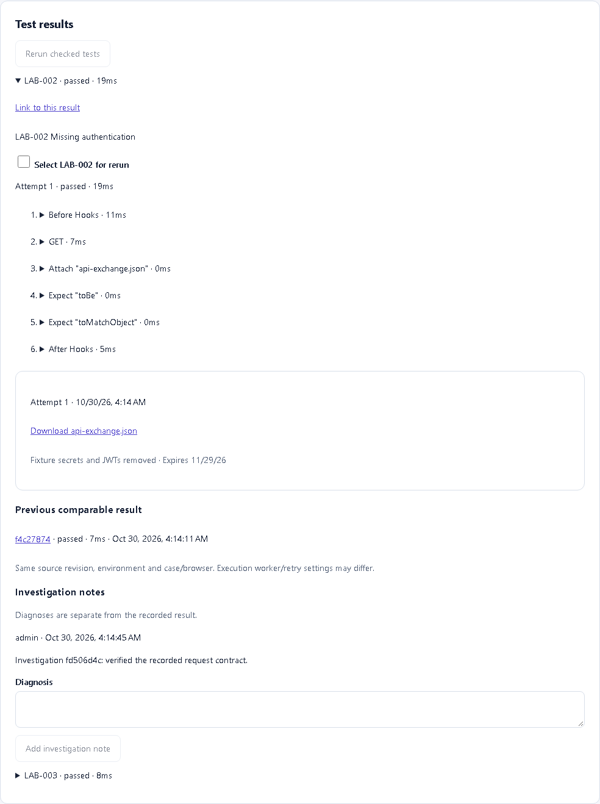
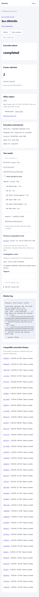

# Result investigation

Expand a result to inspect every recorded attempt and its nested Playwright steps. Errors remain attached to their attempt; a retry pass has an explicit badge. Expected failures are labeled separately. When the assertion contains standard `Expected:` and `Received:` values, they appear beside the original error. Other error formats remain available verbatim after redaction.

Failure categories use versioned rules in this order: cancellation, runner/infrastructure, authentication, timeout, contract/schema, assertion, unknown. These are investigation aids, not asserted root causes. The original event is preserved.

Each result has a shareable URL using the `result` query parameter. The previous-result link matches source revision, environment and case/browser identity; execution concurrency/retry settings may differ and are disclosed. Operators and maintainers can append diagnosis notes with author/time. Viewers can read them. Notes are separately stored and audited; they never rewrite test outcomes. Notes expire with the run's 365-day retention.

