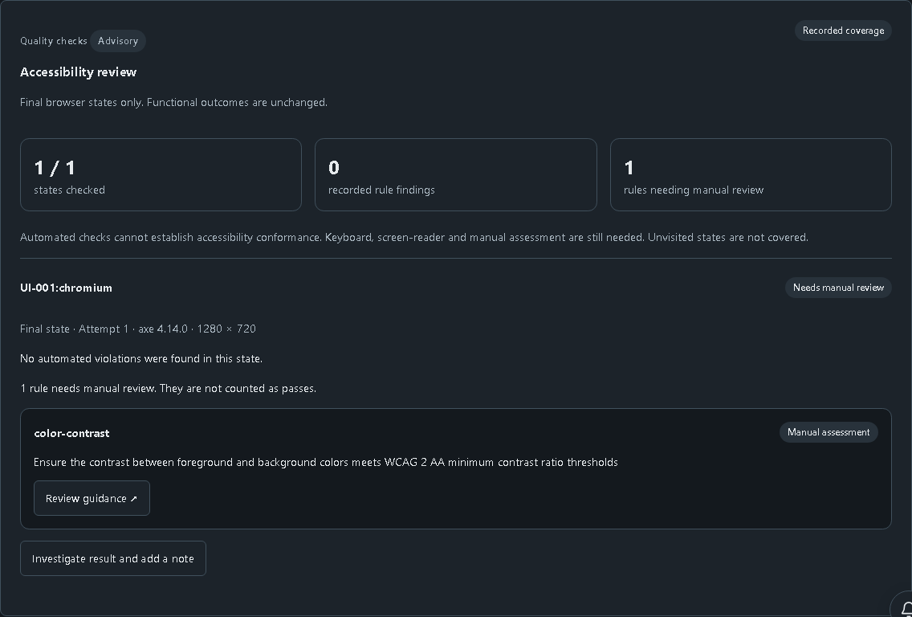
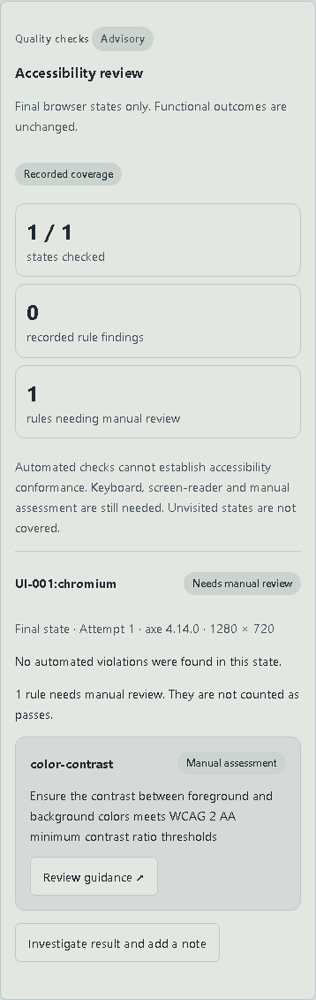

# Accessibility checks on browser runs

This first roadmap slice is implemented locally and remains **Unreleased**. It adds opt-in advisory axe checks to the approved controlled storefront. It does not enable arbitrary destinations, claim accessibility conformance, or implement the complete accessibility roadmap.

## Use

1. In Test explorer, select browser tests and enable **Check accessibility** in Configure execution.
2. Start the execution. The option is frozen with the run configuration; ordinary runs keep it disabled.
3. In Run detail, open **Accessibility review**. Each browser test has one expected checkpoint: its final page state, on its last recorded attempt. Coverage is paginated at ten test/browser instances per page.
4. Review rule findings, impact, affected-node counts and rule guidance. Rules axe could not decide appear separately as requiring manual assessment. Follow **Investigate result and add a note** to use the existing scoped investigation notes.

Functional test outcomes, retry-aware analytics and Allure report readiness remain independent. A scanned page with no automated violations is not a conformance pass. Earlier intermediate states, dialogs already closed and routes not visited are not covered. Keyboard, screen-reader and human assessment remain necessary.

## Evidence, policy and compatibility

- `accessibility: true` is an optional launch field. Omission defaults to false. The server rejects API-only selections with the option enabled; existing operator authorization, environment restrictions and quotas still apply. Reruns preserve the option when browser cases remain, and disable it for an API-only subset.
- The browser fixture scans only final pages on `http://127.0.0.1:4013`. Sensitive tests, closed pages, unapproved destinations and scan failures (including a five-second scan deadline) produce unavailable coverage. Missing, malformed, rejected or duplicate checkpoint evidence is never substituted with an earlier successful retry.
- The fixture records the axe engine version, viewport, rule IDs, descriptions, guidance links and counts. It does not retain DOM, selectors, page text, input values or page URLs in the accessibility payload. Each violation/manual list is capped at 100 rules with explicit truncation; the importer bounds the JSON to 100 KB and validates the schema and HTTPS guidance origin.
- Checkpoints use the existing private artifact importer and current project-membership checks. Raw JSON expires after 30 days. The bounded normalized run summary persists with run outcomes for 365 days. Existing trace/video retention stays at 14 days. No new database table, service or dependency installation is required.
- Roll out matching API/web/worker images before using the new option in isolated deployments. Rebuild the approved automation source snapshot: its digest includes the changed fixture and utility. Keep old images available for their frozen historical runs. Disabling the option restores ordinary functional execution; existing run data need not be migrated or rewritten.

## Verification and limits

The focused browser journey launches an owned UI-001 run, observes an unchanged functional pass, reloads the page and verifies retained final-state coverage. API tests cover imported checkpoint validation, unsafe links, missing retry evidence, duplicate scans, unavailable artifacts, operator permissions and API-only rejection. The web component test distinguishes findings, manual review and missing evidence. Actual dark/light desktop/mobile captures and four axe/reflow checks cover the review surface.

Local quick verification, architecture/reporting checks and five focused browser journeys (new coverage plus existing execution behavior) passed with this change. Linux OCI/Kubernetes execution is wired through the strict worker input but has not been executed locally; its infrastructure checks remain required before release. Existing upstream build warnings are not suppressed.

Still to build: named intermediate state inventories, cross-run finding identity/deduplication, assignment, approved baselines, expiring exceptions and manual-audit records. Lighthouse and bounded protocol load testing remain later roadmap phases. No external traffic testing is enabled by this slice.

Actual controlled browser run; automated findings and manual-assessment needs are separate.

The same recorded state stacks at mobile width without page overflow.
