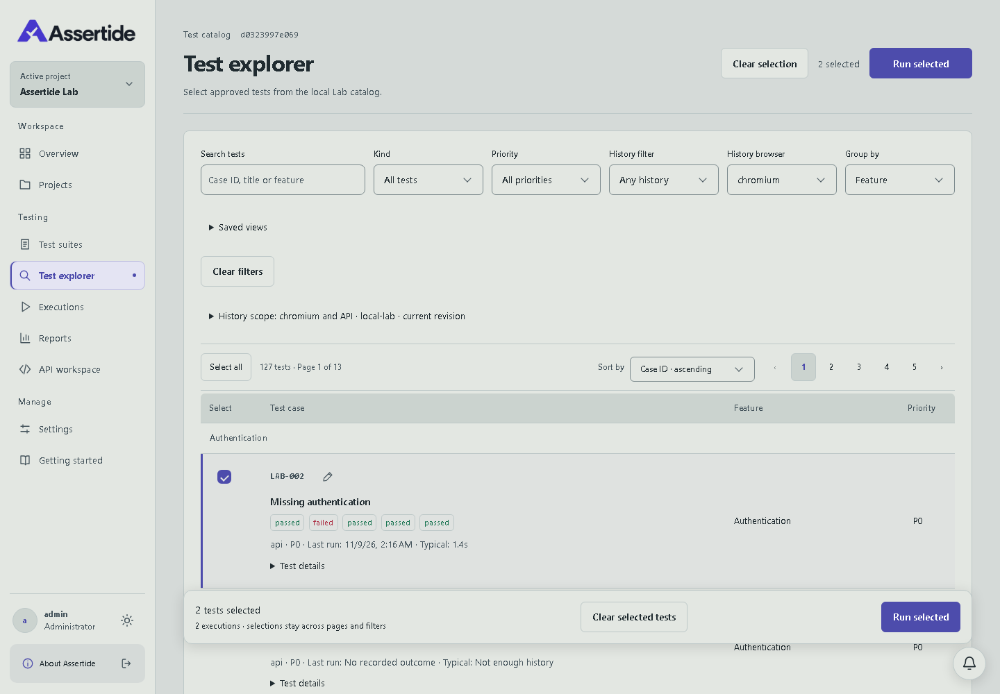
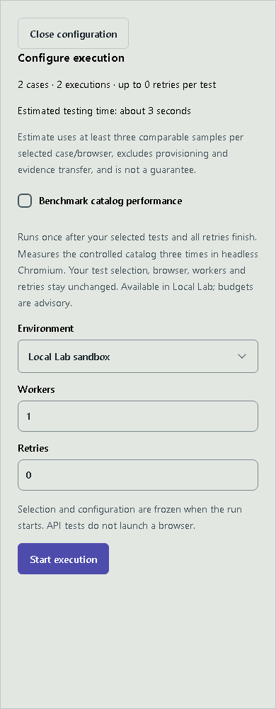
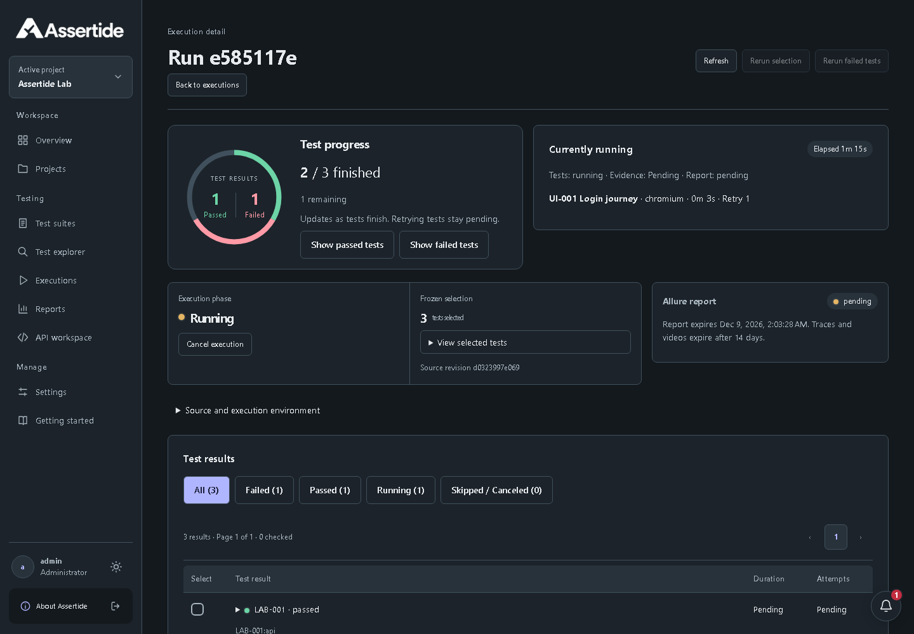
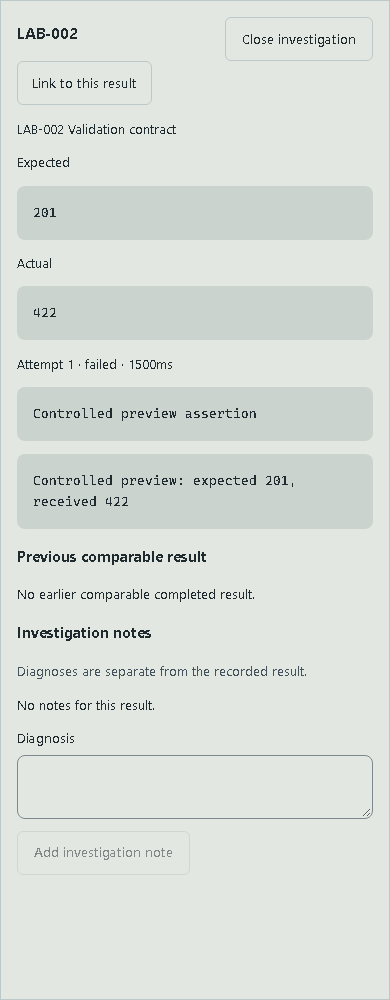

# Test explorer and run investigation

## Explorer

Search, type, priority and history filters narrow the catalog without clearing selected cases. Group by feature, type or suite; tests belonging to several suites appear under the first matching suite alphabetically. Selection remains across pagination, filtering and grouping. The sticky selection bar opens a separate execution configuration panel, where environment, browsers, workers, retries, accessibility and the optional catalog benchmark are reviewed before launch.

Recent outcomes show the last five recorded results per case/browser for the active project, current source revision and selected environment. API cases have no browser. “Never run” means no recorded result within this scope, not no execution anywhere in the product. “Recently failed” means at least one of those five outcomes failed in the last seven days. Loading and unavailable history are distinct from an empty history.

Typical duration is the median of at least three positive measured outcomes; missing and zero durations are excluded. The launch estimate additionally matches retry policy for every selected case/browser. It approximates parallel testing time using the configured worker count and the longest individual test. It excludes startup, evidence transfer and report generation. Missing samples show “Not enough history”; estimates are not guarantees.

Named views store search, type, priority, ordering, history scope, grouping, browser and environment in this browser's local storage, scoped to account and project. They do not save test selections or credentials, and do not synchronize between devices. Save with the same name to replace a view; Delete named view removes it. Test selections retain their existing tab/session scope.

## Run detail

The summary shows the progress ring, active test names, browser, attempt/retry and elapsed time. Active tests come from worker start/end events; they are not inferred from the selected list. Intermediate failed retry attempts stay pending. Test execution, evidence finalization and report generation have separate status text.

Select a ring segment or its keyboard-accessible Passed/Failed button to filter results. All, Failed, Passed, Running and Skipped/Canceled filters show counts and preserve rerun selection. Live outcomes have pending timing/attempt details until final results arrive. The first confirmed failure adds one notification per run per browser session; reconnects and reloads do not repeat it when session storage is available.

Opening a result shows a right-side investigation panel, expanded to full width on mobile. It includes assertions, attempt errors and steps, private screenshots/traces, API request/response inspection, downloads and notes. The result URL can be shared with authorized project members. Closing the panel returns keyboard focus to the result. Source/toolchain and worker log details are collapsed by default.

Comparison uses the most recent earlier completed run with the same project, revision, environment, selection, browser list, workers and retry policy. It identifies new failures, recoveries and duration changes of at least 20% and one second. It waits for finalized outcomes and reports missing history explicitly. Comparison is descriptive, not a diagnosis of the cause of a regression.

## Correctness fixes and API compatibility

The API workspace refreshes a selected active execution every three seconds and also provides Refresh execution. Refreshing preserves the inspected exchange. Responses for an old selection are ignored. Polling stops when the selected execution reaches a terminal state; explicit refresh remains available.

Suite listing now supports `limit` (1–200, default 200) and a UUID `cursor`, and returns `nextCursor`. For example, request `/v1/projects/{project}/suites?limit=200`, then request subsequent pages with the returned cursor until `nextCursor` is null. The web application aggregates all pages for suite lists and pickers. Clients that previously consumed only the first 200 entries should follow `nextCursor` for complete results.

History and comparison endpoints enforce the same server-side organization/project authorization as runs. No database migration, new service or credential is required. Deploy matching service, worker and web images. Older runs retain their results; active-test details are available only for workers emitting the new activity events. Rollback uses the previous matching image set; stored results remain compatible. Browser-local saved views may be removed through the UI or browser storage settings.

## Verification and visual evidence

Local verification on 2026-11-09 passed lint, formatting, type checks, the production build, 53 API checks, 33 web unit checks and the domain/deployment checks. Ten infrastructure-dependent API checks were skipped locally and require Linux CI. All 251 controlled regression tests passed across API, Chromium, Firefox and WebKit. The 76 acceptance scenarios passed across the full run and a focused rerun: two older scenarios were updated to explicitly close the new panel/open collapsed environment details, and all ten affected history/accessibility/workflow scenarios passed on rerun. Automated accessibility checks covered light/dark desktop, tablet and mobile; architecture and reporting checks passed. The existing access-entry CSS size warning remains unrelated to this release.

Focused browser checks cover saved views and selection across reloads, launch-panel mobile layout and focus restoration, history after real controlled executions, previous-run comparison, private API evidence, investigation focus restoration and automatic finalization refresh. Unit/API checks cover retry activity, cursor completeness beyond 200 suites, authorization boundaries, history ordering, expected failures, late responses, comparison and notification deduplication.

The screenshots below are from the actual running application with controlled response fixtures for outcome/history data. They illustrate states, not production test results. Previous released progress visuals remain in the [0.8.0 changelog](../CHANGELOG.md#080--2026-11-09).

## Publication — 0.9.0 — 2026-11-09

Published to main and deployed to [assertide.com](https://assertide.com) from commit `e0a3d49b9a892b49656773c3230c4c10de954d1b`. Version 0.9.0 is a compatible feature release after 0.8.0. No database or configuration migration is required.

[Image publication 42539814771](https://github.com/orKonijn/Assertide/actions/runs/42539814771) passed. The service, web and worker provenance was independently verified against the exact source commit and the hosted publication workflow before deployment. All four application deployments became ready after an idle-work guard and matching-image rollout.

| Image   | Deployed digest                                                           |
| ------- | ------------------------------------------------------------------------- |
| Service | `sha256:3776d807394706cb915960ee8e57eeb5cf793601d05729fa48f8c9ab70d4bf14` |
| Web     | `sha256:fb57d49755063a67f1e0687618a9a57f4d8909201be6c9a1d8b027d2423f02c5` |
| Worker  | `sha256:bb9ea9834dd3773d5ef7d0e50217ed09c76b6bfe36a129f517ddf6fb07fc0bcb` |

Live verification used a dedicated controlled project and temporary identity. Saved views, grouping and selection survived reload. A reviewed API/Chromium/Firefox launch passed all three executions, displayed real worker activity and exposed private API exchanges through the investigation panel. A second compatible execution selected the first as its comparison predecessor.

The live 65-case API suite passed all cases and retained all 559 attachments without unavailable evidence. Progress updated on desktop and mobile; all results appeared during finalization. From launch, results were observed at about 37 seconds, evidence completion at about 154 seconds and the report ready at about 492 seconds. These are observations from one controlled pilot run, not performance guarantees. The API workspace followed completion automatically and preserved the inspected exchange through manual refresh. Private evidence denied anonymous access; the Allure report opened on the private report origin. The About page showed 0.9.0 and logout revoked application access. The temporary identity was disabled, sessions revoked, project access removed and its local credential file deleted afterward.

The local checks and screenshots described above remain the implementation evidence. [Full Linux verification 42539791452](https://github.com/orKonijn/Assertide/actions/runs/42539791452) was still running browser acceptance at publication after completing controlled regression. Its later infrastructure checks were not yet complete; image publication and live smoke checks do not establish a full Linux CI pass.
