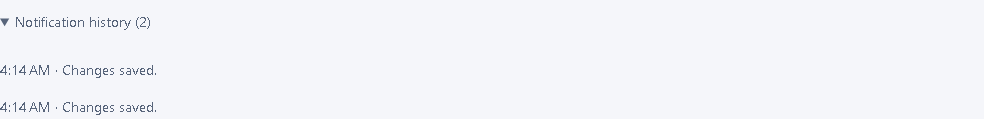

# Shared interactions

Successful saves and execution actions show a polite notification for five seconds. The last 50 messages remain in the session's notification history and clear on logout. Messages contain no response bodies or credentials. Inline validation and failure messages remain with the relevant form; HTTP errors include a generated request reference for support.

The history keeps the two verified saves after their transient notifications disappear.

Overview, history and explorer show loading text immediately, then structural placeholders after 200 ms. History retains its table during refresh so active keyboard focus survives. Run, phase, selection count and creation date can be sorted with the column buttons; `aria-sort` identifies order. Sorting covers loaded rows, and loading older executions adds them to that sort. Router back navigation restores scroll position.

Browser checks exercise notification expiry/history and keyboard sorting with retained focus. Unit checks verify the exact five-second timeout and bounded history. Request-correlation tests verify caller-provided IDs are replaced and logs exclude request paths, authorization and bodies.
