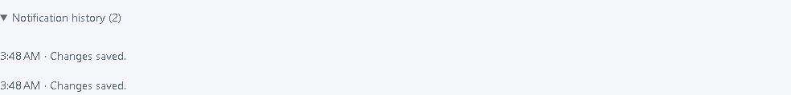

# Shared interactions

Successful saves and execution actions show a polite notification for five seconds. The last 50 messages remain in the session's notification history and clear on logout. Messages contain no response bodies or credentials. Inline validation and failure messages remain with the relevant form; HTTP errors include a generated request reference for support.

The history keeps the two verified saves after their transient notifications disappear.

Overview, history and explorer show loading text immediately, then structural placeholders after 200 ms. History retains its table during refresh so active keyboard focus survives. Run, phase, selection count and creation date can be sorted with the column buttons; `aria-sort` identifies order. Sorting covers loaded rows, and loading older executions adds them to that sort. Router back navigation restores scroll position.

Browser checks exercise notification expiry/history and keyboard sorting with retained focus. Unit checks verify the exact five-second timeout and bounded history. Request-correlation tests verify caller-provided IDs are replaced and logs exclude request paths, authorization and bodies.

## Explorer selection recovery

Selected test IDs survive refresh and navigation in the same browser tab. Drafts are scoped to the project, account and sign-in session, with at most 20 project drafts stored in session storage. A restored selection shows a notice and can be removed with **Clear selection**. Successful execution creation and logout clear the relevant selection data. Execution settings are not restored; review them before starting a run.

A changed catalog revision discards the saved selection. Missing or disabled tests are removed when the catalog loads. Storage failures leave selection usable in memory and show a notice. This is a local browser convenience; the server still validates authorization and execution input. No database migration is required.

## Local review corrections

The mobile sort field now occupies a full toolbar row. Project and date controls include their displayed values in accessible names. Overview labels current activity and latest completed executions as independent of the history filters; historical metric calculations are unchanged.

Actual running captures at 390px: [before](changelog/assets/unreleased/review-sort-before-light.png), [after in light mode](changelog/assets/unreleased/review-sort-after-light.png), [after in dark mode](changelog/assets/unreleased/review-sort-after-dark.png). The [Overview capture](changelog/assets/unreleased/review-overview-scope.png) shows the explicit scope with an empty historical interval.
