# Workspace visual refresh

The workspace uses a consistent indigo accent, navigation icons, clearer headings, softly elevated cards, and a more prominent metric row. History filters expand on demand, preserving all existing filtering, saved-filter, and export controls. Sign-in uses a contained card, and mobile actions expand to a comfortable width.

Motion includes short header and metric entrances, hover/press feedback, a mobile drawer entrance, toast/dialog entrances, and pulsing loading placeholders. The operating system's reduced-motion preference disables animations and transitions, including pseudo-elements.

## Actual application captures

These captures use the running local application and its existing Lab data, with matching viewport sizes and themes before and after the changes. They are not generated mockups.

### Desktop, 1440 × 1000

Before: the full filter form occupies the top of the overview.

After: expandable filters make room for headline metrics, with consistent surfaces and navigation icons.

### Mobile, 390 × 844

Before: filters dominate the initial mobile view.

After: the primary action, filter disclosure, and metric cards fit the viewport.

### Dark theme and sign-in

Dark mode preserves readable text and the white logo treatment.

Sign-in uses a focused card and full-width action.

## Dialog and card polish

Dialogs fade and move slightly as they close, including the backdrop. Native top-layer/display transitions retain the closing surface for 160ms; reduced-motion preferences dismiss it immediately. The mobile drawer now has a small close icon with a 44px hit target and the accessible name “Close menu.” Project actions use a single row with a short visible Edit label and a project-specific accessible name. Catalog status badges and edit buttons have an explicit wrapping gap.

The Workspace heading and close icon replace the full-width close button.

Open project remains prominent, with Edit alongside it.

The disabled status remains distinct from the edit button on a narrow screen.

Closing transition captured from the actual running dialog: [open](changelog/assets/unreleased/detail-polish-popup-open.png), [mid-close](changelog/assets/unreleased/detail-polish-popup-closing.png), [closed](changelog/assets/unreleased/detail-polish-popup-closed.png). The browser animation was paused at its midpoint for the middle capture, then completed. Browser inspection confirmed an active exit transition and immediate reduced-motion dismissal. Seven browser tests, including the 64-state accessibility matrix, passed along with production build and lint. No product version was assigned.

## Dropdowns and scrollbars

Regular select controls now use rounded anchored menus with themed selected options and arrows inset from the right edge. They retain native select semantics, Angular form values, keyboard selection, and Escape dismissal. The project-switch dialog remains searchable, and clicking or tapping its backdrop closes it and returns focus; starting a drag inside the dialog does not dismiss it.

Scrollbars use a slim thumb and transparent track, with light/dark tokens and a forced-colors fallback. The enhanced menus use [the browser's customizable select API](https://developer.chrome.com/blog/a-customizable-select); browsers without support keep the native option menu and receive the restyled closed control and inset arrow.

The menu stays anchored to its field, with rounded options and the current selection highlighted.

The browser places the menu above the field when that gives it more room. This is not a modal dialog.

The navigation uses a narrow themed scrollbar, preserving room for its content. Original user-supplied evidence: [dropdown](changelog/assets/unreleased/controls-dropdown-reported.png), [scrollbar](changelog/assets/unreleased/controls-scrollbar-reported.png). Those crops are not pixel-matched to the new captures.

Validation: production build, lint, automation type checks, architecture/reporting checks, six browser tests including all 64 accessibility states, and direct option selection/Escape checks in light/dark at 390px and 1280px. Desktop and mobile tests cover backdrop dismissal, inside padding, drag-out protection, and restored focus. Changes remain Unreleased without a version increment.

## Site-wide review

Reviewed overview, projects, suites, test explorer, execution history, reports, API workspace, and settings at 320, 768, and 1440 CSS pixels in light and dark themes. The browser acceptance suite additionally exercises run details, live monitoring, reruns, screenshot dialogs, JSON evidence, report access, credentials, and keyboard navigation. Its accessibility matrix covers 64 states at 390/768/1440px.

Completed corrections:

- Suite, member-edit, and rerun actions use wrapping groups with explicit spacing.
- Member tables become labeled cards on mobile, keeping edit buttons on-screen.
- Membership checklists have bounded scrolling, spaced checkboxes, and wrapping names.
- Split layouts no longer stretch editors to match long lists. The suite form appears first on mobile.
- Long names and evidence content stay within cards; dialogs fit short screens.
- Chart tooltips use the active theme and remain inside chart bounds; data tables have keyboard-accessible scrolling regions.

The desktop editor remains at its natural height beside the suite list. [Original full-page capture](changelog/assets/unreleased/site-audit-suites-before.png) records the previous stretched panel; the after image focuses on the first viewport.

The form is reachable before the suite list and checkbox labels wrap within the panel.

Member cards keep all fields and actions within the phone viewport. [Original settings capture at 320px](changelog/assets/unreleased/site-audit-settings-before.png) records the horizontally scrolling table; this focused after capture is 390px, so it is not a pixel-matched comparison.

The tooltip has a dark surface, readable labels, and stays inside the chart.

Verification: all 27 browser acceptance tests passed, including 64 accessibility states; the additional 48-route/theme/viewport scan found no overflowing controls. `npm run verify:quick`, architecture checks, and reporting/redaction checks passed. Eight infrastructure-dependent API checks are skipped locally and remain Linux CI gates. An initial concurrent verification attempt failed catalog initialization; the isolated discovery test and full subsequent verification passed. No product release version is assigned; GitHub source publication is distinct from deployment or a numbered release.

### Earlier refresh verification

Production build, lint, analytics filter/export and execution-history browser tests passed. Automated accessibility scans passed for the application's light/dark desktop/mobile states; keyboard skip-link, menu focus containment, Escape/focus restoration, and reduced-motion checks passed. Entrance animations keep text fully opaque to preserve contrast throughout the transition. Browser checks also verified all eight primary routes at 390px without horizontal overflow and animation suppression under reduced motion. No product version is assigned or published by this update.

## Layout corrections

### Searchable project picker

The active-project control opens a searchable dialog with wrapped names, current-project highlighting, alphabetical results, and a bounded scrolling area. Escape closes the picker and returns focus to its trigger while keeping the mobile navigation open. Selecting another project preserves the existing project-switch behavior.

Actual application capture at 390px. Search, empty results, project switching and persistence, mobile focus restoration, and dark-mode accessibility checks pass. Build and lint pass. No comparable automated before-state image was captured for this change.

Follow-up fixes reduce the logo size, add a 12px gap between wrapping project actions, and align service-health headings with their refresh action. Mobile navigation uses the same 72px offset as its header, omits the duplicate logo, and locks background scrolling while open.

Project actions retain spacing when they wrap onto separate lines.

The heading and action are vertically centered and wrap with a defined gap on narrow screens.

The drawer clears the header even when opened after scrolling. These are actual post-fix captures; the attempted automated before-state capture failed at sign-in, so no comparable before images are claimed.

Build, lint, and browser checks passed. Projects and settings fit 320, 390, 768, and 1280px viewports without horizontal overflow.

## Mobile navigation and sign-in alignment

A dimmed backdrop now dismisses the mobile drawer when clicked. The drawer slides left and the backdrop fades over 180ms when closing through the backdrop, close icon, menu toggle, Escape, or a navigation link. Focus returns to the menu trigger. Reduced-motion preferences remove the transitions.

The sign-in card keeps equal automatic side margins at desktop, tablet, and phone sizes, including widths reached by browser zoom. Previously, the mobile margin override left-aligned the card whenever the available width was larger than its maximum width.

The card remains centered at the mobile breakpoint instead of attaching to the left side.

Actual browser closing sequence: [open](changelog/assets/unreleased/navigation-login-drawer-open.png), [mid-close](changelog/assets/unreleased/navigation-login-drawer-closing.png), [closed](changelog/assets/unreleased/navigation-login-drawer-closed.png). The middle capture pauses the real transition at 90ms for inspection.

Verification: production build, lint, automation type checks, test architecture/reporting checks, and five browser tests passed, including 64 accessibility states. Browser measurements confirm equal sign-in margins at 320, 390, 840, and 1280px. The mobile test checks real outside clicks, restored focus, and an active exit animation before the drawer hides. Changes remain Unreleased; no version increment or deployment is claimed.

## Execution-history sort headings

Replaced oversized outlined header buttons with compact, borderless sorting controls. A muted bidirectional arrow marks sortable columns, and the active column uses an accent-colored arrow showing ascending or descending order. Native buttons, keyboard focus, 44px touch targets, and `aria-sort` remain intact.

At typical mobile widths the four headings fit in one row. At widths of 380px or less they form a two-column grid to avoid cramped labels or horizontal scrolling.

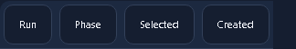

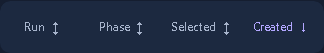

These focused captures use the same 390px viewport and dark theme.

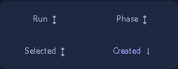

Narrow phones keep full labels and touch targets in two rows. Light and dark desktop/mobile screenshots were captured at 320, 390, and 1280px; none had page overflow.

Verification: production build, lint, four browser tests (including the 64-state accessibility matrix and keyboard sorting), and the six viewport/theme checks passed. Changes remain Unreleased; no version increment.

## Compact test and report cards

Test cards group the identifier and priority together, with a smaller source line and a concise Edit action. The accessible edit name still includes the test identifier. Report cards keep the execution link and report action together, with status and expiry beneath; links use the workspace colors and the report action has a clear external-link indicator. Routes, report authorization, and retention behavior are unchanged.

The mobile header now places a labeled sun/moon icon beside Menu. Desktop navigation retains an icon theme control next to Sign out. The header fits at 320px and theme changes persist as before.

Actual running application, dark theme at 768px, before and after:

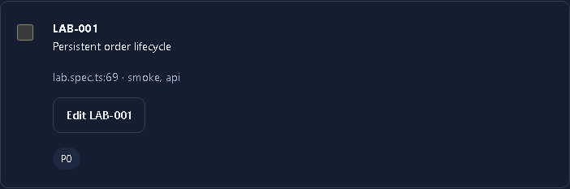
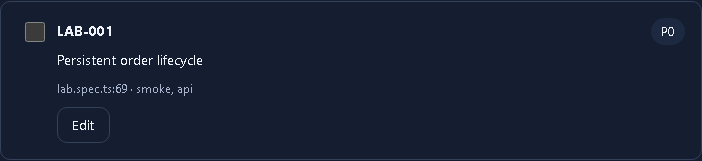

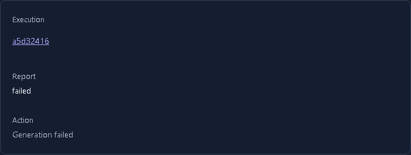
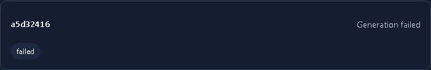

Actual 320px mobile report views show the theme icon, ready report action, and expiry in both themes:

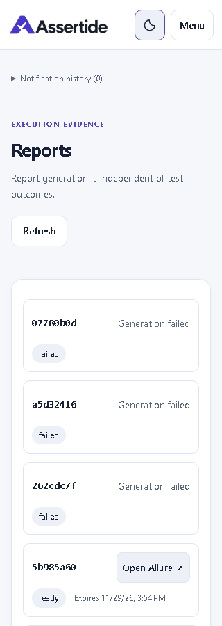
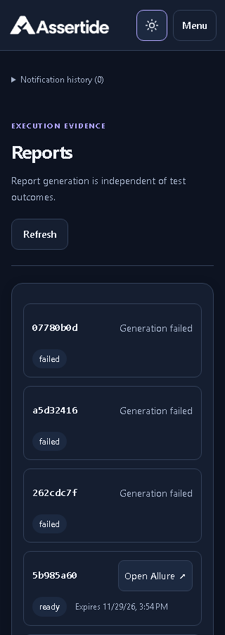

Verification: six browser tests pass, including the 64-state accessibility matrix, catalog editing, project selection, and drawer dismissal/animation. Both routes have no document overflow at 320/390/768/1280px in light and dark themes; the icon switches themes correctly at 320px.

`npm run verify:quick` passes (lint, type checks, local API tests, seven web unit tests, and production build). Eight infrastructure tests remain skipped on Windows. The initial run overlapped browser setup and failed catalog initialization in two API tests; a separate full rerun passed. No release version is assigned; this remains an Unreleased development change.

## Report toolbar and notification bell

Report headings now span a full-width toolbar with a labeled refresh icon beside Action. Refresh is disabled while loading and clears stale errors before retrying. Table headers remain available to assistive technology.

Actual running dark interface at 768px, before and after (sample execution history can grow between captures):

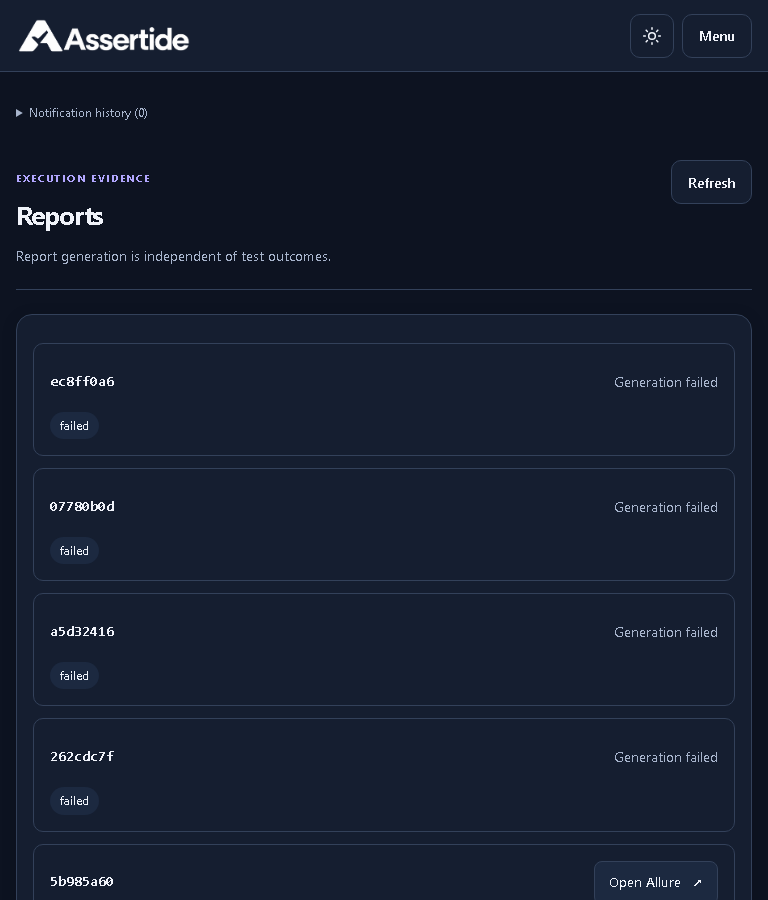
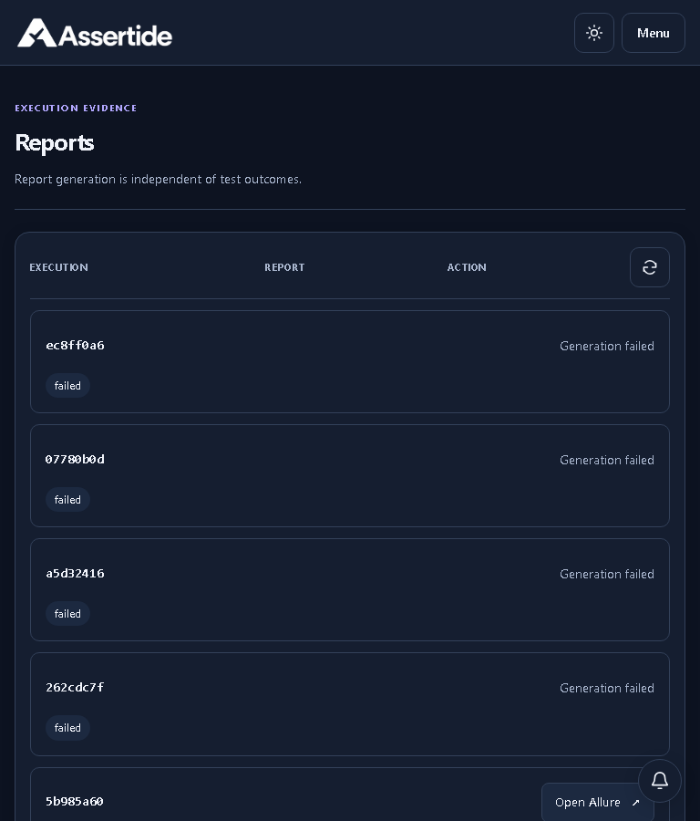
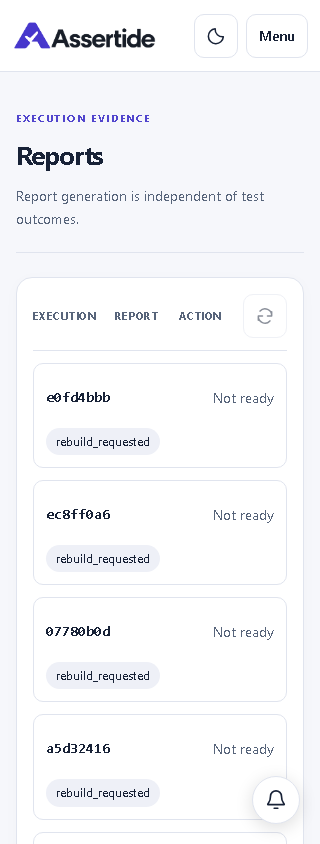

The bell opens session history in an anchored panel. Its red badge counts unread entries in the retained history (up to 50); opening clears the count without deleting history. Entries arriving while open are read, and later entries restore the badge. The panel closes using its close icon, Escape, or an outside click. Visual toasts no longer interrupt the page; polite screen-reader announcements remain. Logging out clears session history.

Actual 390px captures after saving a sample project:

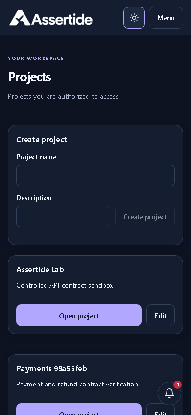

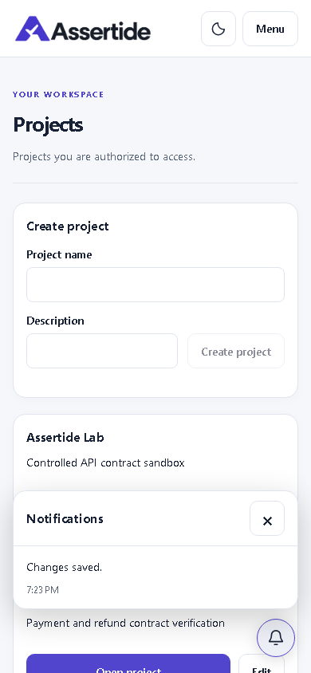

Verification: `npm run verify:quick` passed, including eight web unit tests; eight infrastructure checks are skipped on Windows. Six browser tests passed, covering the 64-state light/dark accessibility matrix, notification unread/history behavior, outside/Escape dismissal, and mobile navigation. Open notification panels also passed automated accessibility scans in both themes. Report refresh and overflow checks passed at 320/390/768/1280px. Page Object architecture and reporting/redaction checks passed. No product version is assigned; these are Unreleased development changes.

## Execution summaries, filters, and button links

Execution summaries use compact status text and independent card heights. Frozen selections keep the count visible and put the complete test identifiers in a keyboard-accessible disclosure with bounded scrolling. Report actions wrap as buttons without changing their destinations or download behavior.

Actual running dark interface at 1280px, before and after:

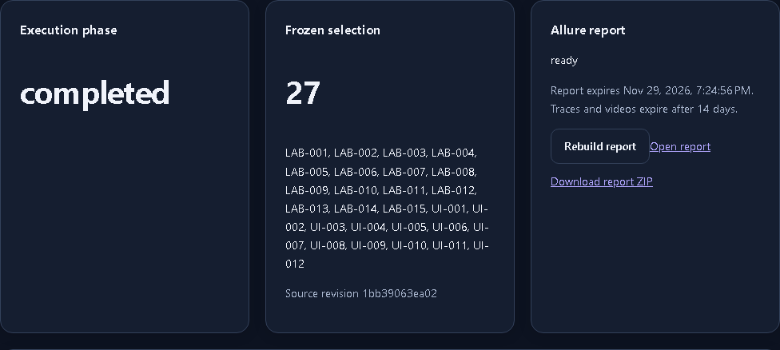
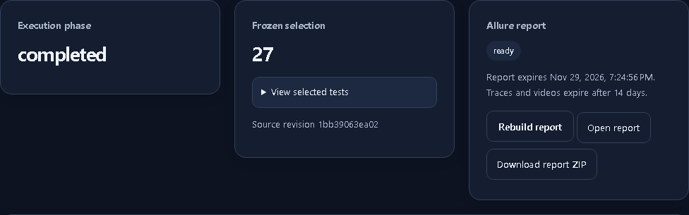

Filters now use a responsive grid with equal-height fields and a separate action row. Suite names stay on one line in the closed selector; the option menu retains the full text.

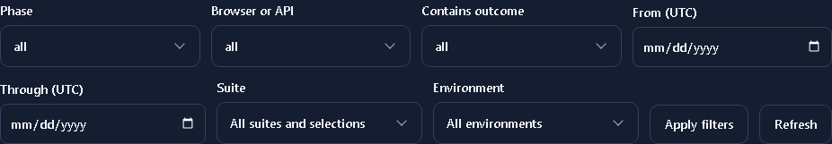
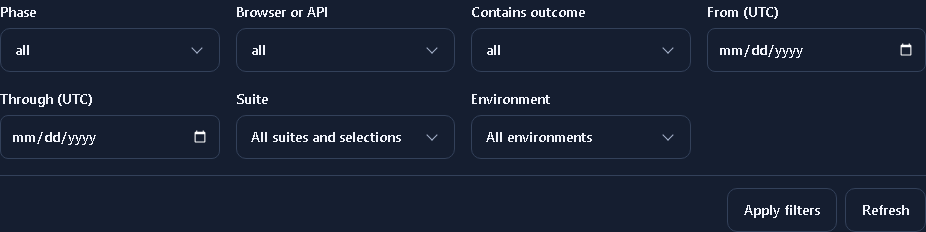

Content links throughout the application now use bordered button surfaces, hover feedback, and visible keyboard focus. They remain semantic links so opening new tabs, copying destinations, and downloading evidence work normally. Primary actions, navigation items, and logo links keep their established presentation.

Actual 390px mobile views:

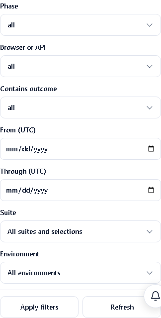
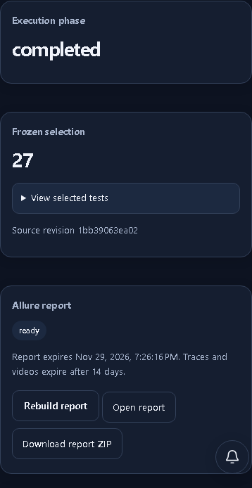

Verification: local lint, type checks, API tests, eight web unit tests, and production build pass; eight infrastructure tests remain skipped on Windows. Layout and link-style checks on overview, history, reports, explorer, and run details pass at 320/390/768/1280px in both themes, including opening the frozen selection. These are Unreleased development changes with no assigned product version.

Twelve browser tests passed, including the 64-state accessibility matrix, filter/sort behavior, cancellation, execution, mobile evidence viewing, reruns, authenticated report downloads, and report-history/investigation workflows.

## Notification panel refinement

The activity panel uses a compact title and session subtitle, a quiet icon-only close control with a 44px target, and notification rows with a small confirmation icon and timestamp. The bell has a subtle active state while the panel is open. Opening and closing use a short slide/fade; reduced-motion preferences disable transitions. Unread counting, keyboard focus, outside-click dismissal, and session history behavior are preserved.

Actual running interface at 390px after saving a sample project:

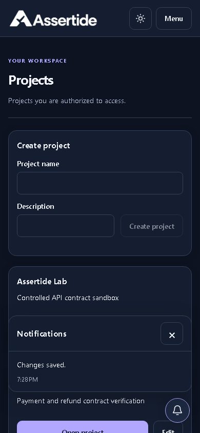
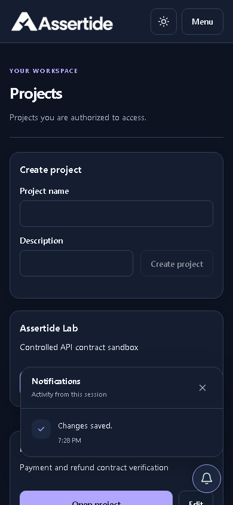
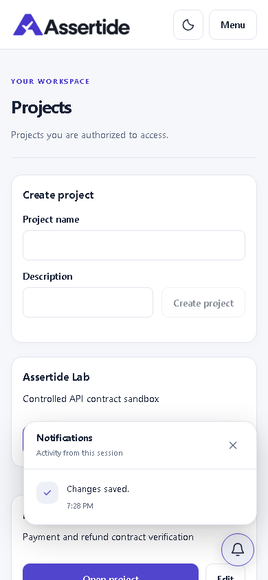

Local verification passes, including lint, type checks, API tests, eight web unit tests, and production build. Eight infrastructure checks remain skipped on Windows. Open-panel accessibility scans pass in light and dark mode. No product version is assigned; this remains an Unreleased UI refinement.

Three browser tests passed, including 64 accessibility states and notification unread/history dismissal behavior. The first attempt was interrupted by the local server becoming unavailable; the rerun passed once the server was available.

## Balanced execution summary

Execution phase and frozen selection now share an aligned two-column row. The Allure report spans the full width below them, with its status beside the heading and actions grouped in a wrapping row. Phones use a single column. This replaces the uneven three-column layout where report buttons made one card much taller than its neighbors.

Actual running dark interface at 1280px (sample execution data can change between captures):

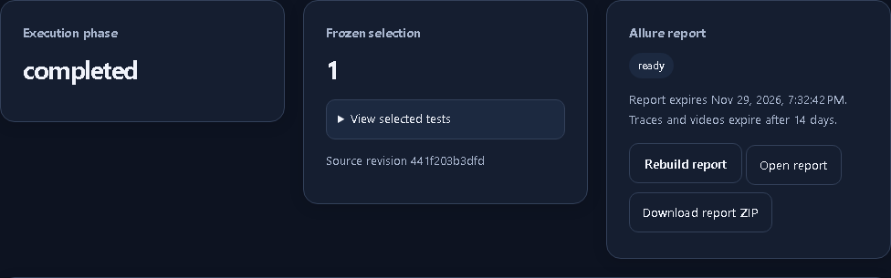
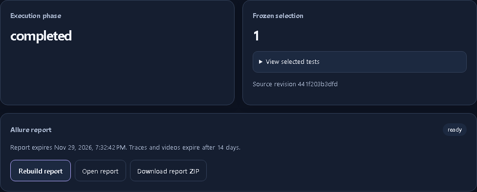

Actual 390px mobile layouts:

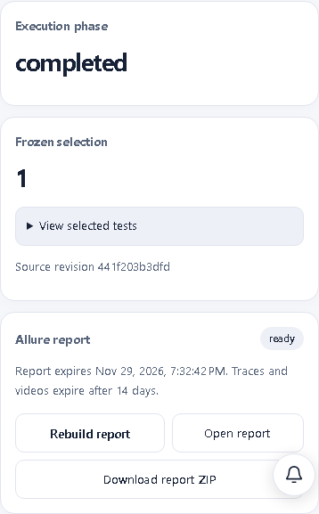
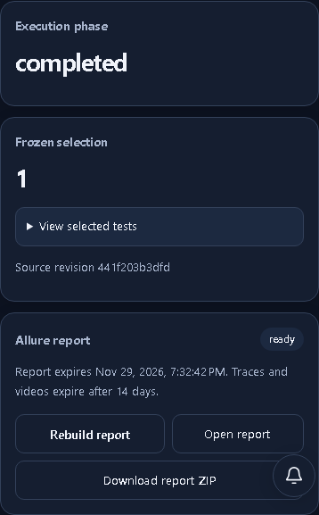

Layout and selection-expansion checks pass at 320/390/768/1280px in both themes. No product version is assigned; this is an Unreleased layout correction.

Local verification passes (lint, type checks, API tests, eight web unit tests, production build; eight Windows infrastructure skips). Six browser tests passed, including 64 accessibility states, execution, mobile evidence viewing, reruns, and evidence downloads.

## Explorer pagination and launch controls

The Test explorer header includes a Start execution button using the same selection, configuration, permissions, and busy state as the existing configuration action. The catalog shows ten tests per page with numbered navigation and previous/next controls. Search or filter changes return to page one; selections survive paging. Select all adds every enabled test matching the current filters across all pages, preserving earlier selections. Disabled tests remain unavailable.

Checkboxes use themed rounded borders, a clear checkmark, disabled styling, and visible keyboard focus. Native controls are retained for forced-colors mode.

Actual running application screenshots:

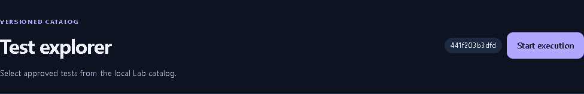
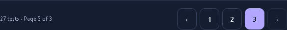
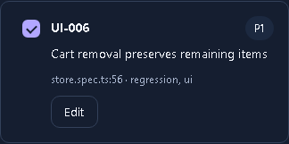
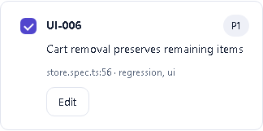

Local verification and Page Object architecture/reporting checks pass. The UI remains within the 390px mobile viewport in both themes. No product version is assigned; this is an Unreleased development change.

Nine browser tests passed, including pagination/selection persistence, launching from the header, catalog editing, login, execution/evidence workflows, and 64 accessibility states. Eight infrastructure checks remain skipped on Windows.

## Explorer selection toggle and visible pagination

Select all becomes Deselect all when every enabled test matching the current filters is selected. Deselecting removes those matching tests and preserves selections outside the filter. The selected count appears immediately beside the header launch action. Pagination is now above the catalog, avoiding the need to scroll past ten cards to find it.

Actual running application captures:

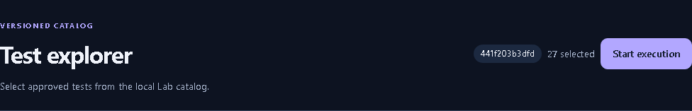
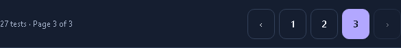

Verification: four browser tests passed, including select/deselect across pages and 64 accessibility states. Local lint, formatting, type checks, API and web unit tests, and production build pass; eight infrastructure checks are skipped on Windows. Page Object architecture and reporting checks pass. This is an Unreleased development change with no assigned product version.

## Explorer toolbar redesign

The explorer separates page identity from catalog controls. The revision is secondary text beside the catalog label, while the selected count sits beside a compact, fixed-content-width Start execution button. Search receives more width; Kind and Priority align in a consistent grid. Select/Deselect all now sits with the result count, and quieter numbered pagination shares that row. On phones search spans the row, filters sit side by side, and pagination wraps without horizontal overflow.

Actual running interface:

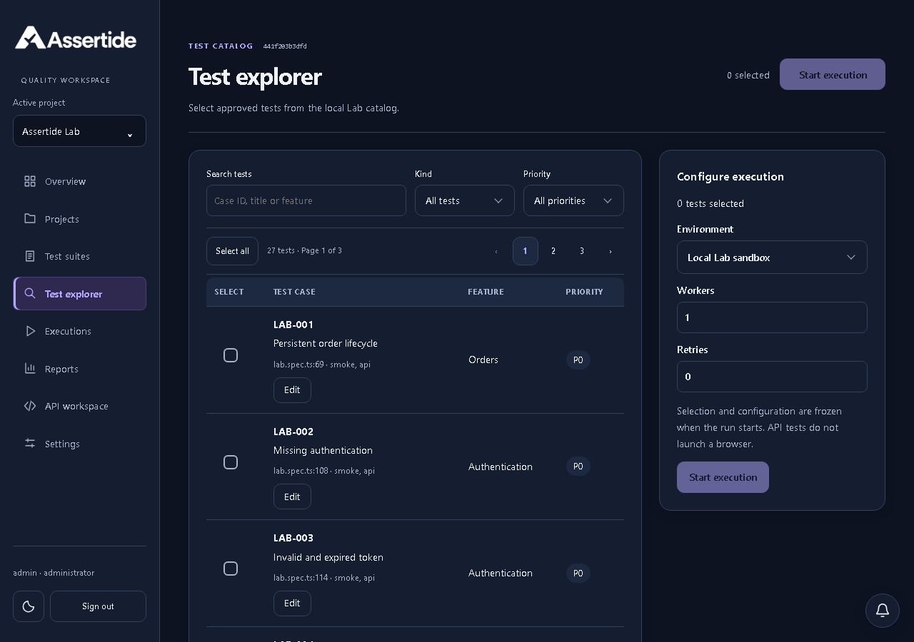
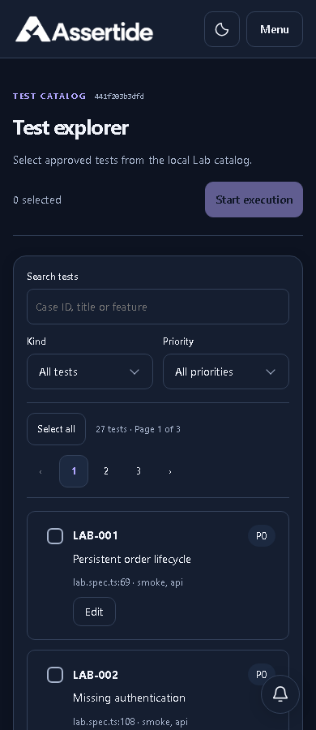
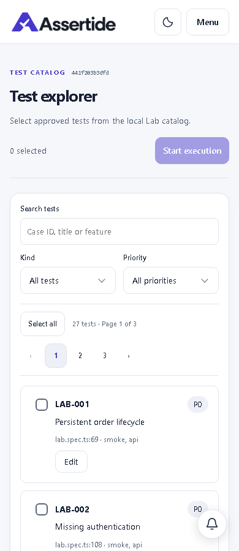

The previous header and pagination are preserved in [selection-control captures](#explorer-selection-toggle-and-visible-pagination). Layout checks pass at 320/390/768/1280px in light and dark themes. Local lint, format, type checks, API/web unit tests, and production build pass; eight infrastructure checks remain skipped on Windows. No product version is assigned; this remains Unreleased.

Four browser tests passed, including the 64-state accessibility matrix, catalog editing, pagination, and select/deselect behavior.

## Sticky execution configuration

Above 850px, Configure execution sticks 24px from the viewport top while its catalog column scrolls. The panel is bounded by the available viewport height and scrolls internally when browser/video settings make it taller. On mobile it stays in document flow to avoid covering the catalog.

Actual desktop view after scrolling the catalog:

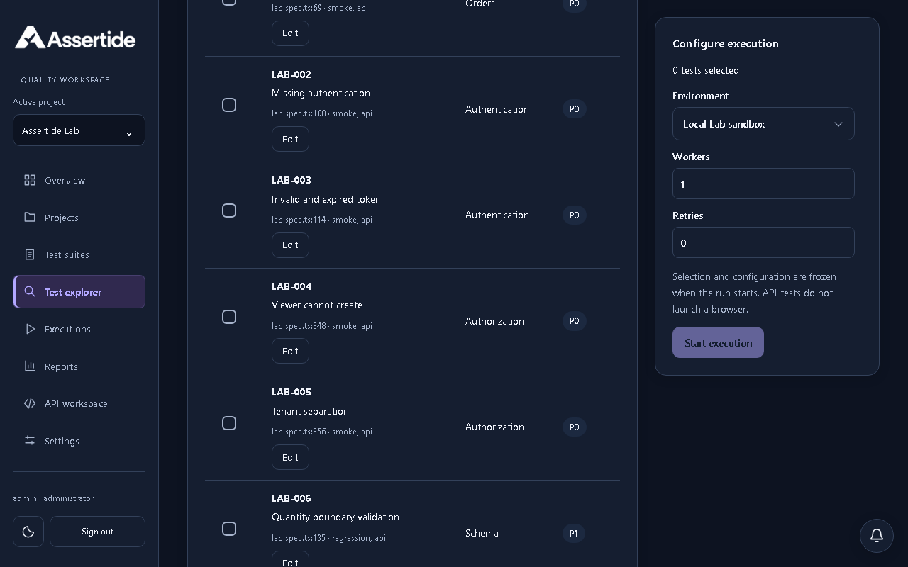
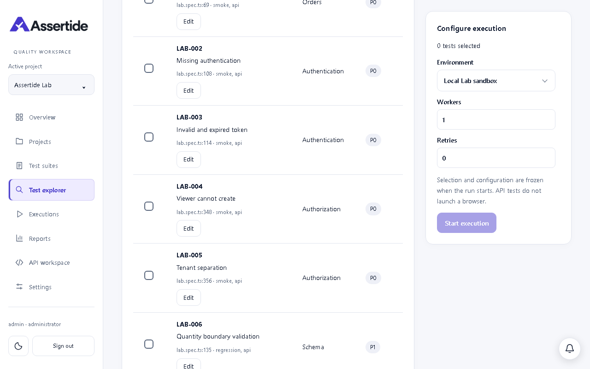

Verification: browser checks confirm the pinned position in both themes, reachability of the launch action at 500px viewport height, and normal mobile flow without overflow at 320/390/768px. Local lint, formatting, type checks, API/web unit tests, and production build pass. Eight infrastructure tests remain skipped on Windows. This remains Unreleased, with no version change.

## Stable catalog columns and sidebar fit

The desktop catalog now uses a fixed table layout with consistent selection, feature, and priority widths. Page contents no longer resize the columns. Navigation spacing becomes more compact in desktop viewports at most 800px tall, removing avoidable overflow while preserving automatic scrolling on genuinely short windows.

Actual running captures at 1280px:

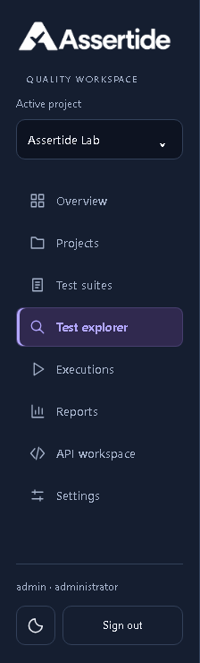
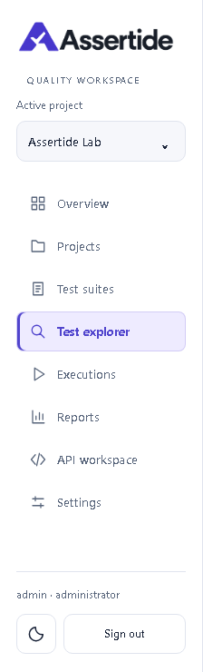
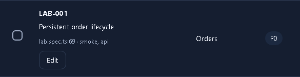
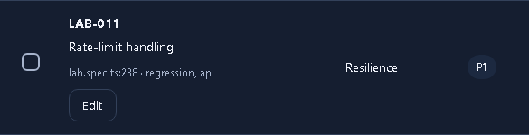

Browser geometry checks confirm identical column positions and widths across all three pages at 1024/1280/1440px in both themes. The sidebar has no overflow at 740px height and remains scrollable at 500px. This is an Unreleased layout fix with no version change.

Local verification passed (lint, formatting, type checks, API/web unit tests, and production build; eight infrastructure checks skipped on Windows). Four browser tests passed, including the 64-state accessibility matrix, catalog metadata, and pagination/selection behavior.

## Header controls, shared checkboxes, and aligned table headings

The mobile/tablet bar now uses a compact logo and a grouped pair of theme/menu icons. Both controls retain accessible names and 44px targets; the menu icon changes to a close symbol while expanded. The header keeps its existing height so the drawer and backdrop remain aligned.

Checkboxes across the application share themed borders, checkmarks, disabled/focus states, and an indeterminate indicator. Forced-colors mode retains native checkbox rendering. The explorer Select column has enough width and does not wrap its title. Reports use their actual table headers on desktop, with refresh beside Action, removing the mismatch between a separate header grid and the data columns.

Actual running captures:

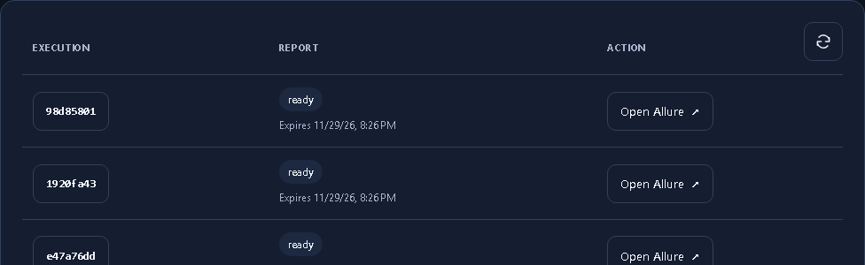

Geometry checks confirm report heading/cell alignment and no horizontal overflow at 320/390/768/1280px in both themes. Local lint, formatting, type checks, API/web tests, and production build pass; eight infrastructure checks remain skipped on Windows. This is an Unreleased UI update with no version change.

Eight browser scenarios pass, including the 64-state accessibility matrix, catalog selection, suite checkbox workflows, and mobile drawer/project-picker behavior. The initial catalog test expected 27 fixtures but the local catalog had expanded to 127; it now derives expected selection/page counts from the catalog API, and both catalog tests pass on rerun. The changed test also passes lint, type checks, and Page Object architecture checks.

## API workspace and exchange pagination

The workspace uses a compact contract/execution summary and a two-panel exchange browser. Exchange rows emphasize method, path, status, case, and attempt; the selected row is highlighted. Recorded exchanges are filtered before pagination, with ten entries per page and a sliding numbered window. Paging preserves the inspected evidence; changing execution resets the page, selected exchange, and evidence. Empty executions show a clear message even when they contain only non-API artifacts.

The request/response inspector has a loading state, explicit empty state, and selected-case badge. It stays in view on desktop with bounded internal scrolling. Evidence still uses the redacted viewer/download flow, and viewing an exchange never repeats its request. Concurrent inspection responses cannot replace a newer selection.

Actual running implementation:

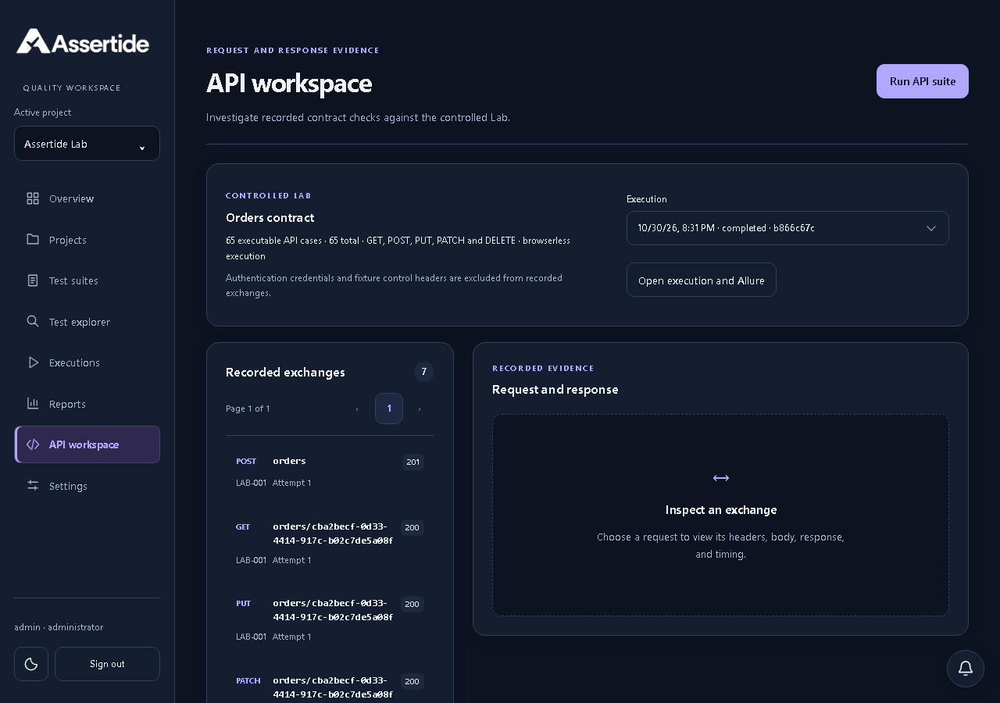
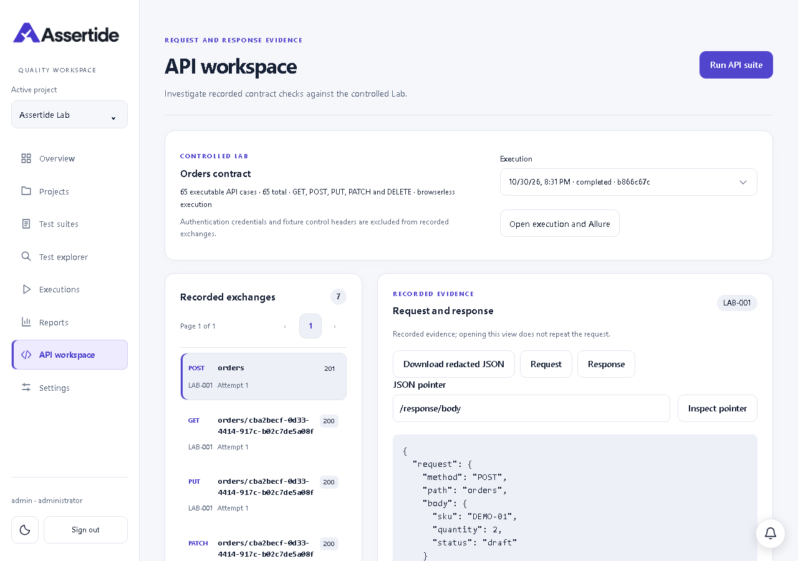
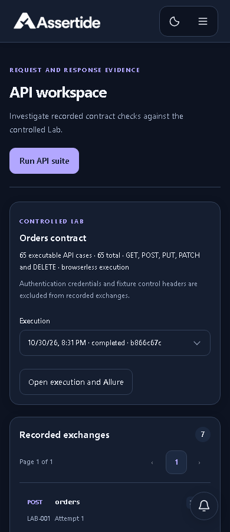

Layout checks pass at 320/390/768/1280px in both themes. Local lint, formatting, type checks, API/web unit tests, production build, and Page Object architecture/reporting checks pass. Eight infrastructure tests remain skipped on Windows. No product version is assigned; the redesign is Unreleased.

Six browser scenarios pass, including the 64-state accessibility matrix, execution/evidence flows, and the expanded API workspace test for ten-row pagination, preserved inspected evidence, JSON inspection, and redacted downloads. An initial multi-case launch returned only one selected case during development; its isolated rerun passed with all 18 results.

## Catalog and execution table redesign

Test explorer now emphasizes the test title, with a secondary case ID/source line and a compact labeled edit icon. Selected rows receive a tinted background and accent edge. Executions use compact run buttons, aligned counts, and phase badges with a status dot and readable text. Both tables have lighter headers, tighter spacing, and mobile cards; selection, pagination, keyboard sorting, and accessible control names are retained.

Actual desktop captures at the same viewport and theme:

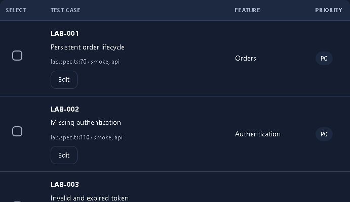
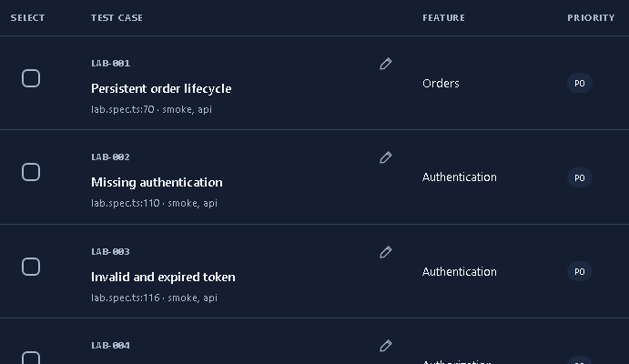
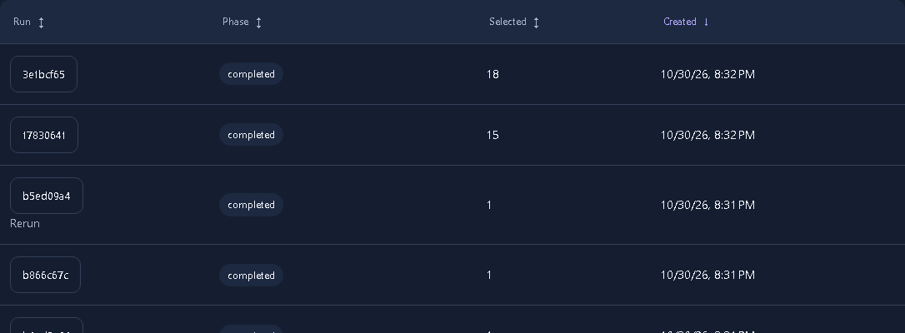
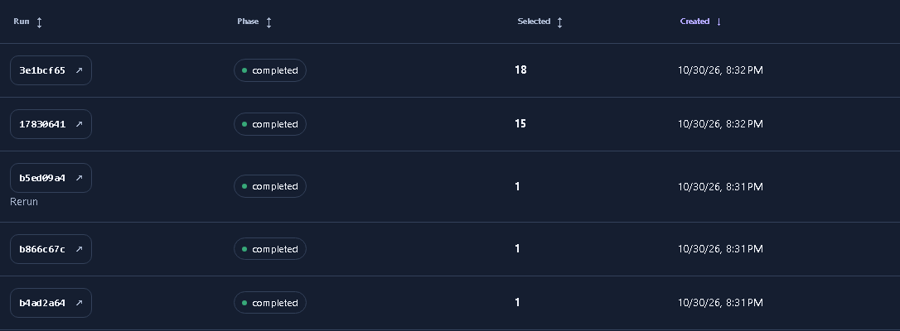

Mobile views:

Local lint, formatting, type checks, API/web tests, and production build pass; eight infrastructure checks remain skipped on Windows. Six browser scenarios pass, including 64 accessibility states, catalog editing/selection/pagination, and execution filtering/sorting. Both tables fit 320/390/768/1280px viewports in light and dark themes without horizontal page overflow. This remains Unreleased with no product version assigned or changed.

## Settings readability and catalog sorting

Settings now has section shortcuts for health, members, environments, service accounts, and audit. Forms use consistent groups and spacing, tables align headings and values, and audit rows become labeled cards on mobile. Account controls separate the name and role beside an initial avatar, with compact theme and sign-out actions.

Explorer sorting sits above the table and supports case ID, title, feature, and priority in both directions. Sorting happens before the ten-row page slice, resets pagination to page one, and persists in the URL. Changing sort retains selections. Edit icons now sit beside case IDs on desktop, and hover backgrounds are quieter.

Actual running views:

Verification: local lint, formatting, type checks, API/web tests, and production build pass. Six browser scenarios pass, including 64 accessibility states, metadata editing, sorting across pages/reloads, selection, pagination, and environment credential execution. Page Object architecture/reporting checks pass. Settings and explorer have no horizontal page overflow at 320/390/768/1280px in both themes; the Members shortcut reaches its section. Eight infrastructure tests remain skipped on Windows. No release version is assigned or changed; these changes remain Unreleased.

## Paginated execution results

Execution summary cards size independently, so expanding Frozen selection no longer stretches the phase card. The identifier list is bounded to 130px. Test results use a table with visible rerun selection, expandable result evidence, duration, and attempt count. Ten results appear per page with numbered navigation and a checked count; mobile uses labeled cards. Existing artifact, screenshot, notes, and rerun controls remain in the result details.

Pagination retains checked cases while switching pages and receiving live updates. Direct result links choose the page containing the target; navigating to another execution resets pagination and selection. Empty results retain an explanatory message.

Actual running captures:

Verification: nine web unit tests and the production build pass, including a new test for pagination, incoming results, retained selections, deep links, empty results, and route reset. Lint passes. Browser checks confirmed pagination, direct links to later-page results, and no horizontal overflow at 320/390/768/1280px in both themes. The two accessibility scenarios passed, including the 64-state matrix.

An initial full local verification passed. The final broader rerun hit API test process out-of-memory failures. The execution acceptance run then remained queued and subsequent scenarios could not connect to the development server; restarting it twice failed with a local PGlite database startup abort. Those four execution acceptance scenarios are not claimed as passing for this change. Eight infrastructure checks remain skipped on Windows. No product version is assigned or changed; this remains Unreleased.

## Settings shortcuts and status indicators

Health, Members, Environments, Service accounts, and Audit trail are in-page buttons. Each focuses its section and scrolls to it without changing the route or reloading the application. Reduced-motion users get immediate scrolling.

Service health and dependency labels, execution phases, report phases, and individual results have status dots. Healthy/ready/completed/passed states are green; queued/running/provisioning/pending/generating/degraded/skipped/canceled states are orange; failures, timeouts, interruptions, and unavailable services are red. Unknown statuses remain neutral. Existing text labels remain visible, so status never depends on color alone. Execution history badges follow the same palette.

Verification: lint, ten web unit tests, and production build pass. A focused regression test checks all five shortcuts for correct focus/scroll targets and unchanged URL, plus missing-target handling and reduced-motion behavior. Live screenshots and browser checks are unavailable: the local development server remains down after the previously recorded database startup failure. No screenshots are claimed for this change. This remains Unreleased; no product version is assigned or changed.

## Settings navigation and report library

Settings shortcuts share a compact navigation strip with numbered labels and a highlighted last-selected section. All five controls scroll and focus within Settings; review found four links remained after the previous change, and this update replaces them with buttons. The strip wraps on smaller screens.

Reports has a library heading with counts for the loaded records and ready reports, an adjacent refresh control, aligned execution/status/expiry/action columns, colored status dots, and compact mobile cards. Counts describe loaded records rather than claiming an organization-wide total. Existing execution and Allure links retain their destinations.

These screenshots show the actual production build with representative intercepted API fixture responses, not live database records:

Lint, ten web unit tests, and production build pass. Browser checks against the production build verify all five shortcuts remain on Settings and update their selected state, and both pages fit 320/390/768/1280px in light/dark themes. The database remains unavailable, so these checks do not verify live API integration or report opening. This remains Unreleased; no product version is assigned or changed.

## Suite list pagination

Test suites now displays ten suites per page with a total count, current page, previous/next controls, and up to five numbered page buttons above the list. First/last controls disable at their boundaries. Page counts clamp when the loaded suite list shrinks, and empty lists retain their existing message. Paging leaves create/edit fields and membership selections intact.

Actual production build with intercepted representative API fixture responses:

Lint, ten web tests, and production build pass. Browser checks verify ten suites on the first page, three on the last page of a 23-suite fixture, disabled boundary controls, retained create/edit form values, and no horizontal overflow at 320/390/768/1280px in light and dark themes. Live database integration remains unverified because the local database is unavailable. No product version is assigned or changed; this remains Unreleased.

## Aligned execution overview

The execution header uses smaller actions and a tighter title. Phase and frozen selection share a divided overview panel, with aligned labels and metrics, a status dot, and an explicit “tests selected” unit. On phones the sections stack with a horizontal divider. Expanded identifiers retain their bounded scrolling region; cancel, refresh, and rerun behavior is unchanged.

Actual production build with sample API responses and an inert live-event connection:

Lint, ten web unit tests, and production build pass. Browser checks cover the queued state, disabled rerun controls, expanding 127 selected identifiers, and no horizontal overflow at 320/390/768/1280px in both themes. These are layout checks; they do not verify queue processing or live database behavior. The previously recorded local database startup problem remains outside this UI change. No product version is assigned or changed; this remains Unreleased.

## Project selector chevron

The active-project selector uses a 16px SVG chevron instead of a font-dependent text glyph. The icon stays centered, retains its inset, and does not shrink when project names wrap. The button retains its accessible name and dialog behavior.

Actual production UI with representative API fixture responses:

Lint and production build pass. Browser checks confirm vertical icon alignment, dialog opening, and focus restoration at 390/1280px in both themes. Live API integration was not exercised. This remains Unreleased with no product version change.

## Projects redesign and sticky suite editor

Projects has a compact creation/edit form, searchable cards with initials and an active-project badge, aligned actions, and twelve projects per page. Search matches names and descriptions across the entire loaded list and returns to page one. Paging preserves form drafts. Empty searches show an explicit message.

Create/Edit suite stays 24px from the top while the desktop suite list scrolls. The panel is limited to viewport height with internal scrolling so Save suite stays reachable. On mobile it stays in normal document flow.

Actual production UI with representative API fixture responses:

Lint, ten web unit tests, and production build pass. Browser checks confirm 12/11 cards for a 23-project fixture, search/page reset, draft preservation, edit/cancel, empty search, and no horizontal overflow at 320/390/768/1280px in both themes. Separate geometry checks verify desktop pinning, a reachable Save suite button, and non-sticky mobile behavior. These checks use sample responses and do not validate live API persistence. No product version is assigned or changed; this remains Unreleased.

## Compact suite card grid

Suite cards use two columns above 850px and one column on smaller screens. The page is limited to 1280px, with a 300px sticky editor column on desktop. Cards have compact spacing, a suite icon and priority beside the title, grouped test/revision metadata, quiet owner/tags, a short accessible Edit action, and a highlighted Run suite action. Existing ten-suite pagination remains intact.

Actual production UI with representative API fixture responses:

Lint and production build pass. Browser checks confirm two columns on desktop, one on mobile, retained create/edit drafts across pagination, disabled boundary controls, and no horizontal overflow at 320/390/768/1280px in both themes. The editor still pins on desktop and its Save action remains reachable. These checks use fixture data and do not claim live API persistence. No product version is assigned or changed; this remains Unreleased.
