# Workspace visual refresh

The workspace uses a consistent indigo accent, navigation icons, clearer headings, softly elevated cards, and a more prominent metric row. History filters expand on demand, preserving all existing filtering, saved-filter, and export controls. Sign-in uses a contained card, and mobile actions expand to a comfortable width.

Motion includes short header and metric entrances, hover/press feedback, a mobile drawer entrance, toast/dialog entrances, and pulsing loading placeholders. The operating system's reduced-motion preference disables animations and transitions, including pseudo-elements.

## Actual application captures

These captures use the running local application and its existing Lab data, with matching viewport sizes and themes before and after the changes. They are not generated mockups.

### Desktop, 1440 × 1000

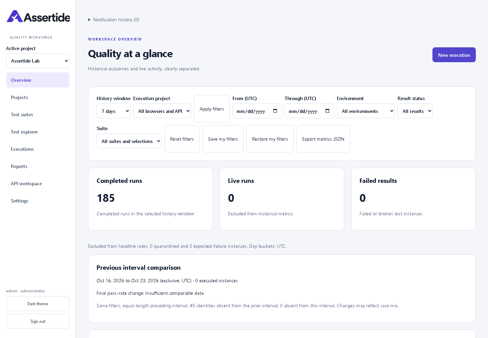

Before: the full filter form occupies the top of the overview.

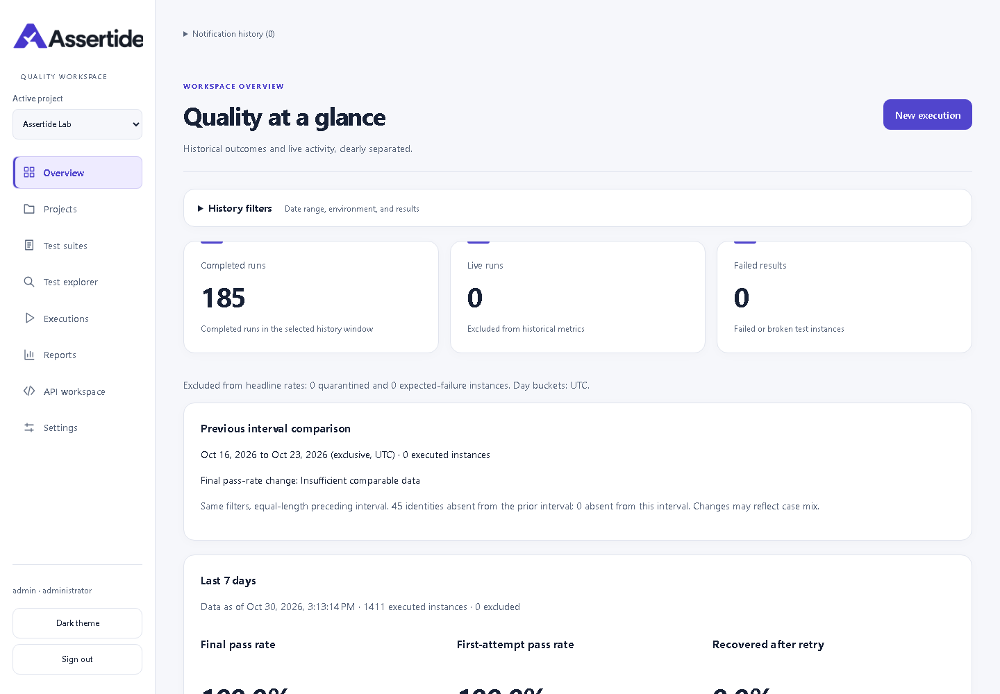

After: expandable filters make room for headline metrics, with consistent surfaces and navigation icons.

### Mobile, 390 × 844

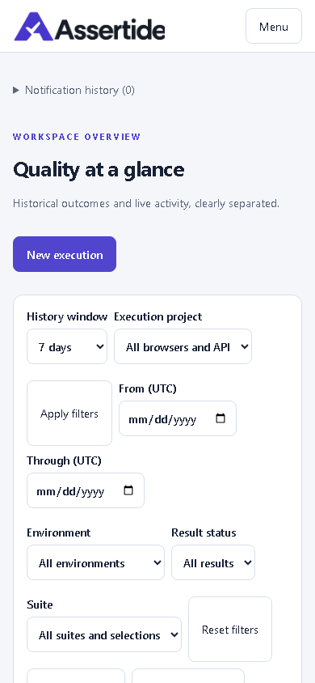

Before: filters dominate the initial mobile view.

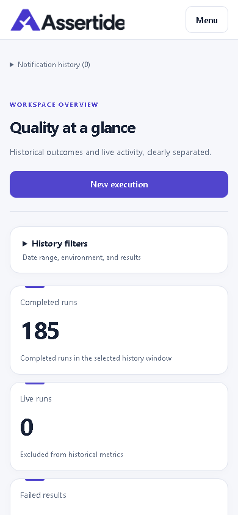

After: the primary action, filter disclosure, and metric cards fit the viewport.

### Dark theme and sign-in

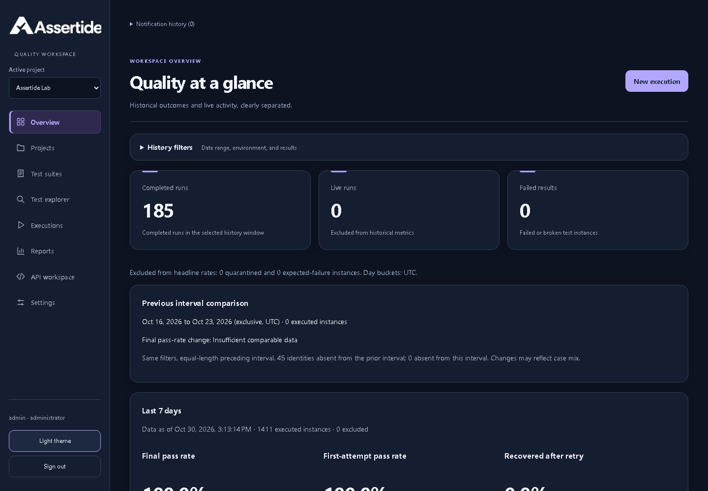

Dark mode preserves readable text and the white logo treatment.

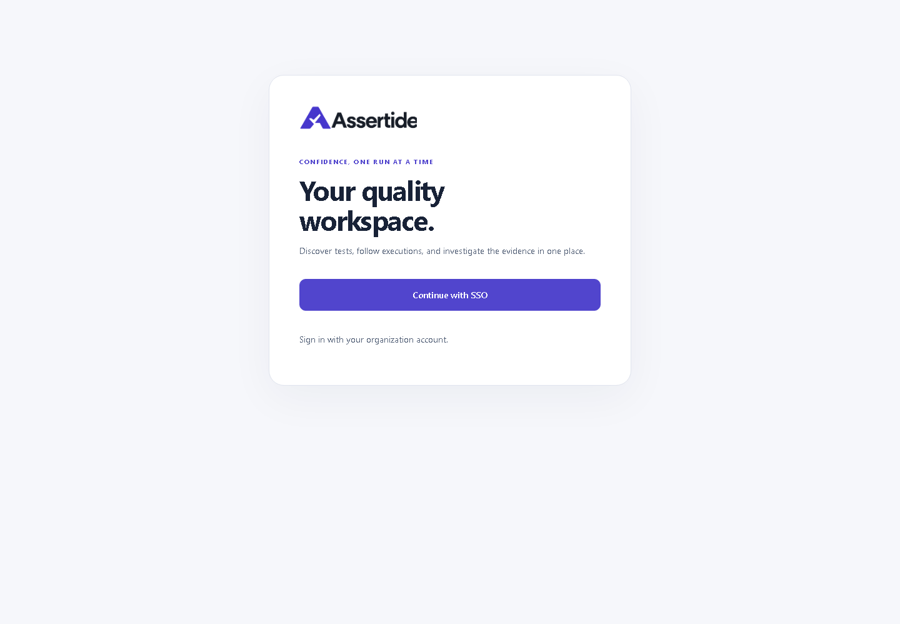

Sign-in uses a focused card and full-width action.

## Dialog and card polish

Dialogs fade and move slightly as they close, including the backdrop. Native top-layer/display transitions retain the closing surface for 160ms; reduced-motion preferences dismiss it immediately. The mobile drawer now has a small close icon with a 44px hit target and the accessible name “Close menu.” Project actions use a single row with a short visible Edit label and a project-specific accessible name. Catalog status badges and edit buttons have an explicit wrapping gap.

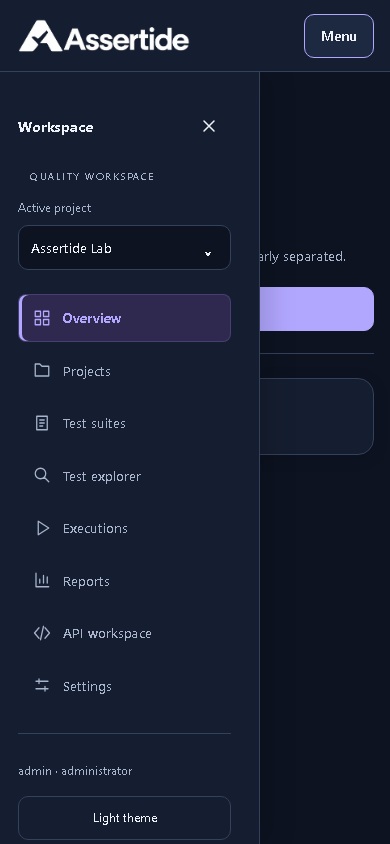

The Workspace heading and close icon replace the full-width close button.

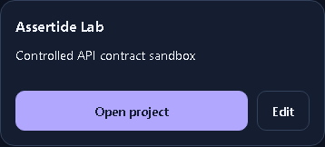

Open project remains prominent, with Edit alongside it.

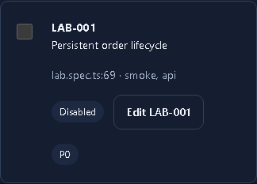

The disabled status remains distinct from the edit button on a narrow screen.

Closing transition captured from the actual running dialog: [open](changelog/assets/unreleased/detail-polish-popup-open.png), [mid-close](changelog/assets/unreleased/detail-polish-popup-closing.png), [closed](changelog/assets/unreleased/detail-polish-popup-closed.png). The browser animation was paused at its midpoint for the middle capture, then completed. Browser inspection confirmed an active exit transition and immediate reduced-motion dismissal. Seven browser tests, including the 64-state accessibility matrix, passed along with production build and lint. No product version was assigned.

## Dropdowns and scrollbars

Regular select controls now use rounded anchored menus with themed selected options and arrows inset from the right edge. They retain native select semantics, Angular form values, keyboard selection, and Escape dismissal. The project-switch dialog remains searchable, and clicking or tapping its backdrop closes it and returns focus; starting a drag inside the dialog does not dismiss it.

Scrollbars use a slim thumb and transparent track, with light/dark tokens and a forced-colors fallback. The enhanced menus use [the browser's customizable select API](https://developer.chrome.com/blog/a-customizable-select); browsers without support keep the native option menu and receive the restyled closed control and inset arrow.

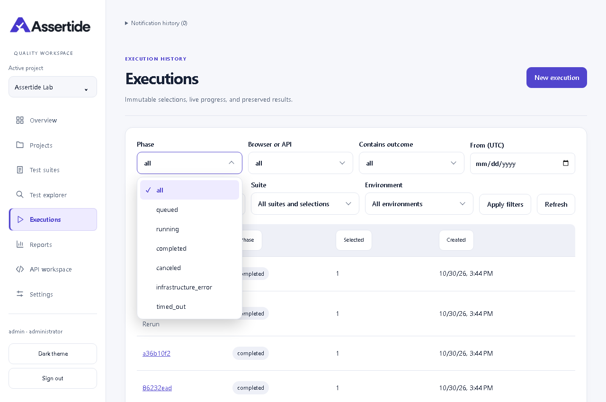

The menu stays anchored to its field, with rounded options and the current selection highlighted.

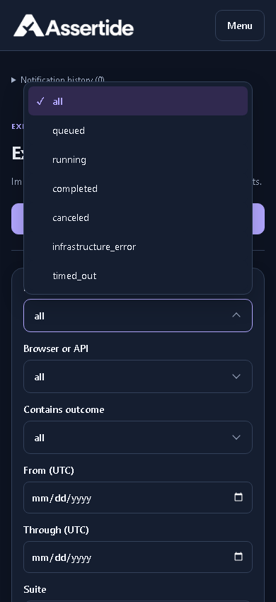

The browser places the menu above the field when that gives it more room. This is not a modal dialog.

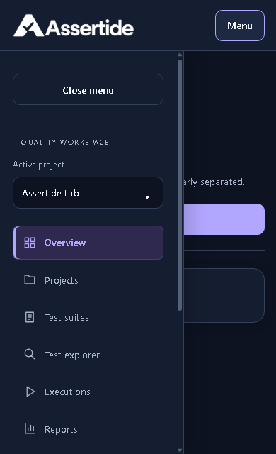

The navigation uses a narrow themed scrollbar, preserving room for its content. Original user-supplied evidence: [dropdown](changelog/assets/unreleased/controls-dropdown-reported.png), [scrollbar](changelog/assets/unreleased/controls-scrollbar-reported.png). Those crops are not pixel-matched to the new captures.

Validation: production build, lint, automation type checks, architecture/reporting checks, six browser tests including all 64 accessibility states, and direct option selection/Escape checks in light/dark at 390px and 1280px. Desktop and mobile tests cover backdrop dismissal, inside padding, drag-out protection, and restored focus. Changes remain Unreleased without a version increment.

## Site-wide review

Reviewed overview, projects, suites, test explorer, execution history, reports, API workspace, and settings at 320, 768, and 1440 CSS pixels in light and dark themes. The browser acceptance suite additionally exercises run details, live monitoring, reruns, screenshot dialogs, JSON evidence, report access, credentials, and keyboard navigation. Its accessibility matrix covers 64 states at 390/768/1440px.

Completed corrections:

- Suite, member-edit, and rerun actions use wrapping groups with explicit spacing.
- Member tables become labeled cards on mobile, keeping edit buttons on-screen.
- Membership checklists have bounded scrolling, spaced checkboxes, and wrapping names.
- Split layouts no longer stretch editors to match long lists. The suite form appears first on mobile.
- Long names and evidence content stay within cards; dialogs fit short screens.
- Chart tooltips use the active theme and remain inside chart bounds; data tables have keyboard-accessible scrolling regions.

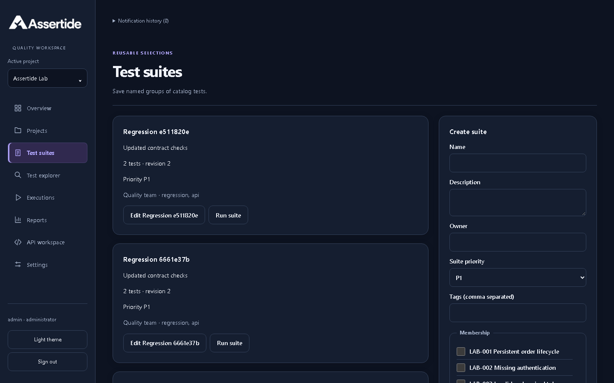

The desktop editor remains at its natural height beside the suite list. [Original full-page capture](changelog/assets/unreleased/site-audit-suites-before.png) records the previous stretched panel; the after image focuses on the first viewport.

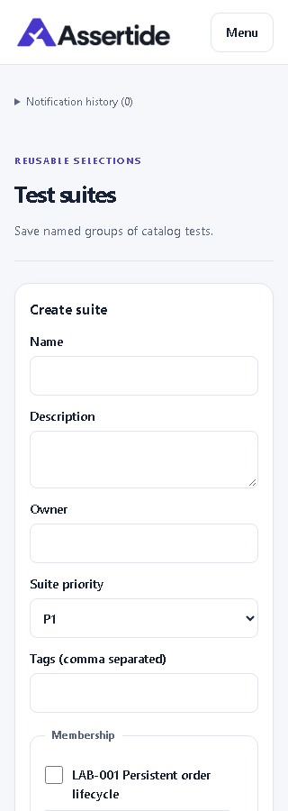

The form is reachable before the suite list and checkbox labels wrap within the panel.

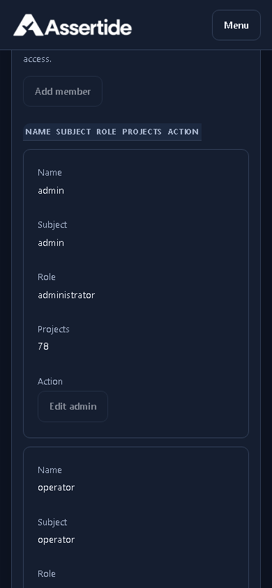

Member cards keep all fields and actions within the phone viewport. [Original settings capture at 320px](changelog/assets/unreleased/site-audit-settings-before.png) records the horizontally scrolling table; this focused after capture is 390px, so it is not a pixel-matched comparison.

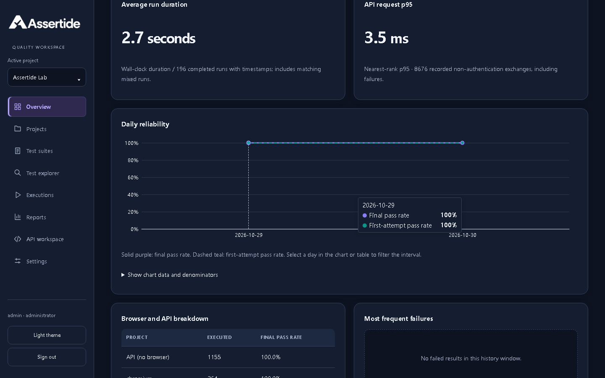

The tooltip has a dark surface, readable labels, and stays inside the chart.

Verification: all 27 browser acceptance tests passed, including 64 accessibility states; the additional 48-route/theme/viewport scan found no overflowing controls. `npm run verify:quick`, architecture checks, and reporting/redaction checks passed. Eight infrastructure-dependent API checks are skipped locally and remain Linux CI gates. An initial concurrent verification attempt failed catalog initialization; the isolated discovery test and full subsequent verification passed. No product release version is assigned; GitHub source publication is distinct from deployment or a numbered release.

### Earlier refresh verification

Production build, lint, analytics filter/export and execution-history browser tests passed. Automated accessibility scans passed for the application's light/dark desktop/mobile states; keyboard skip-link, menu focus containment, Escape/focus restoration, and reduced-motion checks passed. Entrance animations keep text fully opaque to preserve contrast throughout the transition. Browser checks also verified all eight primary routes at 390px without horizontal overflow and animation suppression under reduced motion. No product version is assigned or published by this update.

## Layout corrections

### Searchable project picker

The active-project control opens a searchable dialog with wrapped names, current-project highlighting, alphabetical results, and a bounded scrolling area. Escape closes the picker and returns focus to its trigger while keeping the mobile navigation open. Selecting another project preserves the existing project-switch behavior.

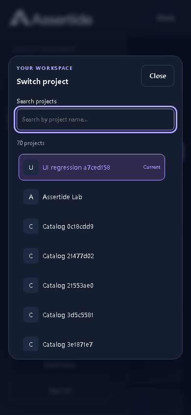

Actual application capture at 390px. Search, empty results, project switching and persistence, mobile focus restoration, and dark-mode accessibility checks pass. Build and lint pass. No comparable automated before-state image was captured for this change.

Follow-up fixes reduce the logo size, add a 12px gap between wrapping project actions, and align service-health headings with their refresh action. Mobile navigation uses the same 72px offset as its header, omits the duplicate logo, and locks background scrolling while open.

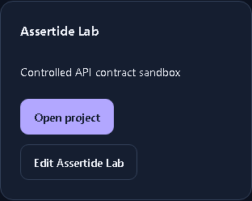

Project actions retain spacing when they wrap onto separate lines.

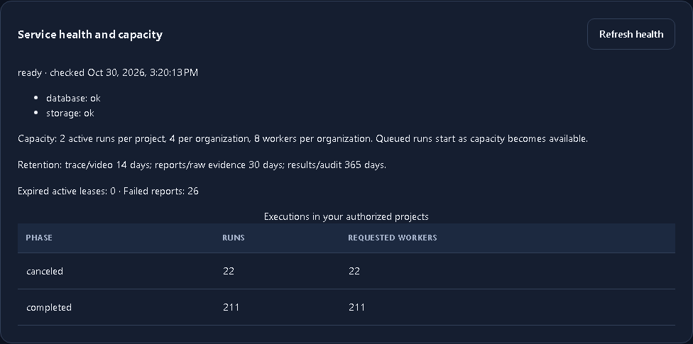

The heading and action are vertically centered and wrap with a defined gap on narrow screens.

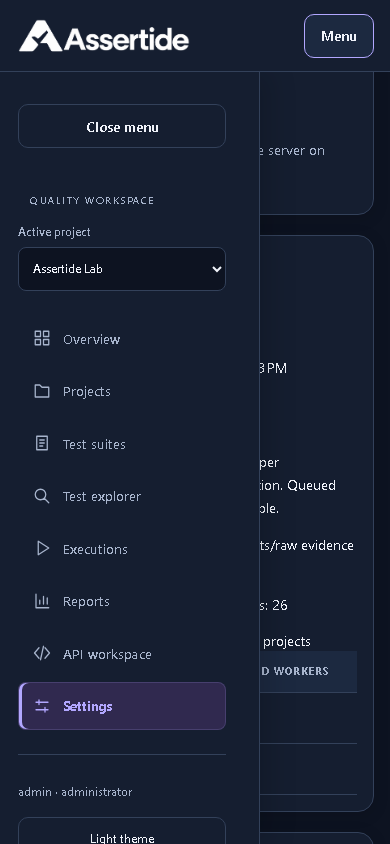

The drawer clears the header even when opened after scrolling. These are actual post-fix captures; the attempted automated before-state capture failed at sign-in, so no comparable before images are claimed.

Build, lint, and browser checks passed. Projects and settings fit 320, 390, 768, and 1280px viewports without horizontal overflow.

## Mobile navigation and sign-in alignment

A dimmed backdrop now dismisses the mobile drawer when clicked. The drawer slides left and the backdrop fades over 180ms when closing through the backdrop, close icon, menu toggle, Escape, or a navigation link. Focus returns to the menu trigger. Reduced-motion preferences remove the transitions.

The sign-in card keeps equal automatic side margins at desktop, tablet, and phone sizes, including widths reached by browser zoom. Previously, the mobile margin override left-aligned the card whenever the available width was larger than its maximum width.

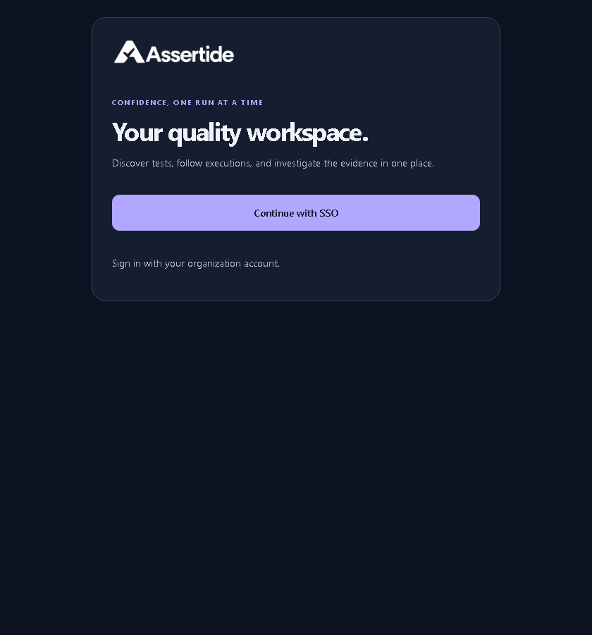

The card remains centered at the mobile breakpoint instead of attaching to the left side.

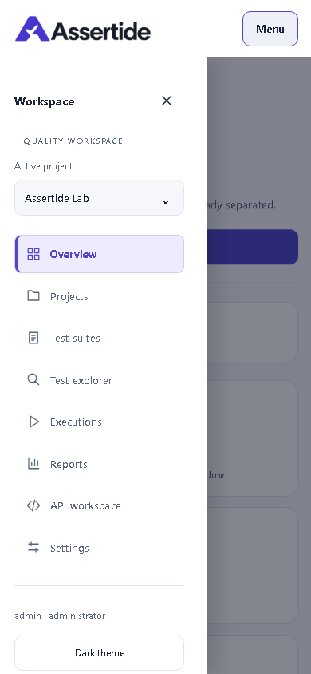

Actual browser closing sequence: [open](changelog/assets/unreleased/navigation-login-drawer-open.png), [mid-close](changelog/assets/unreleased/navigation-login-drawer-closing.png), [closed](changelog/assets/unreleased/navigation-login-drawer-closed.png). The middle capture pauses the real transition at 90ms for inspection.

Verification: production build, lint, automation type checks, test architecture/reporting checks, and five browser tests passed, including 64 accessibility states. Browser measurements confirm equal sign-in margins at 320, 390, 840, and 1280px. The mobile test checks real outside clicks, restored focus, and an active exit animation before the drawer hides. Changes remain Unreleased; no version increment or deployment is claimed.
