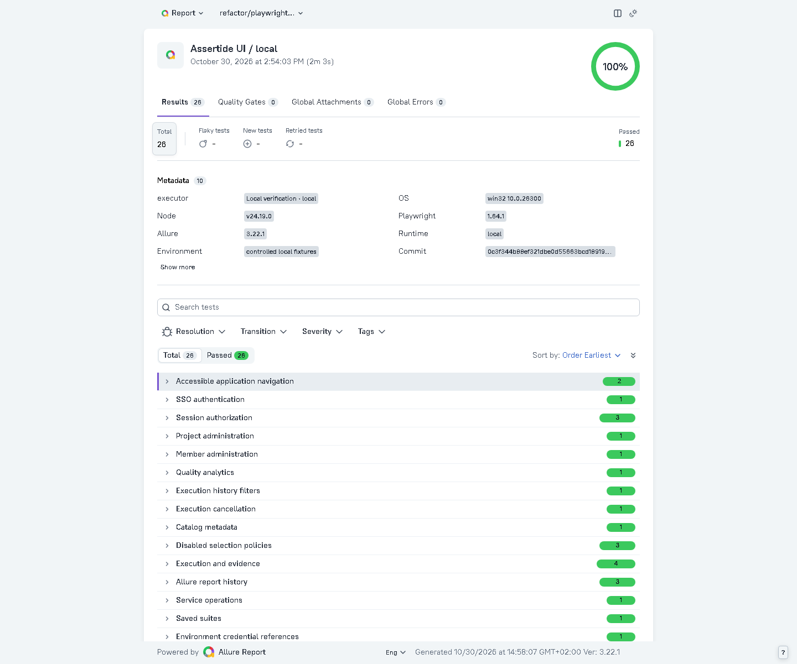

# UI automation and reports

The [owner-supplied architecture](playwright-ui-architecture.md) applies to new and changed UI checks. The application, controlled storefront, and manual browser-practice suites use the same reporting fixture.

## Where changes belong

| Layer | Location | Responsibility |
| --- | --- | --- |
| Scenarios | `packages/automation/platform`, `tests/store.spec.ts`, `practice/web.spec.ts` | Domain groups, independent setup, actions, visible assertions |
| Pages/components | `packages/automation/ui/pages`, `ui/components` | Typed locators and focused domain actions; no complete scenario methods |
| Contracts | `packages/automation/ui/types` | Feature selectors, routes, execution data, viewport and timeout constants |
| Utilities | `packages/automation/ui/utils` | API prerequisites, downloads, accessibility, redaction and Allure metadata |
| Fixtures | `packages/automation/ui/fixtures` | Fresh test-scoped browser state and POM construction in beforeEach; in-memory worker authentication |

The Node-based private trace-viewer security harness also uses focused Page Objects in `apps/api/test/support`; its database/server lifecycle remains in Node test fixtures rather than the Playwright acceptance runner.

Use API setup for unrelated prerequisites. Tests that revoke authentication create their own sessions. Catalog mutations use a unique project per test. Never share a mutable Page, context, or test-created run between cases. Test-scoped objects declared within describe are assigned anew in beforeEach. There is deliberately no mutable beforeAll browser setup.

Page Objects may wait for a navigation or rerender to finish; assertions about the business outcome stay in specs. In the controlled storefront, customer inputs rerender after each character, so the Page Object waits for the entered value before typing the next character. Do not replace condition-based waits with sleeps or retries.

## Run and inspect

Start the local app with `npm start` (after `npm run setup`). From `packages/automation`:

```sh
npm run typecheck
npm run test:architecture
npm run test:reporting
npm run test:ui
npm run test:platform
npm run report:platform -- local
npx allure open ../../.local/platform/local/allure-report
```

`test:ui` runs all 12 storefront cases on Chromium, Firefox and WebKit. Platform acceptance covers 26 independent app journeys, including a 64-state automated accessibility matrix. Public practice retains its existing explicit `ASSERTIDE_PUBLIC_PRACTICE=true` opt-in, single worker, no retries, stop-on-first-failure and no-CI policy; run `npx playwright test --config practice.config.ts web.spec.ts` manually.

Allure results are grouped by feature/story with owner, severity, tags, stable case identity, scenario description, browser version and shallow domain steps. Automatic low-level API-call reporting is disabled. Environment metadata includes the runtime, OS, Node, package versions, commit and branch. CI executor metadata links to its Actions run. Simple failure categories separate assertions from infrastructure errors.

OCI and Kubernetes CI runs independently upload raw Allure results, generated HTML reports and browser evidence under `platform-oci-report-and-evidence` and `platform-kubernetes-report-and-evidence`, including failed runs. Artifacts expire after 14 days. History is cached per branch and runtime, bounded to 30 entries; a cache miss starts a new history. Local output lives under ignored `.local/platform/<runtime>`. Each invocation clears that runtime's previous raw results, preventing stale tests from appearing in a new report. Generated reports and credentials are never committed.

## Evidence and privacy

Authenticated app tests disable raw traces, video and automatic screenshots because they can contain session cookies or one-time credentials. Every failed UI case instead receives a masked screenshot, a URL without query/fragment, and bounded sanitized console/error context. Input and textarea fields are masked, including the CI token. Credential-entry tests omit console text. Known secrets are registered before use, and domain-step errors are redacted before reporting. Never place secrets in test names, parameters, assertions, descriptions or attachment names.

Playwright's automatic DOM snapshot is disabled using the pinned runner's `PLAYWRIGHT_NO_COPY_PROMPT` setting; error context may still contain sanitized errors and source locations. The intentional reporting probe checks this boundary, labels, steps and nonempty screenshot/context artifacts with a synthetic canary. The pinned-version probe must pass before a Playwright upgrade is accepted.

Controlled storefront traces and optional failure video contain only synthetic fixture identities and public fixture credentials, never Assertide sessions. Public practice contains only synthetic upload/input data. The existing video/trace check verifies both retained failure files and Allure rebuild behavior. Do not enable these captures against real credential-bearing environments without a separate privacy review.

Milestone screenshots are attached sparingly through the central helper; automated acceptance no longer overwrites tracked changelog screenshots. Capture release visuals explicitly from a verified run. Source snapshots include `ui/` so isolated workers execute the same approved Page Objects and reporting code as the catalog revision.



Captured from the local acceptance run on this branch. The commit metadata records the base commit used before the changes were committed; CI reports record their tested commit.
